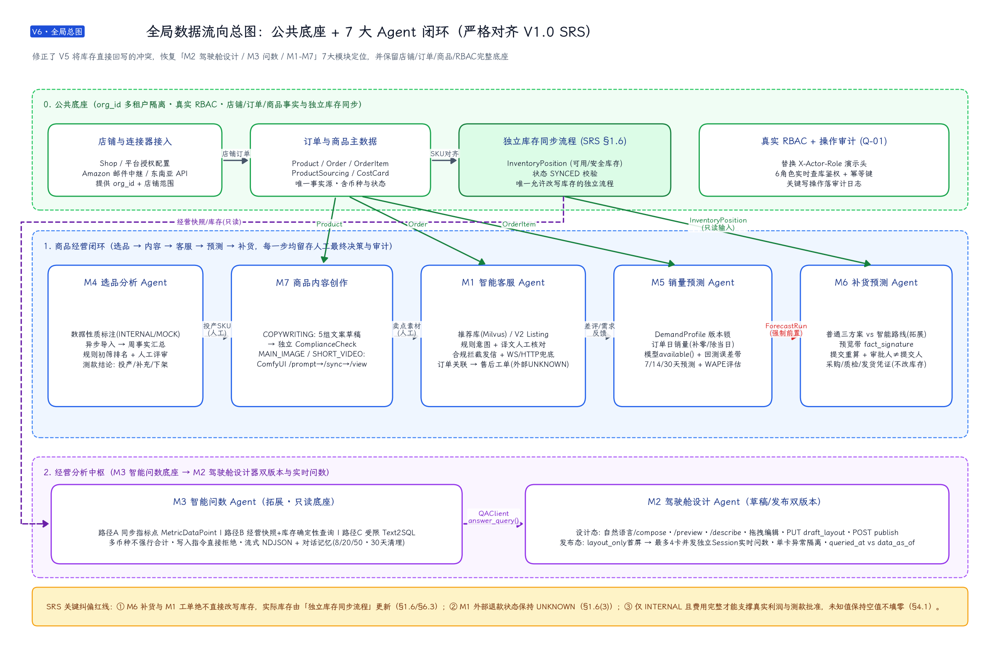
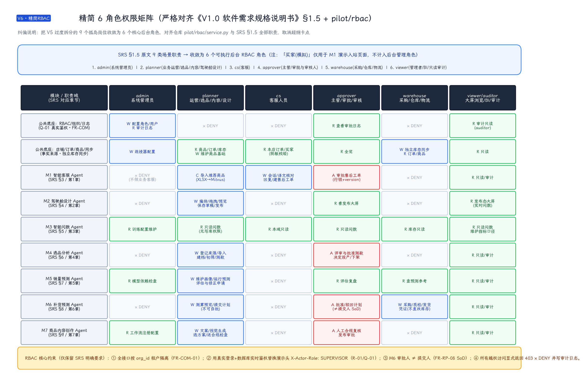
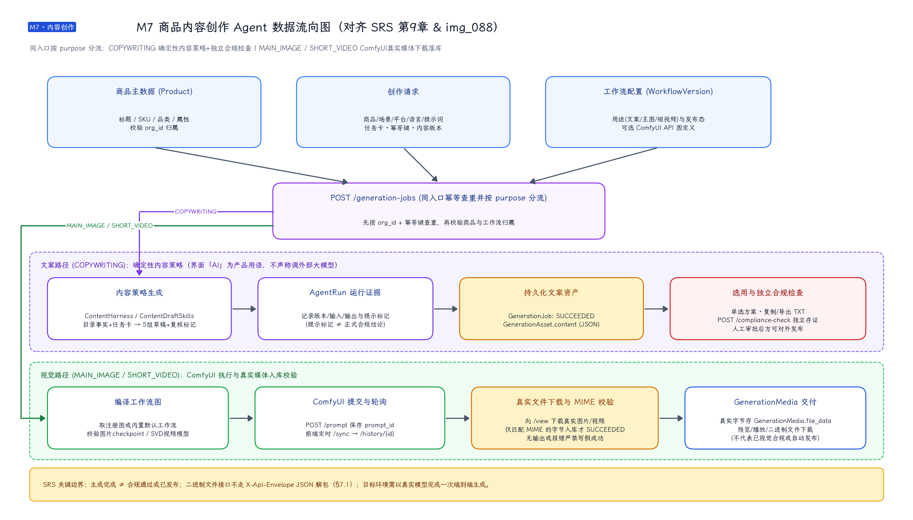

# CrossPilot AI 跨境电商智能协作平台 — 总概要设计说明书

> **文档定位**：本文档统一汇总全平台（M0–M8）概要设计、系统分层架构、全平台数据流图（DFD）及 **V1.1 老师数据库与技术栈标准**（PostgreSQL 16 + `asyncpg`、MinIO、Redis + Celery Worker/Beat、Milvus、Nginx WebSocket、Vanna 2、ComfyUI、Prophet/LightGBM/CatBoost、Docker/Jenkins/Playwright）。

---

## 第一篇 全平台总架构与技术栈标准（V1.1）

### 1.1 系统总体架构与技术栈选型表

| 架构层级 | 选型组件（严格对齐 V1.1 标准） | 工程落盘位置与降级兜底策略 |
| :--- | :--- | :--- |
| **接入网关** | Nginx (`nginx.conf.example`) | 支持 `client_max_body_size 30m`、`/api/` 转发及 `/api/v1/orgs/*/m1/ws/` WebSocket 升级头 |
| **前端工作台** | Vue 3.5 + TypeScript + Vite 6 + Pinia + Axios + Vitest + Playwright | 29 个协作页面（含 `/docs` 文档中心）、`e2e/crosspilot.spec.ts` |
| **后端应用层** | Python 3.11 + FastAPI + Pydantic v2 + SQLAlchemy 2.0 Async + Alembic | 模块化单体架构（M0–M8 独立领域边界与契约接口） |
| **关系主库** | PostgreSQL 16 (`asyncpg`) | 33 张业务与审计表，`org_id` 租户隔离 + `JSONB`；本地单测/零依赖演示自动兼容 SQLite |
| **对象存储** | MinIO (`crosspilot-assets` Bucket) | `core/storage.py` 抽象层；未连 MinIO 时安全回退本地 `STORAGE_ROOT` 磁盘存储 |
| **缓存与异步队列** | Redis 7 + Celery Worker/Beat (`docker-compose --profile worker`) | `core/cache_queue.py` 注册后台任务；未连 Redis 时回退进程内 TTL 缓存与 `asyncio` |
| **向量检索** | Milvus 2.4 + etcd (`docker-compose --profile vector`) | `m1_cs/vector_store.py` 20 条/批写向量并回查 PG 核验在售状态；未连 Milvus 时回退停用词+CJK双字检索 |
| **AI 与算法引擎** | 阿里云百炼 Qwen/Wanxiang · Vanna 2 (`VANNA_BASE_URL`) · ComfyUI (`COMFYUI_BASE_URL`) · Prophet/LightGBM/CatBoost | 均提供可配置 HTTP 适配器与零密钥确定性本地兜底引擎 |
| **CI/CD 与容器化** | `backend/Dockerfile` · `frontend/Dockerfile` · `docker-compose.yml` · `Jenkinsfile` · `deploy/deploy.sh` | 一键构建、全量测试门禁、迁移与多 Profile 容器编排 |

### 1.2 全平台数据流与权限全景图





---

## 第2篇 M8 组织权限、审批策略与平台底座概要设计

> **文档编号**：CP-M8-HLD-2026-V1.0
> **文档定位**：定义 M8 与平台公共安全底座（`core/`）的分层架构、双模认证拦截链、跨模块服务契约、量化性能指标与不可篡改审计体系。

---

### 1. 引言

#### 1.1 编写目的

本概要设计说明书明确 CrossPilot 组织权限与平台底座（M8 + `core/`）的系统边界、鉴权网关链路、多租户隔离架构与中文审计落盘机制，为全平台 M0–M8 所有业务模块提供统一的安全基线。

#### 1.2 范围

- **覆盖范围**：
  1. M8-1 员工名册与岗位授权（`m8a`）、M8-2 岗位权限矩阵与全平台审计台账（`m8b`）。
  2. 平台公共底座 `backend/app/core/`：配置中心、DB 会话、JWT/Header 身份解析、9 角色 RBAC、多租户门禁、独立事务中文审计、本地存储与异步任务队列。
- **不覆盖范围**：
  1. 不覆盖外部企业微信 / 飞书 / Okta SSO OIDC 联合登录实现（V2 保留）。
  2. 不覆盖具体业务模块（M0–M7）内部的审批流业务数据表，仅管控公共 `enforce_sod` 策略与统一审计台账。

#### 1.3 术语表

| 术语 | 定义 |
|---|---|
| 双模认证 (`AuthMode`) | 线上 `Authorization: Bearer <HS256 JWT>` 与演示环境安全受控 Header 模式并存 |
| `SoD` (Separation of Duties) | 职责分离铁律：敏感审批业务单据的提交人与终审人不可为同一用户 |
| `Independent Audit Session` | 独立于业务事务的异步审计写库会话，确保 403/500 失败场景的拦截日志依然持久化 |
| `redact_secrets` | 日志与错误响应脱敏过滤器，自动掩码 `sk-*`、`Bearer *` 与敏感凭据 |

#### 1.4 参考资料

1. 《CrossPilot-M8组织权限与平台底座需求说明书》（V1.0）
2. 《CrossPilot-M8组织权限与平台底座测试用例》（V1.0）
3. 《AI跨境电商平台-模块需求细化_V1.1》（M10 公共管理与任务审核）
4. 《AI跨境电商平台V1.0-软件需求规格说明书》（CM-01~07）

---

### 2. 总体设计

#### 2.1 四项核心设计原则

1. **鉴权网关前置与零信任**：任何业务路由不信任前端隐藏按钮，所有端到端安全性由后端 `require_perm` 与 `org_id` 校验统一裁决。
2. **权限代码静态权威化**：9 角色到 `m0:*`~`m8:*` 的映射唯一固化于 `core/auth_rbac.py`，M8 页面矩阵仅供透明展示与核对，严禁运行时动态篡改代码边界。
3. **拦截记录永不回滚**：权限拒绝（403）或 SoD 拦截时，即使当前请求立即中止，系统依然通过独立数据库会话写入中文审计句，保证可审计性。
4. **凭证脱敏与最小暴露**：异常堆栈、HTTP 响应与审计文本在落盘前统一经过 `redact_secrets()` 清洗，防止 API Key/Token 泄露。

#### 2.2 技术选型及理由

| 技术领域 | 选型方案 | 选型理由 |
|---|---|---|
| 身份令牌 | PyJWT (`HS256`) + FastAPI `Depends` | 轻量、无状态、支持过期时间校验与角色/组织声明注入 |
| 权限裁决 | `ROLE_PERMISSIONS` 静态集合 + `require_perm` 依赖工厂 | O(1) 集合包含检查，天然防止角色权限配置漂移 |
| 审计持久化 | `core/audit.py` + 独立 `AsyncSession` | 业务回滚不影响安全拦截审计落库，满足强安全合规 |
| 追踪与脱敏 | `trace_id` 中间件 + 正则凭证清洗 | 每个请求附带 `X-Trace-Id`，支持前端报错与后端审计精确串联 |

#### 2.3 系统边界

- **本模块做什么**：组织与成员管理、在线调岗/停用、9 岗位矩阵展示、5 大模块审批策略开关维护、全平台多模块审计日志检索、JWT 签发与 Header 校验。
- **本模块不做什么**：不直接存储各业务模块审批单详情；不提供前端删除或清空历史审计日志的入口。

---

### 3. 系统架构与数据流图

#### 3.1 分层架构与请求生命周期图

```
[浏览器 / API 客户端]
        |  HTTP Request (Bearer JWT 或 X-Actor-User-Id/Role/Org-Id)
        v
+-------------------------------------------------------------------+
| 1. TraceId 中间件: 生成/透传 X-Trace-Id, 捕获异常与敏感词脱敏         |
+---------------------------------+---------------------------------+
                                  v
+-------------------------------------------------------------------+
| 2. 身份与租户门禁: get_actor_context -> 核验 actor.org_id == {org_id}|
+---------------------------------+---------------------------------+
                                  v
+-------------------------------------------------------------------+
| 3. RBAC 权限裁决: require_perm(perm) -> 校验 ROLE_PERMISSIONS[role] |
|    --> 若失败: 独立事务写 RBAC 拦截审计 -> 抛出 HTTP 403 M7-4031     |
+---------------------------------+---------------------------------+
                                  v
+-------------------------------------------------------------------+
| 4. M0–M8 业务路由 & 服务层 (执行业务逻辑 + SoD 校验 + 写业务审计)     |
+-------------------------------------------------------------------+
```

#### 3.2 系统权限控制与全局基础数据流图


---

### 4. 模块划分与职责

| 子模块 | 归属路径 | 单一职责 | 依赖方向 |
|---|---|---|---|
| `core/auth_rbac.py` | 公共安全底座 | 解析 JWT/Header 上下文、校验 9 岗位 RBAC 权限码、控制演示切换开关 | 被所有 M0–M8 Router 依赖 |
| `core/audit.py` | 公共审计底座 | 写入标准中文审计句（支持独立会话提交与全局敏感凭据脱敏） | 被所有 M0–M8 Service 及 RBAC 调用 |
| `core/errors.py` & `trace.py` | 统一异常处理 | 生成统一 `{ok, data, error, trace_id}` JSON 信封与全局 `trace_id` | 挂载于 FastAPI App 根级 |
| `core/async_jobs.py` & `storage.py` | 公共基础设施 | 幂等异步长任务调度、防路径穿越安全文件存取（供 M7 等复用） | 被 M7 等异步生产模块调用 |
| `m8_org/service.py` | M8 领域服务 | 组织用户 CRUD、在职状态控制、9 岗位矩阵组装、审批策略与审计多条件查询 | 仅写 `m8_*` 表，只读 `core_audit_events` |

---

### 5. 功能模块设计（追溯至需求与用例）

| 子模块 | 对应需求条目 | 核心交互实体 | 对应验收编号 |
|---|---|---|---|
| M8-1 员工名册与调岗 (`m8a`) | 需求 3.1 | `M8Org`, `M8User` | M8-AC-02, M8-AC-05 |
| M8-2 矩阵/策略/审计 (`m8b`) | 需求 3.2 | `M8ApprovalPolicy`, `CoreAuditEvent` | M8-AC-01, M8-AC-02, M8-AC-06 |
| 底座门禁与双模认证 | 需求 1.4 | `ActorContext`, `ROLE_PERMISSIONS` | M8-AC-03, M8-AC-04 |

---

### 6. 数据设计

#### 6.1 统一数据口径定义（全局安全规范）

1. **审计动作与状态口径**：`result_status` 仅允许 `ALLOWED`（绿标）与 `DENIED`（红标）；任何 `403` 权限或 SoD 拦截必须记录 `DENIED` 且 `module="RBAC"` 或对应业务域。
2. **停用账号生效口径**：`m8_users.is_active == False` 的成员立即失去 API 访问与待办分发资格（V1.1 强制拦截），历史记录保留其原姓名与角色不级联抹除。
3. **默认策略口径**：5 大模块审批策略在组织初始化时默认开启 `enforce_sod=True`。

#### 6.2 核心表清单（不含字段明细）

| 表名 | 主键 | 职责说明 |
|---|---|---|
| `m8_orgs` | `org_id` | 多租户组织基本信息与地区/币种配置 |
| `m8_users` | `user_id` | 组织员工名册、岗位编码、邮箱及启用状态（V1.1 增 `password_hash`、`allowed_shop_ids`） |
| `m8_approval_policies` | `policy_id` | M0/M1/M4/M6/M7 审批规则阈值与 `enforce_sod` 开关 |
| `core_audit_events` | `event_id` | 全平台统一不可篡改中文自然语言操作与拦截审计日志 |
| `core_async_jobs` | `job_id` | 通用幂等异步长任务状态机表 |
| `core_storage_assets` | `asset_id` | 平台二进制资产文件元信息与 SHA-256 摘要表 |

---

### 7. 接口设计（接口清单）

| 接口路径 | 方法 | 权限码 | 职责 |
|---|---|---|---|
| `/api/v1/orgs/{org_id}/m8/users` | `GET` / `POST` | `m8:read` / `m8:manage` | 查询员工列表 / 新增成员 |
| `/api/v1/orgs/{org_id}/m8/users/{user_id}` | `PATCH` | `m8:manage` | 调岗或启停账号 |
| `/api/v1/orgs/{org_id}/m8/roles` | `GET` | `m8:read` | 获取 9 岗位标准权限矩阵 |
| `/api/v1/orgs/{org_id}/m8/policies` | `GET` | `m8:read` | 获取 5 大模块审批策略 |
| `/api/v1/orgs/{org_id}/m8/policies/{id}/toggle` | `POST` | `m8:manage` | 启用或停用审批策略 |
| `/api/v1/orgs/{org_id}/m8/audits` | `GET` | `m8:read` | 按模块与时间倒序查询中文审计台账 |
| `/api/v1/auth/login` *(V1.1)* | `POST` | 公开 | 账号密码校验签发 `HS256 JWT` |

---

### 8. 非功能设计

| 指标类别 | 目标基准 | 说明 |
|---|---|---|
| 鉴权门禁开销 | ≤ 2ms / 请求 | 内存集合 RBAC 匹配 + Header/JWT 解码 |
| 审计列表查询 P95 | ≤ 60ms | 支持按 `org_id`, `module`, `created_at` 复合索引检索 |
| 越权拦截审计成功率 | 100% | 独立 DB 会话提交，不受主请求回滚影响 |
| 密钥泄露拦截率 | 100% | `redact_secrets` 覆盖异常中间件与审计文本 |

---

### 9. 安全设计

1. **生产防伪造 Header**：当配置 `M7_ENABLE_DEMO_ROLE_SWITCH=false` 时，网关自动拒绝无签名的 `X-Actor-*` 伪造头，强制要求合法 `HS256 JWT`。
2. **禁止自举提权**：`ROLE_PERMISSIONS` 静态写入后端代码且不可通过 API 扩大；仅 `manager` 与 `approver` 拥有 `m8:manage`。
3. **防路径穿越**：`core/storage.py` 写入与读取文件严格规范化路径并限制在 `STORAGE_ROOT` 沙盒内。
4. **不可篡改台账**：`core_audit_events` 全系统仅提供 INSERT 与 SELECT，无 UPDATE/DELETE 接口。
5. **跨租户硬拒绝**：任何路径参数 `{org_id}` 与凭证内 `org_id` 不一致时立刻阻断并写入跨租户尝试告警。

---

### 10. 运行环境与外部依赖（对齐 V1.1 老师数据库与中间件标准）

- **运行环境**：Python 3.11+、FastAPI、PyJWT、SQLAlchemy 2.0 Async + `asyncpg`；前端 Vue 3 + Pinia 认证上下文存储。
- **全平台基础设施栈（`docker-compose.yml`）**：
  1. **关系主库（必选）**：**PostgreSQL 16**（`asyncpg` 驱动），承载全平台 31 张业务表、`JSONB`、`TIMESTAMPTZ`、局部唯一索引与不可篡改审计台账；本地无 Docker 时兼容 SQLite 3.40+。
  2. **缓存与异步任务**：**Redis 7 + Celery Worker/Beat**（`core/cache_queue.py`），承担权限/合规规则矩阵 TTL 缓存与跨模块异步任务队列；连不通时回退进程内缓存与 `asyncio`。
  3. **对象存储**：**MinIO**（`core/storage.py`），托管 `crosspilot-assets` Bucket；未配置时回退本地 `STORAGE_ROOT`。
  4. **向量检索（`profiles: ["vector"]` 按需启动）**：**Milvus 2.4 + etcd**，供 M1 导购推荐与 M3 知识检索使用。
  5. **健康探针（`/healthz`）**：统一返回 `database_dialect`、`storage_backend`、`redis_status`、`milvus_status` 及可选 AI 服务（`vanna`、`comfyui`）配置状态。
  6. **容器化与 CI/CD 工程交付（对齐 V1.1 第 12 行）**：提供 `backend/Dockerfile`、`frontend/Dockerfile`、`frontend/nginx.conf.example`（含 `client_max_body_size 30m` 与 WebSocket `/ws/` 升级反代）、`Jenkinsfile`（后端 `pytest` + 前端 `vue-tsc`/`vitest`/`vite build` + 镜像构建）、`deploy/deploy.sh` 一键部署脚本，以及 `frontend/playwright.config.ts` & `frontend/e2e/crosspilot.spec.ts` 端到端测试骨架。
- **配置项**：`DATABASE_URL`、`REDIS_URL`、`MINIO_ENDPOINT`、`MILVUS_URI`、`VANNA_BASE_URL`、`COMFYUI_BASE_URL`、`JWT_SECRET_KEY`、`M7_ENABLE_DEMO_ROLE_SWITCH`、`M7_STRICT_SEPARATION_OF_DUTIES`。

---

## 第3篇 M0 店铺接入、商品主档与仓储盘点概要设计

> **文档编号**：CP-M0-HLD-2026-V1.0
> **文档定位**：定义 M0 在 CrossPilot 平台中的架构分层、子域职责、统一数据口径、跨模块契约、量化非功能指标与安全隔离策略。

---

### 1. 引言

#### 1.1 编写目的

本概要设计说明书面向架构师、后端与前端研发及测试团队，明确 M0 店铺接入与商品主档模块在 CrossPilot 模块化单体中的内部架构、对外只读契约边界与核心数据口径，作为需求说明书与详细设计说明书之间的桥梁。

#### 1.2 范围

- **覆盖范围**：
  1. M0 三大核心页面与对应后端子域：M0-1 店铺授权管理（`m0a`）、M0-2 商品成本与订单台账（`m0b`）、M0-3 分店库存与人工盘点（`m0c`）。
  2. M0 与平台公共底座（组织/RBAC 鉴权、中文操作审计台账）的协同机制。
  3. M0 向 M7（`ProductCatalogContract`）、M5/M6（商品主档与可售库存）、M2/M3（实盘订单与店铺聚合）供应数据的单向边界。
- **不覆盖范围**：
  1. 不覆盖 M1–M8 其余业务模块的内部实现设计。
  2. 不覆盖实际海外电商平台（Amazon SP-API / TikTok Shop / Shopee Open Platform）生产 OAuth2 授权回调与实时 Webhook 采集调度（V1 保留标准 Adapter 位）。
  3. 不覆盖第三方海外仓 WMS 自动改库存接口与实时金融外汇牌价对接。
  4. 不展开表字段精确 DDL、逐行请求/响应 JSON 与状态错误码明细（归入详细设计说明书）。

#### 1.3 术语表

| 术语 | 业务与架构定义 |
|---|---|
| `is_mock` 隔离标记 | 区分实盘店铺/订单与内部联调演示数据的强布尔字段；所有实盘经营报表强制过滤 `is_mock=False` |
| `M0CostRequest` SoD | 成本改价的发起人（`proposer_id`）与审批人（`reviewer_id`）严格物理分人，杜绝自批篡改毛利 |
| 盘点单唯一改库存 | M6-4 仓库收货登记仅保留质检与在途核销留痕；正式可售库存 `on_hand` 仅经 M0-3 盘点确认更新 |
| `ProductCatalogContract` | 跨模块只读商品事实快照契约，屏蔽 `unit_cost_usd` 等采买机密字段 |

#### 1.4 参考资料

1. 《CrossPilot-M0店铺接入与商品主档需求说明书》（V1.0）
2. 《CrossPilot-M0店铺接入与商品主档测试用例》（V1.0）
3. 《AI跨境电商平台-模块需求细化_V1.1》（M02 店铺同步与主档口径规范）
4. 《AI跨境电商平台V1.0-软件需求规格说明书》（ST-01~02 / DT-04）

---

### 2. 总体设计

#### 2.1 四项核心设计原则

1. **单一事实源与跨模块只读隔离**：全平台所有业务读取商品售价、规格与库存必须经过 M0 域表或 `contracts/`，禁止下游模块自建商品副本或反向写改 `M0Product`。
2. **实盘与测试物理隔离**：店铺、订单、供应商报价均具备显式 `is_mock` / `is_simulated` 标识；实盘计算引擎默认且强制排除测试数据。
3. **业务主键防重与缺失诚实声明**：外部订单导入严格以 `(org_id, order_id)` 去重；接口失败或授权失效当天绝不填零销量。
4. **职责分离与强事务审计**：连店、建品、改价审批、CSV 导入与盘点均与 `core_audit_events` 同事务提交，审计不可删除。

#### 2.2 技术选型及理由

| 技术领域 | 选型方案 | 选型理由 |
|---|---|---|
| 服务与参数校验 | FastAPI + Pydantic v2 + Async SQLAlchemy 2.0 | 强类型 Schema 拦截负成本、负库存及非法平台枚举；异步处理 CSV 批量导入无阻塞 |
| 数据库与约束 | PostgreSQL 15+ / SQLite 3.40+ + Alembic | 成本审批、分仓多唯一索引（`uq_m0_shop_code`, `uq_m0_org_sku`, `uq_m0_wh_sku`）依赖 ACID 事务 |
| 跨模块契约 | `contracts/product_catalog_contract.py` | 输出只读 `ProductFactSnapshot` DTO，物理剥离敏感采购成本字段 |
| 权限与隔离 | 平台公共 `core/auth_rbac.py` + `core/tenant.py` | 复用组织上下文提取与 9 岗位权限码细粒度拦截 |

#### 2.3 系统边界（做什么 vs 不做什么）

- **本模块做什么**：管理多平台店铺登记与授权状态、一货多店主 SKU 主档、双人成本变更审批、订单台账检索与 CSV 防重导入、分仓库存台账与人工盘点校准、1688 模拟比价参照。
- **本模块不做什么**：不直接连网修改 Amazon/Shopee 线上价格与库存；不绕过审批静默覆盖历史成本；不绕过盘点单将收货不良品算作线上可售库存。

---

### 3. 系统架构设计

#### 3.1 分层架构说明

1. **表现层（Vue 3 前端）**：承载 `M0ShopsView`、`M0LedgerView`、`M0InventoryView` 三个工作台，完成权限态提示、MOCK 标签渲染、CSV 预览与表单输入校验。
2. **网关与安全层**：通过 `/api/v1/orgs/{org_id}/m0/*` 统一接入，强制校验 `org_id` 租户一致与 `m0:*` RBAC 权限码。
3. **M0 领域服务层**：由 `M0-Shop`、`M0-Catalog`、`M0-CostSoD`、`M0-OrderLedger`、`M0-Inventory`、`M0-QuoteRef` 六个内聚组件构成。
4. **公共底座与契约层**：依赖 `core/audit`（中文审计台账）、`core/auth_rbac`；对外通过 `contracts/product_catalog_contract.py` 暴露只读商品快照。
5. **数据持久化层**：维护 6 张带 `org_id` 索引的核心业务表（V1.1 新增 `m0_sync_batches` 与 `m0_fx_rates`）。

#### 3.2 系统分层与部署架构图

```
+-----------------------------------------------------------------------+
| 表现层 (Vue 3 SPA): m0a 店铺授权 | m0b 主档/成本/CSV台账 | m0c 分仓盘点   |
+-----------------------------------+-----------------------------------+
                                    | HTTPS / JSON (X-Actor-* / JWT)
+-----------------------------------v-----------------------------------+
| 网关与安全层: /api/v1/orgs/{org_id}/m0/*  --> Tenant隔离 + RBAC 6权限码  |
+-----------------------------------+-----------------------------------+
| M0 领域服务层 (M0CatalogService):                                       |
|  [M0-Shop]  [M0-Catalog]  [M0-CostSoD]  [M0-OrderLedger] [M0-Inventory] |
+---------+-------------------------+-------------------------+---------+
          | 同步写入审计               | 单向只读契约              | 事务持久化
+---------v---------+     +---------v---------+     +---------v---------+
| core_audit_events |     | ProductCatalog    |     | m0_shops/products |
| (中文审计底座)      |     | Contract -> M7    |     | orders/inventory  |
+-------------------+     +-------------------+     +-------------------+
```

---

### 4. 模块划分与职责

#### 4.1 模块清单与单一职责

| 子模块 | 归属层级 | 单一职责 |
|---|---|---|
| `M0-Shop` | 接入治理 | 店铺注册、唯一编码校验、`is_mock` 隔离打标、授权健康态与同步批次管理 |
| `M0-Catalog` | 主数据中台 | 一货多店主 SKU 档案维护、防止重复建品、承接 M4 过会新品落库 |
| `M0-CostSoD` | 价格合规流 | 管理成本变更申请单生命周期、执行 `proposer != reviewer` 职责分离、批准后回写主档 |
| `M0-OrderLedger` | 账务台账 | 订单检索与 CSV 批量幂等导入、行级校验与 `(org_id, order_id)` 防重跳过 |
| `M0-Inventory` | 仓储库存 | 分店分仓独立台账维护、低水位识别、人工盘点校准 `on_hand` |
| `M0-QuoteRef` | 采买参考 | 只读维护 1688 模拟比价表，隔离测试/参考报价层不触碰正式成本 |

#### 4.2 跨模块协作与同步/异步依赖表

| 协作方 | 方向 | 通信方式 | 契约与边界约束 |
|---|---|---|---|
| **M4 选品决策** | M4 → M0 | 同事务同步调用 | 仅 `M4Candidate` 终审通过时写入 `M0Product`，标 `origin="M4_APPROVED"` |
| **M7 内容创作** | M0 → M7 | 同步只读契约 | `ProductCatalogContract` 屏蔽 `unit_cost_usd` 与供应商信息 |
| **M5 预测 / M6 补货** | M0 → M5/M6 | 同步只读查询 | 读取 `M0Product` 供应链参数及 `M0Inventory.on_hand`/`in_transit` |
| **M6-4 仓库收货** | M6 → M0 | 异步解耦边界 | 收货登记不直接修改可售数；须由仓管在 M0-3 提交盘点单校准 |
| **M2 大屏 / M3 问数** | M0 → M2/M3 | 同步只读聚合 | 强制过滤 `is_mock=False`，防止演示订单污染实盘营收 |

---

### 5. 功能模块设计（追溯至需求与用例）

#### 5.1 功能与需求追溯总表

| 子模块 | 对应需求条目 | 核心交互实体 | 对应验收编号 |
|---|---|---|---|
| M0-1 店铺授权 (`m0a`) | 需求 3.1 | `M0Shop`, `M0SyncBatch` (V1.1) | M0-AC-01, M0-AC-06 |
| M0-2 主档与台账 (`m0b`) | 需求 3.2 | `M0Product`, `M0CostRequest`, `M0Order`, `M0SupplierQuote` | M0-AC-01, M0-AC-02, M0-AC-03 |
| M0-3 分仓盘点 (`m0c`) | 需求 3.3 | `M0Inventory` | M0-AC-04, M0-AC-05, M0-AC-06 |

#### 5.2 关键业务设计说明

1. **成本改价双人闭环**：申请提交时将当前 `M0Product.unit_cost_usd` 快照为 `old_cost_usd`；主管审批校验通过前主档价格纹丝不动；仅当 `decision == "APPROVED"` 且 `proposer_id != reviewer_id` 时原子更新主档。
2. **CSV 导入行级容错**：解析时跳过空行，捕获负数数量或负数营收记录进 `errors[]` 数组而不中断同批次合法记录入库；重复单号计入 `skipped_duplicates`。

---

### 6. 数据设计

#### 6.1 统一数据口径定义（全局防打架规范）

1. **实盘订单口径**：实盘 GMV 与实盘订单数仅统计 `m0_orders.is_mock == False` 且 `status != "CANCELLED"` 的记录；`is_mock == True` 订单永不参与实盘结算。
2. **净可售库存口径**：`on_hand` 即代表当前仓库净可售库存；`reserved` 仅作参考展示，严禁下游再次扣减为 `on_hand - reserved`；`in_transit` 代表海空头程在途数，未到仓不可售。
3. **双币种隔离口径**：主档售价与成本以 USD 保留 2 位小数存储；1688 参考报价以 RMB 标示；跨币种展示必须携带币种前缀与汇率来源，严禁直接数值相加。
4. **低库存预警口径**：分仓记录 `on_hand < 30` 触发前端高亮红字预警并提示关联 M6 补货。

#### 6.2 核心数据实体与表清单（不含字段明细）

| 表名 | 主键 | 唯一业务键 | 职责说明 |
|---|---|---|---|
| `m0_shops` | `shop_id` | `(org_id, shop_code)` | 平台店铺注册档案与演示隔离标识 |
| `m0_products` | `product_id` | `(org_id, sku)` | 商品主档（定价、核算成本、MOQ/箱规/交期） |
| `m0_cost_requests` | `request_id` | — | 成本改价申请审批单与版本记录 |
| `m0_orders` | `id` | `(org_id, order_id)` | 多平台订单流水台账（防重导入） |
| `m0_inventory` | `inv_id` | `(org_id, warehouse_code, sku)` | 分仓库存实时台账（净可售、在途、盘点人） |
| `m0_supplier_quotes` | `quote_id` | — | 1688 模拟比价记录（带 `is_simulated` 标） |

#### 6.3 基础主数据与店铺接入数据流图（DFD）


---

### 7. 接口设计（接口与契约清单）

| 接口 / 契约路径 | 方法 | 权限码 | 核心职责 |
|---|---|---|---|
| `/api/v1/orgs/{org_id}/m0/shops` | `GET` / `POST` | `m0:read` / `m0:shop:manage` | 查询店铺列表 / 新增连店 |
| `/api/v1/orgs/{org_id}/m0/products` | `GET` / `POST` | `m0:read` / `m0:cost:propose` | 查询商品主档 / 新增主档 SKU |
| `/api/v1/orgs/{org_id}/m0/cost-requests` | `GET` / `POST` | `m0:read` / `m0:cost:propose` | 成本申请列表 / 提交改价申请 |
| `/api/v1/orgs/{org_id}/m0/cost-requests/{id}/decide` | `POST` | `m0:cost:approve` | 主管审批/驳回改价（禁自批） |
| `/api/v1/orgs/{org_id}/m0/orders` | `GET` | `m0:read` | 查询订单台账（按 `is_mock` 与时间倒序） |
| `/api/v1/orgs/{org_id}/m0/orders/import-csv` | `POST` | `m0:cost:propose` | 订单 CSV 防重批量导入 |
| `/api/v1/orgs/{org_id}/m0/inventory` | `GET` | `m0:read` | 分仓库存台账查询 |
| `/api/v1/orgs/{org_id}/m0/inventory/stocktake` | `POST` | `m0:inventory:edit` | 人工盘点校准可售库存 |
| `/api/v1/orgs/{org_id}/m0/supplier-quotes` | `GET` | `m0:read` | 1688 模拟比价列表 |
| `contracts/product_catalog_contract.py` | 内部同步 | 只读契约 | 向 M7 供应脱敏 `ProductFactSnapshot` |

---

### 8. 非功能设计

#### 8.1 性能指标（量化基准）

| 指标项 | 目标基准 | 说明 |
|---|---|---|
| 店铺 / 主档 / 库存列表查询 P95 | ≤ 100ms | 单组织 ≤ 5,000 SKU 规模下带索引查询 |
| 500 行订单 CSV 批量导入耗时 | ≤ 500ms | 含逐行校验、`order_id` 查重与批量写库 |
| 成本审批 / 人工盘点事务耗时 P95 | ≤ 80ms | 含同事务写 `core_audit_events` |

#### 8.2 可靠性与容错指标

1. **订单幂等防重率 100%**：相同 `(org_id, order_id)` 重复导入绝不翻倍记账。
2. **部分失败隔离**：CSV 批量导入单行格式错误仅记入 `errors[]`，同批次其余合法行正常入库。
3. **测试隔离零泄漏**：`mock_buyer` 对所有 `/m0/*` 端点拦截率 100%；`is_mock=True` 订单与模拟报价永不混入实盘指标。

#### 8.3 可扩展性指标

- **多平台扩展**：新增电商平台仅需在 `PlatformEnum` 与同步 Adapter 注册表中增加枚举和解析器，不改动核心订单/主档表结构。
- **多仓库扩展**：分仓库存以 `(org_id, warehouse_code, sku)` 联合唯一建模，天然支持任意数量海外仓/中转仓横向扩展。

---

### 9. 安全设计

#### 9.1 岗位 RBAC 权限矩阵

见《需求说明书》第 2 节矩阵：涵盖 `m0:read`、`m0:shop:manage`（仅 `manager`）、`m0:cost:propose`（仅 `planner`）、`m0:cost:approve`（仅 `approver`）、`m0:inventory:edit`（仅 `warehouse`）。

#### 9.2 安全防护与审计策略

1. **多租户隔离**：所有表按 `org_id` 强索引且在路由层校验 `X-Actor-Org-Id == org_id`，跨组织访问 100% 返回 `403`。
2. **职责分离强约束**：`cost-requests/{id}/decide` 严格执行 `proposer_id != actor.user_id`（`403 M7-4032`）。
3. **成本字段敏感屏蔽**：跨模块向 M7 输送商品事实时物理裁剪 `unit_cost_usd` 与 1688 供应商报价。
4. **CSV 注入与超长文本防护**：拦截超长字段与非法数值，字符串输入去除危险公式前缀并转义。
5. **全量不可篡改审计**：所有连店、加品、改价、导入、盘点均写入中文审计台账（`module="M0"`），前端无删除权限。

---

### 10. 运行环境与外部依赖（对齐 V1.1 老师数据库与中间件标准）

- **服务端环境**：Python 3.11+、FastAPI 0.115+、SQLAlchemy 2.0 Async + `asyncpg`、Alembic；**PostgreSQL 15+ 为正式主库**（本地单机无 Docker 测试态兼容 SQLite 3.40+）。
- **配套基础设施**：**Redis + Celery**（订单/同步批处理异步任务与汇率缓存）、**MinIO**（导入原始 CSV/附件归档对象存储），由根目录 `docker-compose.yml` 一键拉起。
- **前端环境**：Node.js 20+、Vue 3.4+、TypeScript 5+、Pinia 2+、Vite 5+；浏览器兼容 Chrome / Edge / Safari 最新两代主版本。
- **V1 外部依赖说明**：V1 阶段不依赖外网电商开放平台生产密钥，可纯离线闭环运行；V2 对接真实店铺时通过环境变量注入平台 OAuth AppKey/Secret。

---

## 第4篇 M4 智能选品与过会决策概要设计

> **文档编号**：CP-M4-HLD-2026-V1.0
> **文档定位**：定义 M4 在 CrossPilot 平台中的架构分层、漏斗状态机、毛利计算口径、跨模块交接契约、量化指标与安全隔离策略。

---

### 1. 引言

#### 1.1 编写目的

本概要设计说明书明确 M4 智能选品与过会决策模块在 CrossPilot 模块化单体中的子域结构、毛利/五维评分引擎边界、与 M0 主档及 M7 创作的交接契约，作为需求与详细设计的架构依据。

#### 1.2 范围

- **覆盖范围**：M4-1 候选导入（`m4a`）、M4-2 选品评估工作台（`m4b`）、M4-3 测款终审拍板（`m4c`）及过会向 M0 主档写回的同事务衔接。
- **不覆盖范围**：V1 不接入付费第三方爬虫（JungleScout/Helium10 实时收费接口）、实时商标局/专利局官方法律裁决接口以及自动 1688 下单采购。

#### 1.3 术语表

| 术语 | 业务与架构定义 |
|---|---|
| `est_margin_pct` | 未舍入净毛利率，精确扣除平台佣金（15%）与人民币换算采购+头程成本 |
| 五维加权分 (`total_score`) | 需求(25%) + 竞争(20%) + 利润(25%) + 供应链(15%) + 合规(15%) 综合评估值 |
| 过会交接 (`M4_APPROVED`) | 终审同意测款后原子创建或升级 `M0Product`，打通 M7 与 M5 流程 |

#### 1.4 参考资料

1. 《CrossPilot-M4智能选品与过会决策需求说明书》（V1.0）
2. 《CrossPilot-M4智能选品与过会决策测试用例》（V1.0）
3. 《AI跨境电商平台-模块需求细化_V1.1》（M01 / M03）
4. 《AI跨境电商平台V1.0-软件需求规格说明书》（DQ/SE/SO/PR/LG/IP）

---

### 2. 总体设计

#### 2.1 四项核心设计原则

1. **统一毛利算子无分叉**：导入入池与工作台调参复用同一服务端纯算函数，杜绝前后端各算一套利润数字。
2. **高精度门槛比对**：内部保存四位小数精确毛利率（`round(..., 4)`），保证 `29.996%` 绝不因展示取整被误判为 `30%`。
3. **原子交接绝不半成品**：过会批准写回 `M0Product` 与更新 `M4Candidate` 状态及写审计处于同一 ACID 事务内。
4. **严格职责分离**：选品提交人（`submitter_id`）与终审人（`approver_id`）必须物理分人，拦截自批并留痕。

#### 2.2 技术选型及理由

| 技术领域 | 选型方案 | 选型理由 |
|---|---|---|
| 纯函数算子 | Python 纯函数 `compute_margin_pct()` & `compute_total_score()` | 计算确定、零外部依赖、易于单测验证边界值 |
| 事务持久化 | FastAPI + Async SQLAlchemy 2.0 | 保障 M4 过会同事务原子写入 `M0Product` 不留脏数据 |
| 权限与审计 | `core/auth_rbac.py` + `core/audit.py` | 实现 `m4:edit`、`m4:approve` 严格分权与中文不可篡改审计 |

#### 2.3 系统边界

- **本模块做什么**：候选入池初算、多维打分与运营评注、送审锁定、主管终审及向 M0 写回过会新品档案。
- **本模块不做什么**：不直接执行采购下单（归 M6）；不直接对外发布商品（归 M7 审核后导出）；不向未过会候选品开放生产主档写入。

---

### 3. 系统架构与数据流图

#### 3.1 分层架构图

```
+-----------------------------------------------------------------------+
| 表现层 (Vue 3): m4a 候选导入 | m4b 毛利与五维工作台 | m4c 测款终审拍板  |
+-----------------------------------+-----------------------------------+
                                    | /api/v1/orgs/{org_id}/m4/*
+-----------------------------------v-----------------------------------+
| 网关与鉴权层: Tenant org_id 隔离 + RBAC (m4:read / m4:edit / m4:approve)|
+-----------------------------------v-----------------------------------+
| 领域服务层 (M4SelectionService):                                       |
|  [毛利/评分纯算引擎]  [状态流转与 SoD 校验]  [过会原子写 M0 适配器]       |
+---------+-------------------------+-------------------------+---------+
          | 中文审计                 | 同事务同步创建/更新        | 持久化
+---------v---------+     +---------v---------+     +---------v---------+
| core_audit_events |     | M0Product (M0-2)  |     |   m4_candidates   |
+-------------------+     +-------------------+     +-------------------+
```

#### 3.2 智能选品决策数据流图（DFD）


---

### 4. 模块划分与职责

| 子模块 | 归属层级 | 单一职责 | 协作对象 |
|---|---|---|---|
| `M4-Intake` | 领域服务 | 候选单品校验、SKU 规范化与初算入池（`DISCOVERED`） | `selector` |
| `M4-Workbench` | 领域服务 | 成本/售价调参重算、五维加权总分更新及送审状态锁定（`EVALUATING`/`PENDING_APPROVAL`） | `selector` |
| `M4-Approval` | 领域服务 | 执行 `submitter_id != actor.user_id` SoD 校验，批准写回 `M0Product` | `approver`, M0-2, M7-1 |

---

### 5. 功能模块设计（追溯至需求与用例）

| 子模块 | 对应需求条目 | 核心交互实体 | 对应验收编号 |
|---|---|---|---|
| M4-1 候选导入 (`m4a`) | 需求 3.1 | `M4Candidate` | M4-AC-01, M4-AC-06 |
| M4-2 选品工作台 (`m4b`) | 需求 3.2 | `M4Candidate` | M4-AC-01, M4-AC-02 |
| M4-3 测款终审 (`m4c`) | 需求 3.3 | `M4Candidate`, `M0Product` | M4-AC-03, M4-AC-04, M4-AC-05 |

---

### 6. 数据设计

#### 6.1 统一数据口径定义

1. **净毛利率口径**：`net_margin = (target_price_usd * 0.85 - (est_cost_rmb + est_shipping_rmb) / 7.2) / target_price_usd * 100`，结果四舍五入至 2 位（内部精度校验留 4 位小数）。
2. **五维综合分口径**：`0.25*demand + 0.20*competition + 0.25*margin + 0.15*supply + 0.15*compliance`（每项 0~100）。
3. **过会落库 M0 成本换算口径**：`unit_cost_usd = round((est_cost_rmb + est_shipping_rmb) / 7.2, 2)`，来源标记 `origin="M4_APPROVED"`。

#### 6.2 核心表清单（不含字段明细）

| 表名 | 主键 | 职责说明 |
|---|---|---|
| `m4_candidates` | `candidate_id` | 选品候选池全生命周期记录、五维分、利润测算与审批决策依据 |
| `m0_products` (跨模块写回) | `product_id` | 仅当过会 `APPROVED` 时同步新增或升级对应 `(org_id, sku)` 商品主档 |

---

### 7. 接口设计（接口清单）

| 接口路径 | 方法 | 权限码 | 核心职责 |
|---|---|---|---|
| `/api/v1/orgs/{org_id}/m4/candidates` | `GET` / `POST` | `m4:read` / `m4:edit` | 查询候选列表 / 导入候选商品 |
| `/api/v1/orgs/{org_id}/m4/candidates/{id}/evaluate` | `POST` | `m4:edit` | 调参评估并可选保存草稿或提交审批 |
| `/api/v1/orgs/{org_id}/m4/candidates/{id}/decide` | `POST` | `m4:approve` | 主管终审通过（原子落库 M0）或驳回 |

---

### 8. 非功能设计

| 指标类别 | 目标基准 | 说明 |
|---|---|---|
| 列表 / 导入 / 评估 P95 | ≤ 80ms | 含纯函数实时重算与审计落盘 |
| 终审过会事务 P95 | ≤ 120ms | 原子更新 `m4_candidates` 与 `m0_products` |
| 利润/评分公式一致率 | 100% | 前后端与测试采用同一权威算子 |

---

### 9. 安全设计

1. **职责分离强拦截**：`decide_candidate` 核对 `submitter_id != actor.user_id`（`403 M7-4032`）。
2. **分权隔离**：`selector` 仅拥有 `m4:read` + `m4:edit`，无 `m4:approve`；`approver` 仅有 `m4:read` + `m4:approve`，无 `m4:edit`。
3. **跨租户与无关角色阻断**：`creator`/`warehouse`/`cs`/`mock_buyer` 访问全部 `/m4/*` 返回 `403`。
4. **全量审计与防 XSS**：输入评语转义；入池、评估、送审、批准、驳回全量写中文审计。

---

### 10. 运行环境与外部依赖（对齐 V1.1 老师数据库与中间件标准）

- **运行环境**：Python 3.11+、FastAPI、SQLAlchemy 2.0 Async + `asyncpg`；**PostgreSQL 15+ 为正式主库**（单机开发演示兼容 SQLite 3.40+）；Vue 3 + TypeScript 前端工作台。
- **配套存储与异步栈**：选品原始批量导入文件归档至 **MinIO**（`FileStorage` 抽象层），大批量三态分流导入（≤25 MB 上限，Nginx 同步放开 `client_max_body_size 30m`）提供 **`202 Accepted` 异步导入端点（`POST /m4/candidates/import-csv-async`）** 与 **Redis + Celery / `M7GenerationJob`** 异步任务进度轮询，业务事实表统一落 **PostgreSQL**（`JSONB` 存储五维评分权重）。
- **V1 外部依赖**：无需外网大模型或付费侵权 API Key 即可完整跑通评估与过会闭环；V1.1 扩展 CSV 导入预览与一键触发 M7 文案草稿。

---

## 第5篇 M1 客服导购、咨询模拟与售后闭环概要设计

> **文档编号**：CP-M1-HLD-2026-V1.0
> **文档定位**：定义 M1 在 CrossPilot 平台中的子域拆分、沙盒隔离边界、跨模块 FAQ 契约、状态流转、量化指标与安全设计。

---

### 1. 引言

#### 1.1 编写目的

本概要设计说明书明确 M1 客服导购与售后闭环模块在 CrossPilot 模块化单体中的架构分层、沙盒隔离机制、售后退款状态机与向 M7/M2 输出数据契约的边界约束。

#### 1.2 范围

- **覆盖范围**：M1-1 会话与建单（`m1a`）、M1-2 导购 FAQ 知识库（`m1b`）、M1-4 买家咨询模拟（`m1d`）、M1-3 售后退款审批（`m1c`），以及向 M7 供数契约与向 M2 扣减净利的只读聚合关系。
- **不覆盖范围**：V1 不覆盖 Amazon/Shopee/TikTok 真实站内信 Webhook 收发与自动化第三方支付通道打款 API；向量检索（Milvus）与对象存储（MinIO）通过 `Compose profile` 按需启用并保留主库兜底。

#### 1.3 术语表

| 术语 | 定义 |
|---|---|
| `is_mock=True` 沙盒标 | 模拟器生成会话的强制字段，物理区分内部模拟测试进线与真实客户咨询 |
| `VoiceFaqContract` | 向 M7 文案与视频供应痛点与标准 Q&A 的只读跨模块契约 |
| `Aftersales SoD` | 售后建单人（`submitter_id`）与审批人（`approver_id`）严格物理分人 |

#### 1.4 参考资料

1. 《CrossPilot-M1客服导购与售后闭环需求说明书》（V1.0）
2. 《CrossPilot-M1客服导购与售后闭环测试用例》（V1.0）
3. 《CrossPilot-需求分析》（FR-16~FR-22）

---

### 2. 总体设计

#### 2.1 四项核心设计原则

1. **测试沙盒绝对隔离**：`mock_buyer` 仅授予 `m1:simulator:run`；模拟器写入 `m1_cs_sessions` 时强制 `is_mock=True` 且永不触发真实外发。
2. **售后赔付强职责分离**：客服提单与主管审批双角色分离（`submitter_id != actor.user_id`），杜绝单人自审套现。
3. **售前口径单向同源**：M1-2 FAQ 修改权收敛至运营 `planner`，M7 仅通过只读契约读取，确保详情页卖点与客服回答不冲突。
4. **友好降级与无 FAQ 兜底**：遇到未知 SKU 或未命中问题时返回标准人工转接提示，绝不崩溃或杜撰退款承诺。

#### 2.2 技术选型及理由

| 技术领域 | 选型方案 | 选型理由 |
|---|---|---|
| 知识与工单存储 | SQLAlchemy 2.0 Async + JSONBCompat | 支持结构化问答数组（`faq_pairs_json`）与工单强事务 SoD 校验 |
| 跨模块解耦 | `contracts/voice_faq_contract.py` | 为 M7 提供只读 `VoiceFaqSnapshot`，防止跨模块直接修改 `m1_faq_entries` |
| 安全沙盒隔离 | 权限集合最小化（`mock_buyer = {"m1:simulator:run"}`）+ `is_mock` 标 | 从网关与数据层双维度杜绝联调测试数据外溢至实盘业务 |

#### 2.3 系统边界

- **本模块做什么**：维护 SKU 痛点与 FAQ、模拟买家进线命中检索、会话回复接管、售后工单起草与主管终审、向 M7/M2 同步供数。
- **本模块不做什么**：不直连外部电商消息中心发送真实买家私信；不允许 AI 绕过人工审批擅自承诺现金退款。

---

### 3. 系统架构与数据流图

#### 3.1 分层架构图

```
+-----------------------------------------------------------------------+
| 表现层 (Vue 3): m1a 会话与建单 | m1b FAQ库 | m1d 模拟器 | m1c 售后审批  |
+-----------------------------------+-----------------------------------+
                                    | /api/v1/orgs/{org_id}/m1/*
+-----------------------------------v-----------------------------------+
| 网关与鉴权层: Tenant隔离 + RBAC (含 mock_buyer 单点最小沙盒放行)         |
+-----------------------------------v-----------------------------------+
| 领域服务层 (M1CsService):                                               |
|  [FaqService Upsert] [Session/Simulator] [Aftersales SoD 审批机]       |
+---------+-------------------------+-------------------------+---------+
          | 中文审计                 | 只读契约                  | 净利联动
+---------v---------+     +---------v---------+     +---------v---------+
| core_audit_events |     | VoiceFaqContract  |     | M2 净利扣减汇总    |
+-------------------+     |     -> M7-1/3     |     | (APPROVED退款之和) |
                          +-------------------+     +-------------------+
```

#### 3.2 智能客服与售后数据流图（DFD）


---

### 4. 模块划分与职责

| 子模块 / 契约 | 单一职责 | 交互对象 |
|---|---|---|
| `M1-FaqService` | 按 `(org_id, sku)` 幂等维护痛点与问答对，写入 `FAQ_UPDATED` 审计 | 下游 `VoiceFaqContract` → M7-1 / M7-3 |
| `M1-SessionService` | 管理会话回复（`OPEN -> REPLIED`）与模拟器 FAQ 检索建单（强制 `is_mock=True`） | `mock_buyer` / `cs` |
| `M1-AftersalesService` | 管控退款单生命周期（`PENDING_APPROVAL -> APPROVED/REJECTED`）及 SoD 防自批 | `cs` 建单、`approver` 拍板、M2 净利聚合 |

---

### 5. 功能模块设计（追溯至需求与用例）

| 子模块 | 对应需求条目 | 核心实体 | 对应验收编号 |
|---|---|---|---|
| M1-1 会话与建单 (`m1a`) | 需求 3.1 | `M1CsSession`, `M1AftersalesTicket` | M1-AC-03, M1-AC-05 |
| M1-2 导购 FAQ (`m1b`) | 需求 3.2 | `M1FaqEntry` | M1-AC-01 |
| M1-4 模拟器 (`m1d`) | 需求 3.3 | `M1CsSession`, `M1FaqEntry` | M1-AC-02, M1-AC-05 |
| M1-3 售后审批 (`m1c`) | 需求 3.4 | `M1AftersalesTicket` | M1-AC-03, M1-AC-04 |

---

### 6. 数据设计

#### 6.1 统一数据口径定义

1. **模拟会话标识口径**：所有由 `/m1/simulator/ask` 产生的会话必须固定 `is_mock=True` 且 `channel="Buyer Simulator (MOCK)"`。
2. **售后退款联动口径**：仅 `status == "APPROVED"` 的售后工单计入 M2 `approved_refund_usd`；`PENDING_APPROVAL` 与 `REJECTED` 均不扣减利润。
3. **FAQ 幂等更新口径**：以 `(org_id, sku)` 联合唯一索引执行 Upsert，不产生同 SKU 重复 FAQ 文档。

#### 6.2 核心表清单（不含字段明细）

| 表名 | 主键 | 职责说明 |
|---|---|---|
| `m1_faq_entries` | `faq_id` | SKU 买家痛点与问答对知识库（`(org_id, sku)` 唯一） |
| `m1_cs_sessions` | `session_id` | 客服会话与模拟进线隔离记录 |
| `m1_aftersales_tickets` | `ticket_id` | 售后退款审批单与凭证追踪 |

---

### 7. 接口设计（接口清单）

| 接口路径 | 方法 | 权限码 | 核心职责 |
|---|---|---|---|
| `/api/v1/orgs/{org_id}/m1/faqs` | `GET` / `POST` | `m1:read` / `m1:faq:edit` | 查询 FAQ 列表 / Upsert 痛点问答 |
| `/api/v1/orgs/{org_id}/m1/sessions` | `GET` | `m1:read` | 查询客服与模拟会话列表 |
| `/api/v1/orgs/{org_id}/m1/sessions/{id}/reply` | `POST` | `m1:session:edit` | 人工回复并锁定处理人 |
| `/api/v1/orgs/{org_id}/m1/simulator/ask` | `POST` | `m1:simulator:run` | 内部安全模拟进线与 FAQ 检索 |
| `/api/v1/orgs/{org_id}/m1/aftersales` | `GET` / `POST` | `m1:read` / `m1:aftersales:submit` | 售后列表 / 提交退款申请 |
| `/api/v1/orgs/{org_id}/m1/aftersales/{id}/decide` | `POST` | `m1:aftersales:approve` | 主管审批/驳回退款（禁自批） |
| `contracts/voice_faq_contract.py` | 内部同步 | 只读契约 | 向 M7 供应 `VoiceFaqSnapshot` |

---

### 8. 非功能设计

| 指标类别 | 目标基准 | 说明 |
|---|---|---|
| 列表与模拟命中 P95 | ≤ 60ms | 带 `(org_id, sku)` 索引精确匹配及关键词检索 |
| 售后审批与审计 P95 | ≤ 100ms | 含 SoD 校验与写 `core_audit_events` |
| 沙盒误访拦截率 | 100% | `mock_buyer` 对非模拟端点返回 `403` 拦截并记审计 |

---

### 9. 安全设计

1. **沙盒角色极简授权**：`mock_buyer` 仅有 `m1:simulator:run`，前端与后端双重隔离其余模块。
2. **售后防自批铁律**：`decide_aftersales` 校验 `submitter_id != actor.user_id`（`403 M7-4032`）。
3. **FAQ 编辑权隔离**：仅 `planner` 可调 `POST /m1/faqs`，防止客服或模拟账号污染 M7 文案参照源。
4. **防 XSS 与输入校验**：客服回复与审批意见转义，限制 `refund_usd >= 0`。
5. **全量中文审计**：FAQ 更新、模拟进线、回复、建单、批准/驳回均写入 `module="M1"` 审计台账。

---

### 10. 运行环境与外部依赖（对齐 V1.1 老师数据库与中间件标准）

- **运行环境**：Python 3.11+、FastAPI、SQLAlchemy 2.0 Async + `asyncpg`；Vue 3 + TypeScript 前端工作台。
- **数据库与中间件架构**：
  - **关系主库（必选）**：**PostgreSQL 15+**（存储 FAQ、会话、售后工单与审计台账，单库 `org_id` 隔离；开发单测兼容 SQLite 3.40+）。
  - **向量检索（按需 `vector` profile）**：**Milvus + `pymilvus`**（`crosspilot_m1_products` 集合，按 20 件一批写入向量并校验维度，召回后回查 PostgreSQL 核验在售状态与店铺归属；未启用 Milvus 时自动回退主库停用词+CJK双字精准匹配）。
  - **文件存储（按需）**：**MinIO**（`crosspilot-assets` Bucket 存放打款截图/售后附件；本地未起 MinIO 时回退 `FileStorage` 磁盘存储）。
  - **异步队列与缓存（按需）**：**Redis + Celery Worker/Beat**（批量建索引任务调度，业务事实以 PostgreSQL 为唯一真源）。
  - **实时推送与 Nginx WebSocket 网关**：进程内 `M1EventHub` 提供 `/api/v1/orgs/{org_id}/m1/ws/{session_id}` 双向通道（Nginx 显式透传 `Upgrade` / `Connection` 升级头），数据库为最终真源、断线由 HTTP 自动兜底补全。
  - **多附件上传**：`M1AftersalesAttachment` 支撑 `multipart/form-data`（单工单 ≤10 件、单文件 ≤5MB、白名单 `pdf/jpg/jpeg/png/docx/txt`），字节落盘 `FileStorage`（MinIO / 本地磁盘）并校验归属防越权下载。

---

## 第6篇 M5 销量预测与 M6 智能补货闭环概要设计

> **文档编号**：CP-M5M6-HLD-2026-V1.0
> **文档定位**：定义 M5 预测与 M6 补货在 CrossPilot 平台中的分层架构、零依赖纯领域计算核隔离、多模型回测、双状态机流转、量化非功能与安全设计。

---

### 1. 引言

#### 1.1 编写目的

本概要设计说明书明确 M5 销量预测与 M6 智能补货执行模块在 CrossPilot 模块化单体中的计算核架构、双状态机（补货申请 + 采购单）与跟 M0/M2 跨模块协作边界。

#### 1.2 范围

- **覆盖范围**：M5-1~3 销量预测、回测与复盘（`m5a~c`）；M6-1~4 沙盒、路线对比、审批状态机、PO 分批收货与缺货告警中心（`m6a~d`）。
- **不覆盖范围**：V1 不覆盖真实 1688/ERP 采购付款接口、第三方头程海运追踪 Webhook 以及分布式 GPU 深度学习长序列训练任务调度。

#### 1.3 术语表

| 术语 | 定义 |
|---|---|
| `domain/` 纯计算核 | 完全脱离 FastAPI 与 SQLAlchemy 的纯 Python 算法集，保障计算可复算与单测全覆盖 |
| 两步取整 (`two_step_round`) | 正净需求先 `max(net, moq)` 再向上取整至 `pack_size` 整数倍；非正需求返回 `0` |
| `snapshot_json` 快照冻结 | 补货草案创建/提交时冻结当时库存、预测日均与运费快照，防止审批前后遭暗改 |

#### 1.4 参考资料

1. 《CrossPilot-M5M6销量预测与智能补货需求说明书》（V1.0）
2. 《CrossPilot-M5M6销量预测与智能补货测试用例》（V1.0）
3. 《AI跨境电商平台-模块需求细化_V1.1》（M06 / M07）
4. 《AI跨境电商平台V1.0-软件需求规格说明书》（FC-01~06 / RP-01~05）

---

### 2. 总体设计

#### 2.1 四项核心设计原则

1. **领域计算核完全纯化**：缺货还原、滚动回测、安全库存、两步取整与状态机校验全部抽离到 `domain/` 纯函数模块，0 框架耦合。
2. **事实防造假原则**：无历史销量 SKU 立即阻断并抛 `422 M5-1003`；实际销量之和为 0 时绝不强算 WAPE=0%。
3. **审批快照冻结与 SoD**：`M6ReplenishApply` 提交审批锁定快照与 `submit_user`，由 `approver` 核查且禁自批。
4. **守恒校验与质检红线**：PO 累计收货绝不能超 `order_qty`，不良品不可计入可售库存。

#### 2.2 技术选型及理由

| 技术领域 | 选型方案 | 选型理由 |
|---|---|---|
| 纯计算预测与库存引擎 | 零依赖纯 Python `m5_m6_supply/domain/` | 确定性数学运算、运行极快（<40ms）、可脱离数据库高频单测 |
| 状态流转机 | `domain/replenish_flow.py` | 统一作为申请单与采购单跃迁权威来源，防止业务代码漏判非法跃迁 |
| 持久化与快照 | SQLAlchemy 2.0 Async + `snapshot_json` | 保障批准申请单、创建 PO 与更新在途数处于同一 ACID 事务 |

#### 2.3 系统边界

- **本模块做什么**：销量历史断货还原、6 模型滚动回测、What-If 沙盒仿真、4 路线 × 3 目标比较、补货申请审批流、PO 分批发货质检与断货告警中心。
- **本模块不做什么**：不直接调用外部付款转账 API；不绕过人工盘点凭收货单将未检验或不良品直接混入可售库存。

---

### 3. 系统架构与数据流图

#### 3.1 分层架构图

```
+-----------------------------------------------------------------------+
| 表现层 (Vue 3): m5a~c (预测与复盘) | m6a~d (沙盒/路线/审批/收货与告警)   |
+-----------------------------------+-----------------------------------+
                                    | /api/v1/orgs/{org_id}/supply/*
+-----------------------------------v-----------------------------------+
| 网关与鉴权层: Tenant隔离 + RBAC (m5:read/run/review, m6:read/draft/...) |
+-----------------------------------v-----------------------------------+
| 应用编排层 (M5M6SupplyService): 装配 M0/M5 数据 + SoD + 事务写库 + 审计 |
+-----------------------------------v-----------------------------------+
| 纯计算领域核 (domain/):                                                 |
|  [demand 断货还原] [backtest 6模型] [inventory 两步取整] [routes] [flow] |
+---------+---------------------------------------------------+---------+
          | 只读读取                                           | 读写持久化
+---------v---------+                               +---------v---------+
| M0Product / Inv   |                               | m5_sales_history  |
| (成本/库存/MOQ)    |                               | m6_applies / pos  |
+-------------------+                               +-------------------+
```

#### 3.2 销量预测数据流图（M5）


#### 3.3 智能补货与采购执行数据流图（M6）


---

### 4. 模块划分与职责

| 子模块 | 归属层级 | 单一职责 | 同步/异步协作 |
|---|---|---|---|
| `domain/demand` & `backtest` | 纯领域层 | 断货日还原、6 种时序模型滚动回测与 WAPE/MAE 选优 | 同步纯函数 |
| `domain/inventory` & `routes` | 纯领域层 | 安全库存 SS、ROP、两步取整与 4 路线 × 3 目标比较 | 同步纯函数 |
| `domain/simulate` | 纯领域层 | What-If 交期/审阅期/服务水平/需求倍率仿真比较 | 同步纯函数 |
| `domain/replenish_flow` | 纯领域层 | 严格校验申请单与采购单状态跃迁及数量守恒边界 | 同步纯函数 |
| `M5M6SupplyService` | 应用编排层 | 装配 `M0Product`/`M0Inventory`/`M5SalesHistory`，控制 SoD 与写 `core_audit_events` | 同事务写 DB |

---

### 5. 功能模块设计（追溯至需求与用例）

| 子模块 | 对应需求条目 | 核心实体 / 引擎 | 对应验收编号 |
|---|---|---|---|
| M5-1/2 预测 (`m5a/b`) | 需求 3.1 | `M5SalesHistory`, `domain/{demand,backtest}` | M5M6-AC-01, M5M6-AC-02 |
| M5-3 误差复盘 (`m5c`) | 需求 3.1 | `M6WeeklyReview` | M5M6-AC-02 |
| M6-1/2 沙盒与路线 (`m6a/b`) | 需求 3.2 | `domain/{simulate,routes}`, `M6ReplenishApply` | M5M6-AC-03 |
| M6-3/4 审批与收货 (`m6c/d`) | 需求 3.2 | `domain/replenish_flow`, `M6PurchaseOrder`, `M6AlertEvent` | M5M6-AC-04, M5M6-AC-05, M5M6-AC-06 |

---

### 6. 数据设计

#### 6.1 统一数据口径定义

1. **总提前期口径**：`L_eff = lead_time_days + route.transit_days`（生产交期 + 头程物流时效）。
2. **两步取整口径**：`net = Target - (on_hand + in_transit)`；`net <= 0` 输出 `0`；否则 `ceil(max(net, moq) / pack_size) * pack_size`。
3. **WAPE 误差口径**：`sum(|pred - actual|) / sum(actual)`；仅当 `sum(actual) > 0` 计算，否则标 `N/A`。

#### 6.2 核心表清单（不含字段明细）

| 表名 | 主键 | 职责说明 |
|---|---|---|
| `m5_sales_history` | `id` | `(org_id, sku, sales_date)` 唯一历史日销与日末库存表 |
| `m6_replenish_applies` | `apply_id` | 补货申请草案、参数快照与审批流状态表 |
| `m6_purchase_orders` | `po_id` | 采购履约单与累计实收/不良/取消状态表 |
| `m6_alert_events` | `alert_id` | 低库存/断货风险告警与人工确认台账 |
| `m6_weekly_reviews` | `review_id` | 预测误差周复盘总结与评估指标沉淀 |

---

### 7. 接口设计（接口清单）

| 接口路径 | 方法 | 权限码 | 核心职责 |
|---|---|---|---|
| `/api/v1/orgs/{org_id}/supply/forecast/{sku}` | `GET` | `m5:read` | 多模型回测、建议补货量与 4 路线对比 |
| `/api/v1/orgs/{org_id}/supply/sandbox` | `POST` | `m5:run` | What-If 沙盒参数调优仿真 |
| `/api/v1/orgs/{org_id}/supply/applies` | `GET` / `POST` | `m6:read` / `m6:draft` | 补货申请列表 / 创建草稿 |
| `/api/v1/orgs/{org_id}/supply/applies/{id}/{submit,approve,reject}` | `POST` | `m6:draft` / `m6:approve` | 提交审批 / 终审生成 PO / 驳回 |
| `/api/v1/orgs/{org_id}/supply/pos` | `GET` | `m6:read` | 查询采购履约单 |
| `/api/v1/orgs/{org_id}/supply/pos/{id}/{ship,receive,cancel}` | `POST` | `m6:receive` | 发货 / 分批质检收货 / 取消回退在途 |
| `/api/v1/orgs/{org_id}/supply/alerts*` | `GET` / `POST` | `m6:read` / `m6:receive` | 告警列表 / 确认消警 |
| `/api/v1/orgs/{org_id}/supply/weekly-reviews` | `GET` / `POST` | `m5:read` / `m5:review` | 预测误差周复盘列表与发布 |

---

### 8. 非功能设计

| 指标类别 | 目标基准 | 说明 |
|---|---|---|
| 单 SKU 预测与 4 路线计算 | ≤ 40ms | 纯内存 NumPy/Python 运算无网络调用 |
| 全接口端到端响应 P95 | ≤ 120ms | 含 SQLite/PostgreSQL 查询与写审计 |
| 非法状态跃迁拦截率 | 100% | `replenish_flow` 统一拦截 `F-2001~2003` |
| 禁自批与角色分权拦截率 | 100% | `submit_user == actor.user_id` 必返 `403 M7-4032` |

---

### 9. 安全设计

1. **岗位权责四分离**：`planner`（起草/沙盒）≠ `approver`（审批下单）≠ `warehouse`（收货取消消警）≠ `bi_analyst`（误差周复盘）。
2. **禁止自批**：`approve` 与 `reject` 均强制校核 `submit_user != actor.user_id`。
3. **快照不可篡改**：批准生成 PO 的采购数量严格受已提交快照及申请量约束。
4. **租户全表隔离**：全部 5 张业务表带 `org_id` 索引。
5. **全量审计**：申请、提交、批准、驳回、发货、收货、取消、消警、周复盘 100% 写入中文审计。

---

### 10. 运行环境与外部依赖（对齐 V1.1 老师数据库与中间件标准）

- **运行环境**：Python 3.11+、FastAPI、SQLAlchemy 2.0 Async + `asyncpg`；**PostgreSQL 15+ 为正式主库**（单机开发演示兼容 SQLite 3.40+）；Vue 3 + TypeScript 前端工作台。
- **配套存储与计算栈**：时序预测回测（覆盖 `ma7`、`es`、`snaive`、`croston_sba` 及 V1.1 扩展的 **`prophet`、`lightgbm`、`catboost`** 七大模型策略）与补货优化基于 PostgreSQL 历史销量表在后端执行；周期性预警扫描与长耗时 CSV 导入通过 **Redis + Celery Beat/Worker** 按需调度；采购/质检单据快照以 `JSONB` 存于 PostgreSQL，附件归档至 **MinIO**。
- **V1 零外网依赖**：所有时序模型（含内置确定性 `f_prophet_trend` / `f_lightgbm_gbdt` / `f_catboost_tree` 策略实现）与路线方案均本地计算完成，不依赖外部 GPU 或第三方预测 SaaS。

---

## 第7篇 M2 经营分析驾驶舱与 M3 竞品/智能问数概要设计

> **文档编号**：CP-M2M3-HLD-2026-V1.0
> **文档定位**：定义首页工作台、M2 经营看板与广告调控、M3 竞品舆情与只读智能问数的架构分层、跨模块只读聚合、统一口径字典、量化非功能指标与安全守卫设计。

---

### 1. 引言

#### 1.1 编写目的

本概要设计说明书明确 CrossPilot 经营分析（M2）、竞品舆情与智能问数（M3）以及协同首页工作台（`/home`）的架构分层、跨模块只读聚合规则、统一财务指标口径及只读问数安全守卫边界。

#### 1.2 范围

- **覆盖范围**：首页协同工作台（`/home`）、M2-1 广告监控调节（`m2a`）、M2-2 经营大屏（`m2b`）、M3-1 竞品监控（`m3a`）、M3-2 智能问数（`m3b`）。
- **不覆盖范围**：V1 不覆盖 Amazon Ads / TikTok Ads 实时自动出价投放、第三方电商结算单 PDF/CSV 自动解析对账以及独立 BI 拖拽画布持久化版本表。

#### 1.3 术语表

| 术语 | 定义 |
|---|---|
| `Single Metric Truth` | 首页、M2 大屏与 M3 问数共用同一服务端利润与 GMV 算子，零口径分叉 |
| `Write-Block` 安全守卫 | M3-2 对任何修改、删除、改价、建单写意图的强制拦截机制并落审计 |
| `po_commitment_rmb` | M6 非取消采购单人民币承诺总额，与美元 GMV/利润分栏独立展示 |

#### 1.4 参考资料

1. 《CrossPilot-M2M3经营分析与智能问数需求说明书》（V1.0）
2. 《CrossPilot-M2M3经营分析与智能问数测试用例》（V1.0）
3. 《AI跨境电商平台-模块需求细化_V1.1》（M01 / M08 / M09）
4. 《AI跨境电商平台V1.0-软件需求规格说明书》（QA-01~07 / BI-01~06）

---

### 2. 总体设计

#### 2.1 四项核心设计原则

1. **只读聚合零跨写**：M2/M3 绝不反向写改 M0/M1/M4/M5/M6 业务表，仅通过只读查询聚合并写自身私有表（`m2_ad_campaigns`、`m3_competitor_watches`）。
2. **实盘与演示严格过滤**：所有 GMV、SKU 收益与首页 KPI 强制以 `is_mock == False` 过滤演示数据（V1.1 全量加固）。
3. **跨币种分栏隔离**：USD 与 RMB 独立计算独立渲染，绝不直接相加。
4. **只读问数零执行写风险**：智能问数引擎无任何 DB 写权限，对写意图关键词强制拦截与告警审计。

#### 2.2 技术选型及理由

| 技术领域 | 选型方案 | 选型理由 |
|---|---|---|
| 跨模块只读聚合 | `M2M3BiService` 统一聚合只读查询 | 保证首页、M2 大屏与 M3 问数共用同一份核算公式，杜绝口径分叉 |
| 问数安全守卫 | 关键字/意图前置拦截 + 审计留痕 + 只读 ORM 查询 | 彻底消除大模型或自由输入产生写库/删表风险 |
| 前端响应式渲染 | Vue 3 Composition API + KPI 四列网格 | 支持多角色刷新与错误态友好降级 |

#### 2.3 系统边界

- **本模块做什么**：聚合并展示组织经营大盘、分 SKU 盈利、30 天销量趋势、多渠道结算、广告预算微调、竞品 ASIN 监控及只读智能问数。
- **本模块不做什么**：不替用户直接向海外广告后台自动出价扣款；不执行任何智能问数触发的数据篡改指令。

---

### 3. 系统架构与数据流图

#### 3.1 分层架构图

```
+-----------------------------------------------------------------------+
| 表现层 (Vue 3): /home 工作台 | m2a 广告 | m2b 经营大屏 | m3a 竞品 | m3b 问数 |
+-----------------------------------+-----------------------------------+
                                    | /api/v1/orgs/{org_id}/{home,m2,m3}/*
+-----------------------------------v-----------------------------------+
| 网关与鉴权层: Tenant隔离 + RBAC (m2:read/edit, m3:read/edit/ask)        |
+-----------------------------------v-----------------------------------+
| 领域聚合层 (M2M3BiService):                                             |
|  [HomeWorkbench] [M2-ProfitEngine] [M2-Ads] [M3-Comp] [M3-Ask Guard]  |
+---------+---------------------------------------------------+---------+
          | 只读聚合 (is_mock=False)                           | 读写私有表
+---------v-------------------+                     +---------v---------+
| M0订单/主档 | M1已批退款      |                     | m2_ad_campaigns   |
| M5日销趋势 | M6 PO/告警       |                     | m3_competitors    |
+-----------------------------+                     +-------------------+
```

#### 3.2 经营分析大屏数据流图（M2）


#### 3.3 智能问数数据流图（M3）


---

### 4. 模块划分与职责

| 子模块 | 单一职责 | 只读引用上游表 | 可写私有表 |
|---|---|---|---|
| `HomeWorkbench` | 按组织聚合计算 6 项首页 KPI 与 4 项实时待办路由 | `m0_*`, `m1_aftersales_tickets`, `m6_*` | 无（纯只读） |
| `M2-ProfitEngine` | 按 SKU 拆解收入/COGS/佣金，汇总广告与售后退款得出组织净利及渠道结算视图 | `m0_*`, `m5_sales_history`, `m6_purchase_orders`, `m1_aftersales_tickets` | 无 |
| `M2-AdsManager` | 展示并调节广告日预算与启停，写入中文审计 | — | `m2_ad_campaigns` |
| `M3-Competitor` | 维护对标竞品 ASIN 售价、BSR、评分与高频差评痛点 | — | `m3_competitor_watches` |
| `M3-AskAssistant` | 拦截写指令并基于 M2/M6 口径解答经营查数问题 | 复用 `M2-ProfitEngine` & `M6AlertEvent` | V1.1 写问数审计 |

---

### 5. 功能模块设计（追溯至需求与用例）

| 子模块 | 对应需求条目 | 核心实体 / 聚合 | 对应验收编号 |
|---|---|---|---|
| 首页工作台 (`/home`) | 需求 3.1 | `HomeWorkbenchResp` | M2M3-AC-05 |
| M2-1 广告调控 (`m2a`) | 需求 3.2 | `M2AdCampaign` | M2M3-AC-04 |
| M2-2 经营大屏 (`m2b`) | 需求 3.3 | `M2OverviewResp` | M2M3-AC-01, M2M3-AC-02 |
| M3-1 竞品监控 (`m3a`) | 需求 3.4 | `M3CompetitorWatch` | M2M3-AC-04 |
| M3-2 智能问数 (`m3b`) | 需求 3.5 | `AskAssistant` + 安全守卫 | M2M3-AC-03, M2M3-AC-05 |

---

### 6. 数据设计

#### 6.1 统一数据口径定义（全局防打架规范）

1. **实盘订单 GMV 口径**：`sum(o.revenue_usd for o in m0_orders if not o.is_mock and o.status != "CANCELLED")`。
2. **净利润口径**：`sum(sku_gmv - sku_cogs - sku_gmv * 0.15) - sum(ad_spend_7d) - sum(approved_refund_usd)`。
3. **PO 承诺资金口径**：统计 `m6_purchase_orders` 中 `status != "cancelled"` 订单的 `order_qty * round(unit_cost_usd * 7.2, 2)`，单位严格标为 `RMB`。

#### 6.2 核心表清单（不含字段明细）

| 表名 | 主键 | 职责说明 |
|---|---|---|
| `m2_ad_campaigns` | `campaign_id` | 广告投放计划、消耗、产出比与日预算调控表 |
| `m3_competitor_watches` | `watch_id` | 竞品 ASIN、定价、BSR 排名、评分与差评痛点监控表 |

---

### 7. 接口设计（接口清单）

| 接口路径 | 方法 | 权限码 | 核心职责 |
|---|---|---|---|
| `/api/v1/orgs/{org_id}/home/workbench` | `GET` | `m0:read` | 获取首页 6 KPI 与 4 跨模块待办 |
| `/api/v1/orgs/{org_id}/m2/overview` | `GET` | `m2:read` | 组织级经营大屏与分 SKU/分渠道核算 |
| `/api/v1/orgs/{org_id}/m2/ads` | `GET` | `m2:read` | 查询广告投放计划列表 |
| `/api/v1/orgs/{org_id}/m2/ads/{id}/adjust` | `POST` | `m2:edit` | 调整广告日预算及启停状态 |
| `/api/v1/orgs/{org_id}/m3/competitors` | `GET` / `POST` | `m3:read` / `m3:edit` | 查询 / 新增竞品 ASIN 监控 |
| `/api/v1/orgs/{org_id}/m3/ask` *(V1.1)* | `POST` | `m3:ask` | 只读经营智能问数与写意图拦截审计 |

---

### 8. 非功能设计

| 指标类别 | 目标基准 | 说明 |
|---|---|---|
| 跨 6 模块大屏聚合 P95 | ≤ 150ms | 单组织常规订单与库存规模下高效聚合 |
| 广告调价 / 新增竞品 P95 | ≤ 80ms | 含校验与同事务写审计 |
| 写意图问数拦截率 | 100% | 拦截全部增删改/调价语句并记录审计 |
| 零除/空集稳定性 | 100% | 空订单时毛利率安全返回 `0.0%`，不抛 500 |

---

### 9. 安全设计

1. **大屏浏览只读分离**：`manager` 与 `approver` 仅能读 `m2:read` / `m3:read`，禁止调广告预算或改竞品库。
2. **问数只读硬守卫**：`M3Ask` 拦截一切写入关键字（`delete`/`drop`/`update`/`insert`/`修改`/`删除`）且底层不暴露写会话。
3. **测试隔离**：`mock_buyer` 拦截访问全部首页及 M2/M3 接口（`403`）。
4. **全量审计**：广告调价、新增竞品与问数拦截 100% 写入中文审计。

---

### 10. 运行环境与外部依赖（对齐 V1.1 老师数据库与中间件标准）

- **运行环境**：Python 3.11+、FastAPI、SQLAlchemy 2.0 Async + `asyncpg`；**PostgreSQL 15+ 为正式主库**（单机开发演示兼容 SQLite 3.40+）；Vue 3 + TypeScript 前端视图。
- **配套存储与智能问数栈**：M2 经营驾驶舱支持 **草稿/发布双态布局（`M2DashboardLayout`）与乐观锁版本校验（`409`）**，最多 4 张业务卡并发问数各自使用独立 PostgreSQL 会话并按卡隔离异常（响应头 `Cache-Control: no-store`）；指标缓存按需接入 **Redis**；M3 智能问数基于只读 SQL 白名单守卫与 **Vanna 2 HTTP 服务（`VANNA_BASE_URL`，未配时安全回退只读引擎）**，禁止直接执行写删 SQL；知识文档向量检索按需启用 **Milvus（`vector` profile）**。
- **V1.1 升级重点**：修复 `todo-m7` 路由为 `/m7/compliance`、全量强制过滤 `M0Order.is_mock == False`、后端落地 `POST /m3/ask`（`m3:ask`）四类写删指令拦截、Vanna 2 适配器接入及 M2 驾驶舱设计器接口。

---

## 第8篇 M7 商品内容创作与合规交付概要设计（完整版）



文档定位：本文档回答 M7 模块在 CrossPilot 平台中“分成几块、每块干什么、块之间怎么连接、数据怎么存储”，作为《CrossPilot-M7商品内容创作与合规交付需求说明书》与后续详细设计、后端编码之间的架构桥梁。
设计边界遵守：不展开接口请求/响应字段清单、不展开数据库全量列与字段类型、不编写具体算法步骤/代码片段、不罗列错误码明细表（上述内容均归入详细设计）。

#### 1. 引言

##### 1.1 编写目的

为 CrossPilot 平台 M7 商品内容创作与合规交付模块确立清晰的模块化单体架构、子域职责划分、同步/异步通信边界、核心数据实体关系、量化非功能目标与安全权限矩阵，确保研发、测试与评审团队对“系统结构、上下游契约及技术落地口径”达成唯一共识。

##### 1.2 范围

• 覆盖范围：

1. M7 四大核心页面与对应后端子域：M7-1 多语言商品文案（`m7a`）、M7-2 主图与详情套图（`m7b`）、M7-3 商品短视频制作（`m7c`，含 A+ 图文长页）、M7-4 合规检查与成品打包（`m7d`）。

2. M7 与平台公共底座的协作机制（组织与 RBAC 鉴权、异步任务、本地文件存储、中文操作审计台账）。

3. M7 读取上游模块（M0-2 商品主档、M4-3 选品终审、M1-2 客服知识库）的单向只读契约，以及面向运营人工使用的离线交付包导出链路。

• 不覆盖范围：

1. 不覆盖 M0–M6、M8 等其余业务模块的内部设计。

2. 不覆盖实际申请或直连海外电商平台（Amazon / Shopee / TikTok Shop）商家生产 API、不覆盖线上在售商品自动改价/改库存/自动发布。

3. 不覆盖本地高显存 GPU 集群部署与重型 ComfyUI 集群运维（V1 仅保留统一引擎适配器接口）。

4. 不展开接口字段明细、全表字段与数据类型、具体算法伪代码及错误码对照表。

##### 1.3 术语表

| 术语 | 定义 |
| :--- | :--- |
| 8+N 交付体系 | 由 8 类上架必需核心资产（标题、五点、详情、搜索词、白底主图、4 张附图、A+ 页面、15s 短视频）与 6 类可选扩展文案（FAQ、A+ 文案、变体命名、后台属性、ALT 文本、保修说明）构成的独立计数交付结构 |
| MOCK 标识 | 用于显式区分预置演示/模拟店铺商品数据与真实生产数据的强标记，防止模拟数据混入经营核算 |
| 三层词库联防 | 由「品牌必用词库 + SKU 卖点」「目标平台红线违禁词库」「商标侵权与类目监管敏感词库」组成的三级扫描机制 |
| IPTC / XMP 元数据 | 写入图片文件内部的合规声明属性（含 trainedAlgorithmicMedia 与 contains-synthetic-performer），用于标识 AI 生成内容与合成人物 |
| FFmpeg 合成 | 后端基于开源音视频工具将云端动态镜头或套图、运镜缩放、配音、BGM 与双语字幕合成为标准 .mp4 的本地处理环节 |
| 单向契约（Contracts） | 跨业务域只读接口封装层，保证 M7 读取上游事实数据时不引入跨模块数据库物理外键 |

##### 1.4 参考资料

1. 《CrossPilot-M7商品内容创作与合规交付需求说明书》（含第 6 节《已确认的技术落地口径》）

2. 《CrossPilot-M7商品内容创作与合规交付测试用例》（V2.0 评审版）

3. 《CrossPilot-需求分析》（FR-09～FR-15、FR-23～FR-32）

4. 《AI跨境电商平台V1.1-架构与需求》《AI跨境电商平台-模块需求细化_V1.1》

#### 2. 总体设计

##### 2.1 设计原则

1. 模块化单体与边界隔离：M7 作为独立业务域模块运行在统一单体服务内，通过 contracts/ 单向读取 M0-2、M4-3、M1-2 的数据快照，禁止跨模块建立数据库外键或反向写改上游业务表。

2. 双路径诚实声明与阻断优先：创作阶段高亮提示不替代正式合规检查；未配置生成节点或未取回真实有效媒体文件时，系统必须如实阻断并保留已有成果，禁止用任务号或占位图伪造成功。

3. 事实锁定与局部变更最小化：文案、套图、A+ 与视频共享 M0-2 商品事实源，不继承竞品多件套虚假配件；支持单段微调、单图重绘与单镜重做，修改后仅重新校验受影响链路并作废旧审批结论。

4. 职责分离与权限前置：内容制作/送检（creator）与上架终审放行（approver）严格分离，杜绝自批自导；词库与资质变更权收敛至 approver 并全程留痕。

##### 2.2 技术选型及理由

| 技术领域 | 选型方案 | 选型理由 |
| :--- | :--- | :--- |
| 前后端交互 | 前后端分离（Web SPA + FastAPI REST） | 便于原型页面（m7a–m7d）平滑对接后端 API，支持异步任务轮询与二进制媒体/导出包下载 |
| 业务元数据存储 | 关系型数据库（PostgreSQL / 开发态兼容 SQLite） | 任务状态机、版本快照、合规检查报告、审批记录、审计事件要求强事务一致性与可追溯关联 |
| 媒体与导出存储 | 本地文件 / 对象存储抽象（FileStorage） | 图片（.png）、视频（.mp4）与离线导出包体积大，与关系型主库分离存储可避免数据库膨胀并支持真实磁盘读写校验 |
| 内容/视觉生成引擎 | 统一适配器（云端 LLM/生图/生视频 API + 本地 Pillow & FFmpeg） | 适配普通笔记本无独显运行约束；云端 API 负责文案润色与动态画面，本地 Pillow 保证套图拼装可控，FFmpeg 保证字幕零乱码、分镜秒数精准且可降级兜底 |
| 合规元数据读写 | Python Pillow 本地文件读写 + 校验器 | 无需对接海外平台审核接口即可在图片保存末端真实写入并从磁盘读回验证 IPTC/XMP 标签，支持裁剪剥离阻断演练 |
| 规则与词库管理 | 数据库配置表 + 默认 JSON 种子 | 避免过度开发庞大规则后台，出厂即具备三平台规则与三层词库，仅由主管在线维护 |

##### 2.3 系统边界

• 本系统做什么：

1. 承接 M4-3 批准测款新品与在售老品，基于 M0-2 事实生成/微调 8+N 多语言文案并执行三层词库拦截。

2. 通过统一引擎适配器生成 1+4 差异化电商套图（支持单图重绘与局部对比精修），并在保存末端写入及读回校验 IPTC/XMP 合规元数据。

3. 生成可控的 15 秒 3 段分镜短视频（支持单镜改图/改运镜/改字幕/引用 M7-1/单镜重做）及可视化 A+ 图文详情长页。

4. 维护三平台 × 四类目规则矩阵与资质有效期，执行 5 项上架合规校验、提供「预览，尚未发布」买家视角预览，并经主管批准后导出本地离线交付包。

• 本系统明确不做什么：

1. 不直连真实海外平台卖家后台：不向 Amazon / Shopee / TikTok 生产店铺自动建品、传图或发布上架。

2. 不直接修改上游模块数据：不篡改 M0-2 成本/库存/价格、不修改 M1-2 客服知识库、不更改 M4-3 选品评审结论。

3. 不强依赖本地显卡算力：普通笔记本无需部署重型本地 ComfyUI（保留未来切换节点池的适配位）。

4. 不将模拟数据冒充实盘经营数据：所有模拟店铺商品及演示素材均带显式 MOCK /「预览，尚未发布」标识。

#### 3. 系统架构设计

##### 3.1 分层架构说明

1. 表现层（Web 前端）：承载 M7-1～M7-4 四个交互工作台，完成多岗位视图切换、表单校验、1+4 画廊、15s 播放器与 6 页签成品预览。

2. 网关与安全层：通过统一路径 /api/v1/orgs/{org_id}/m7/* 接入，负责组织作用域隔离（org_id）与 RBAC 权限码校验。

3. M7 领域服务层：包含接单聚合、文案与词库扫描、套图编排与元数据检验、分镜视频与 A+ 组装、合规引擎与打包导出 6 个高内聚子模块。

4. 公共底座与上游契约层：复用平台 core/（async_jobs 异步任务调度、FileStorage 文件存取、audit 中文审计台账）与 contracts/（只读拉取 M0-2/M4-3/M1-2）。

5. 外部引擎与存储层：通过适配器调用云端 AI API（通义/豆包）及本地 Pillow / FFmpeg（预留 ComfyUI 节点池扩展）；结构化数据落关系型数据库，二进制资产落文件存储。

##### 3.2 系统分层与部署架构图

| [mermaid] flowchart TB     subgraph Client["表现层（Web 前端 · Chrome / Edge / Safari / Firefox）"]         UI1["M7-1 多语言商品文案 (m7a)"]         UI2["M7-2 主图与详情套图 (m7b)"]         UI3["M7-3 短视频与A+长页 (m7c)"]         UI4["M7-4 合规检查与成品打包 (m7d)"]     end      subgraph Gateway["接入与安全层（Nginx + FastAPI Middleware）"]         GW["统一路由 /api/v1/orgs/{org_id}/m7/*\n组织隔离校验 + RBAC 权限码拦截"]     end      subgraph App["M7 领域服务层（Modular Monolith）"]         S1["文案与三层词库服务"]         S2["套图编排与IPTC校验服务"]         S3["分镜视频与A+组装服务"]         S4["合规矩阵与批准打包服务"]     end      subgraph PlatformCore["公共底座与上游契约层"]         C1["contracts/ 上游只读契约\n(M0-2 主档 / M4-3 测款 / M1-2 FAQ)"]         C2["core/ 公共基础设施\n(async_jobs / RBAC / 中文审计)"]     end      subgraph Engine["能力适配层（可配置双模式）"]         E1["云端大模型 API\n(通义千问/万相 · 豆包/Seedance)"]         E2["本地确定性处理\n(Pillow 制图+元数据 / FFmpeg 合成)"]         E3["扩展节点池预留\n(ComfyUI Server Pool)"]     end      subgraph Storage["数据与文件存储层"]         DB[("关系型数据库\n任务/资产版本/规则/检查/审批/审计")]         FS[("FileStorage 本地/对象存储\nPNG套图 / MP4成片 / HTML&ZIP导出包")]     end      UI1 & UI2 & UI3 & UI4 -->\|HTTPS/JSON & 二进制流\| GW     GW --> S1 & S2 & S3 & S4     S1 & S2 & S3 & S4 -->\|同步只读\| C1     S1 & S2 & S3 & S4 -->\|任务/鉴权/审计\| C2     S1 -.->\|文本策略/云端LLM\| E1     S2 -->\|同步/异步任务\| E1 & E2     S2 -.->\|可选扩展\| E3     S3 -->\|分镜/音画合成\| E1 & E2     S1 & S2 & S3 & S4 --> DB     S2 & S3 & S4 --> FS |
| :--- |

图 1：渲染视图

#### 4. 模块划分与职责

##### 4.1 模块清单与单一职责

| 模块编号 | 模块名称 | 归属层级 | 单一职责说明 |
| :--- | :--- | :--- | :--- |
| M7-Core-Intake | 接单与事实聚合模块 | M7 领域层 | 聚合 M4-3 已批准新品与 M0-2 老品清单、带入规格与 FAQ，提供全局进度汇总与重置 |
| M7-1-Copy | 多语言文案与词库模块 | M7 领域层 | 管理三站点字符/字节规则、三层词库扫描、10 类文案生成、就地微调与还原 AI 原稿 |
| M7-2-Image | 套图工作台与元数据模块 | M7 领域层 | 管理结构化出图参数、1+4 异步任务/单图重绘/局部精修、IPTC/XMP 末端写入与读回校验 |
| M7-3-VideoAplus | 短视频分镜与 A+ 模块 | M7 领域层 | 管理 3 段分镜图位/运镜/字幕编排、单镜重做、引用 M7-1、FFmpeg 成片合成与 A+ 组装 |
| M7-4-Compliance | 合规规则与质检模块 | M7 领域层 | 维护站点×类目规则矩阵与资质有效期，执行 5 项上架合规检查并生成独立检查记录 |
| M7-4-Package | 审批门禁与离线打包模块 | M7 领域层 | 执行主管审批权限校验、上游修改失效机制、买家视角预览聚合与离线交付包生成 |
| Platform-Contracts | 上游只读契约模块 | 平台公共层 | 只读提供 M0-2 商品属性/价格/变体、M4-3 测款状态、M1-2 导购 FAQ |
| Platform-Core | 权限/任务/存储/审计底座 | 平台公共层 | 提供 9 岗位 RBAC、异步任务调度、磁盘媒体存取、全量中文审计台账 |

##### 4.2 模块依赖关系图（标明同步 / 异步）

| [mermaid] flowchart LR     M4["M4-3 选品终审\n(已批准测款)"]     M0["M0-2 商品主档\n(规格/价格/变体)"]     M1["M1-2 客服知识库\n(FAQ 要点)"]      Intake["M7-Core-Intake\n接单与事实聚合"]     M71["M7-1 多语言文案"]     M72["M7-2 套图与元数据"]     M73["M7-3 短视频与A+"]     M74C["M7-4 合规检查引擎"]     M74P["M7-4 审批与离线导出"]      Engine["生成适配器\n(云端API / Pillow / FFmpeg)"]     Core["Platform-Core\n(RBAC / 异步队列 / 审计 / 存储)"]      M4 -->\|同步只读\| Intake     M0 -->\|同步只读\| Intake     M1 -->\|同步只读\| M71     M0 -->\|同步只读: 9项属性/折扣\| M74P      Intake -->\|同步传递SKU事实\| M71     M71 -->\|同步提供核心卖点/字幕\| M72     M71 -->\|同步拉取标题/五点\| M73     M72 -->\|同步提供1+4主附图\| M73      M71 -.->\|异步/同步生成\| Engine     M72 -.->\|异步任务: 1+4出图/精修\| Engine     M73 -.->\|异步任务: 视频合成\| Engine      M71 & M72 & M73 -->\|同步汇总资产版本\| M74C     M74C -->\|校验通过后解锁\| M74P     M71 & M72 -.->\|上游变更触发旧审批作废\| M74P      M71 & M72 & M73 & M74C & M74P -->\|鉴权/任务/写审计\| Core |
| :--- |

图 2：渲染视图

#### 5. 功能模块设计（追溯至需求与用例）

##### 5.1 功能与需求追溯总表

| 页面 / 子模块 | 对应界面路径 | 核心子功能 | 追溯需求编号 | 对应冒烟用例 |
| :--- | :--- | :--- | :--- | :--- |
| M7-1 多语言商品文案 | #m7a | 选品切换与接力条、三平台字数/字节限制、三层词库扫描、10 类页签与一键采纳、中文对照、就地微调与还原原稿 | FR-09, FR-GC-01/04/05, M7-AC-01/02 | TC-SMK-01 ~ 03 |
| M7-2 主图与详情套图 | #m7b | M7-1 同步开关与主体锁定、结构化参数工作台、1+4 出图、单图重绘、局部对比精修、可折叠 Prompt 编排、节点状态、IPTC/XMP 读写校验 | FR-10, FR-23~32, FR-GC-06~10, M7-AC-03/04 | TC-SMK-04 ~ 06 |
| M7-3 商品短视频制作 | #m7c | 服务可用性诚实校验、脚本/配音/BGM、15s 交互播放器、3 段可编辑分镜（图位/运镜/字幕/引用M7-1/单镜重做）、素材溯源、A+ 图文组装 | FR-11, FR-23~29, FR-GC-06~10, M7-AC-05/06 | TC-SMK-07 ~ 09 |
| M7-4 合规检查与成品打包 | #m7d | 站点×类目规则矩阵、资质有效期与 TikTok 保证金、5 项逐条合规检查、6 页签总览（含买家视角预览）、8+N 补齐、主管审批门禁、离线导出 | FR-12~15, FR-GC-05/09, M7-AC-07/08 | TC-SMK-10 ~ 12 |

##### 5.2 各子模块关键业务设计说明

1. M7-1 多语言商品文案：将交付物切分为「核心 4 类（计入 8/8 进度）」与「扩展 6 类（8+N 独立计数）」；支持保存时与输入态双重词库扫描，已选原稿独立留存快照供一键还原。

2. M7-2 主图与详情套图：将底层英文 Prompt 拆装逻辑收敛在后端适配器与可折叠高级视图中，前端面向运营暴露风格/视角/画幅/避坑芯片与分图位要求；单图重绘与局部修改通过资产版本号隔离，确保其余 4 张图不变；AI 人物文件在存储最末端写入双标记并在 m7d 检查时真读盘验证。

3. M7-3 商品短视频制作：视频任务必须取回真实可播放媒体流才计入成功；分镜状态数组独立维护每段的 slot、motion、subEN、subCN，支持单镜局部重渲染并保持其余两段配置。A+ 模块在本步自动消费 M7-1 标题与 M7-2 图位完成拼装。

4. M7-4 合规检查与成品打包：作为整套流程的唯一合规关口，整合「静态规则矩阵 + 动态资质状态 + 资产完整度 + 磁盘元数据读回 + 文本红线二次复查」，形成独立 ComplianceCheck 记录；仅在全部通过且由主管审批签字后，允许导出本地离线包；一旦上游文案或主图发生修改，已生成的批准状态自动失效。

#### 6. 数据设计

##### 6.1 统一数据口径定义（全局防打架规范）

1. 核心交付进度口径（`doneCnt / 8`）：仅统计核心 8 类资产就绪数（标题、五点、详情、搜索词、白底主图、4 张附图全部完成、A+ 图文、15s 短视频）；任意一项未达标均记为部分完成，扩展文案不得顶替核心 8 类计数。

2. 扩展文案计数口径（`extDoneCnt / 6`）：6 类扩展文案独立统计，共同构成 8+N 交付包清单。

3. 字符与字节校验口径：Amazon（200）/ TikTok（150）/ Shopee（120）按字符长度校验；后台搜索词（250）按 UTF-8 编码真实字节数校验。

4. 买家视角折扣与价格口径：折扣率 = round((1 - 售价 / 划线价) × 100)%；仅当划线价存在且大于售价时展示折扣标签；M0-2 字段缺失时显示引导补齐，不参与算术拼接或输出 NaN。

5. 资质有效期判定口径：当前日期 > 到期日（T-1 及更早）判定为「已过期」并触发合规阻断；当天到期及以后判定为「有效」。

6. 演示与实盘隔离口径：模拟商品、演示图、演示视频与买家视角预览页面强制携带 MOCK 或「预览，尚未发布」标识。

##### 6.2 核心数据 ER 图

| [mermaid] erDiagram     WORKFLOW_REGISTRY \|\|--o{ GENERATION_JOB : "locks version"     GENERATION_JOB \|\|--\|{ GENERATION_ASSET : "produces"     GENERATION_ASSET \|\|--o\| GENERATION_MEDIA : "references file"     COMPLIANCE_RULE_SEED \|\|--o{ COMPLIANCE_CHECK : "evaluates against"     CERT_RECORD \|\|--o{ COMPLIANCE_CHECK : "validates expiry"     COMPLIANCE_CHECK \|\|--o\| APPROVAL_RECORD : "unlocks"     APPROVAL_RECORD \|\|--o{ AUDIT_EVENT : "logs"     GENERATION_JOB \|\|--o{ AUDIT_EVENT : "logs"      WORKFLOW_REGISTRY {         string workflow_id PK     }     GENERATION_JOB {         string job_id PK         string org_id         string sku         string workflow_id FK     }     GENERATION_ASSET {         string asset_id PK         string job_id FK     }     GENERATION_MEDIA {         string media_id PK         string asset_id FK     }     COMPLIANCE_RULE_SEED {         string rule_id PK     }     CERT_RECORD {         string cert_id PK         string org_id         string sku     }     COMPLIANCE_CHECK {         string check_id PK         string org_id         string sku         string rule_id FK     }     APPROVAL_RECORD {         string approval_id PK         string check_id FK     }     AUDIT_EVENT {         string event_id PK         string org_id     } |
| :--- |

图 3：渲染视图

##### 6.3 核心表清单（仅列归属、主键与职责，不展开全表字段）

| 表名 | 主键 | 关键逻辑/外键关联 | 核心职责 |
| :--- | :--- | :--- | :--- |
| m7_workflow_registry | workflow_id | 被 m7_generation_jobs 引用 | 存储可用出图/视频工作流模板、版本与末端元数据节点定义 |
| m7_generation_jobs | job_id | 关联 org_id、sku（逻辑归属）与 workflow_id | 记录文案/套图/视频/A+ 异步任务状态、幂等键与引擎回执号 |
| m7_generation_assets | asset_id | 外键关联 job_id | 存储各槽位文案 JSON（含当前稿与 AI 原稿快照）及分镜/图位描述与选中态 |
| m7_generation_media | media_id | 外键关联 asset_id | 记录本地/对象存储媒体路径、真实 MIME、大小及 IPTC/XMP 核验状态 |
| m7_compliance_rules | rule_id | 索引 (platform, category, rule_version) | 内置三平台 × 四类目合规规则矩阵、字符限制与三层词库种子 |
| m7_cert_records | cert_id | 关联 org_id、sku | 管理产品质检报告、品牌授权等资质台账与到期状态 |
| m7_compliance_checks | check_id | 关联 org_id、sku、rule_id | 持久化 M7-4 独立运行的 5 项合规校验结论（不与创作提示混淆） |
| m7_approval_records | approval_id | 外键关联 check_id | 存储主管批准人、审批时间、意见及当前包有效状态（上游变更可置为失效） |
| core_audit_events | event_id | 平台公共审计表（按 org_id 隔离） | 记录全流程生成、越权拦截、红线阻断、重绘、审批与导出中文审计句 |

##### 6.4 端到端数据流图（DFD）

| [mermaid] flowchart LR     U1(["运营 / 创作人员\n(creator)"])     U2(["主管 / 审批人\n(approver)"])     Up[("上游只读数据源\nM4-3 / M0-2 / M1-2")]     Rules[("内置规则与三层词库\nm7_compliance_rules / cert_records")]      P1["1. 文案生成与三层词库扫描"]     P2["2. 套图生成与IPTC末端写入"]     P3["3. 分镜视频合成与A+组装"]     P4["4. 五维合规检查与磁盘元数据读回"]     P5["5. 主管审批与离线包打包导出"]      DB[("M7 业务库\nJobs / Assets / Checks / Approvals")]     FS[("FileStorage 磁盘存储\n.png / .mp4 / .html / .zip")]     Pkg(["本地离线交付包\n(供人工上传三平台)"])      Up -->\|SKU事实/价格/FAQ\| P1 & P2 & P4     U1 -->\|平台/语言/微调指令\| P1     Rules -->\|红线与品牌词\| P1     P1 -->\|选定文案与原稿快照\| DB      P1 -->\|核心卖点\| P2     U1 -->\|风格/视角/比例/局部要求\| P2     P2 -->\|Asset版本\| DB     P2 -->\|写PNG并植入IPTC/XMP\| FS      P1 -->\|标题/五点字幕\| P3     P2 -->\|1+4 套图引用\| P3     U1 -->\|3段分镜与配音BGM\| P3     P3 -->\|A+结构与分镜记录\| DB     P3 -->\|FFmpeg输出15s MP4\| FS      DB -->\|8+N选定版本\| P4     FS -->\|读盘复核IPTC与媒体\| P4     Rules -->\|站点规则与资质有效期\| P4     P4 -->\|独立ComplianceCheck\| DB      P4 -->\|校验通过流转待办\| U2     U2 -->\|审批意见确认\| P5     P5 -->\|ApprovalRecord\| DB     DB & FS -->\|汇总文案+媒体+报告\| P5     P5 -->\|浏览器下载\| Pkg |
| :--- |

图 4：渲染视图

#### 7. 接口设计（接口清单）

统一前缀：/api/v1/orgs/{org_id}/m7；统一鉴权头：登录会话与组织上下文；本节仅列接口路径、方法、模式与用途，请求/响应字段留待详细设计。

| 序号 | HTTP 方法 | 接口路径 | 调用模式 | 允许角色 | 用途说明 |
| :--- | :--- | :--- | :--- | :--- | :--- |
| 1 | GET | /products/available | 同步 | creator, approver, 只读岗 | 拉取 M4-3 已批准测款新品与 M0-2 老品列表及摘要 |
| 2 | POST | /copy/generate | 同步/异步 | creator, approver | 生成当前 SKU 的多版本多语言文案草稿（幂等保护） |
| 3 | POST | /copy/scan | 同步 | creator, approver | 按三层词库与站点字符/字节口径实时扫描指定文本 |
| 4 | POST | /copy/assets/{asset_id}/select | 同步 | creator, approver | 采纳候选草稿写入交付清单（并校验红线/上限） |
| 5 | PUT | /copy/assets/{asset_id} | 同步 | creator, approver | 校验并保存人工就地微调后的文案版本 |
| 6 | POST | /copy/assets/{asset_id}/restore | 同步 | creator, approver | 将已微调文案无损还原为 AI 原稿快照 |
| 7 | POST | /images/batch | 异步 | creator, approver | 提交 1+4 差异化电商套图生成任务 |
| 8 | POST | /images/slots/{slot_idx}/regenerate | 异步 | creator, approver | 单独重绘指定图位（其余 4 张图保持不变） |
| 9 | POST | /images/slots/{slot_idx}/inpaint | 异步 | creator, approver | 对指定图位执行局部精修并生成修改前后对比结果 |
| 10 | GET | /engines/status | 同步 | creator, approver, 只读岗 | 查询当前生成引擎（云端 API / 本地 Pillow&FFmpeg / 预留节点池）与批量队列状态 |
| 11 | POST | /jobs/{job_id}/sync | 同步 | creator, approver | 轮询异步生成进度并在 MIME 校验通过后落盘真实媒体文件 |
| 12 | POST | /images/iptc/verify | 同步 | creator, approver | 读盘核验或重新写入图片末端 IPTC/XMP 合规标记 |
| 13 | POST | /videos/generate | 异步 | creator, approver | 提交 15 秒 3 段分镜短视频生成与 FFmpeg 音画合成任务 |
| 14 | PUT | /videos/segments/{seg_idx} | 同步 | creator, approver | 更新单段分镜图位/运镜/字幕（含引用 M7-1） |
| 15 | POST | /videos/segments/{seg_idx}/regenerate | 异步 | creator, approver | 单独重做指定分镜并重新合成 MP4 |
| 16 | POST | /aplus/generate | 同步 | creator, approver | 聚合 M7-1 文案与 M7-2 套图组装可视化 A+ 图文详情结构 |
| 17 | GET | /compliance/matrix | 同步 | creator, approver, 只读岗 | 查询站点×类目规则矩阵及商品资质有效期台账 |
| 18 | PUT | /compliance/matrix/{rule_id} | 同步 | 仅 approver | 维护站点×类目规则与三层词库（写入不可篡改审计） |
| 19 | POST | /certs/renew | 同步 | 仅 approver | 维护或续期商品类目资质与授权有效期 |
| 20 | POST | /compliance/check | 同步 | creator, approver | 执行 5 项上架合规检查并生成独立检查记录 |
| 21 | GET | /packages/{sku}/summary | 同步 | creator, approver, 只读岗 | 获取 8+N 清单就绪度与买家视角预览数据 |
| 22 | POST / GET | /packages/approve 与 /packages/{sku}/export | 同步 | approve 仅 approver；export 需已批准 | 主管审批放行上架素材包；校验批准状态后打包下载本地离线交付包 |

#### 8. 非功能设计

##### 8.1 性能指标（全量化基准）

| 指标项 | 目标阈值 | 度量口径与前提 |
| :--- | :--- | :--- |
| 前端页面切换与重渲染耗时 | < 50 ms | 桌面浏览器中 m7a–m7d 切换与状态重绘单次主线程耗时 |
| 文案实时合规扫描响应 | < 10 ms | 单次输入 500 字符、15 条三层词库规则即时扫描，无输入卡顿 |
| 单 SKU 1+4 出图耗时 | P95 ≤ 30 s（本地 Pillow ≤ 2 s） | 云端 API 稳定响应或本地处理器执行 5 张图渲染、IPTC 写入与落盘端到端耗时 |
| 多 SKU 批量处理吞吐 | ≥ 100 SKU / 小时 / 节点 | 并发队列开启下批量任务稳定吞吐下限 |
| FFmpeg 15s 短视频合成耗时 | ≤ 5 s（纯局部合成） | 基于已就绪 3 段画面与音频字幕执行拼接与封装耗时 |
| 离线交付包打包下载响应 | < 1 s（HTML）/ ≤ 3 s（含媒体 ZIP） | 8+N 全套资产读取组装并返回文件流耗时 |

##### 8.2 可靠性与容错指标

1. 幂等防重率 100%：相同 idempotency_key 并发重提不产生重复任务与重复扣费。

2. 伪成功零容忍（100% 拦截）：仅拿到任务号无媒体文件、媒体 MIME 校验不匹配或视频服务未配置时，任务状态必须显式落为失败，不得虚增 8/8 完成度。

3. 部分失败隔离：多 SKU 批处理中单品失败不影响同批次其他 SKU 已完成结果落库。

4. 状态一致性：已批准的素材包在修改 M7-1 核心文案或 M7-2 主图后，ApprovalRecord 100% 自动置为失效，强制重新运行合规检查与主管批准。

5. 前端资源零泄漏：离开 m7c 或暂停预览时 100% 清理播放定时器。

##### 8.3 可扩展性指标

1. 引擎可插拔：通过统一 Copy/Image/VideoGenerator 接口切换「本地 Pillow/FFmpeg ↔ 云端通义/豆包 API ↔ 未来 ComfyUI GPU 节点池」，业务主流程代码零改动。

2. 规则与站点可扩展：新增平台站点（如 Amazon DE/JP）、新增类目或补充扩展文案页签，通过追加配置种子记录即可生效，不破坏原有核心 8/8 校验结构。

#### 9. 安全设计

##### 9.1 岗位 RBAC 权限矩阵

图例：✓ 读写/执行 ｜ ★ 终审放行/规则维护 ｜ ○ 只读查看 ｜ ✕ 禁止（403拦截+写审计）

| 权限码 / 能力 | 主管/审批人 (approver) | 内容创作/审核 (creator) | 管理者 (manager) | 运营 (planner) | 选品 (selector) | BI / 仓管 / 客服 / 测买 |
| :--- | :--- | :--- | :--- | :--- | :--- | :--- |
| m7:content:read（查看四页及预览） | ✓ | ✓ | ○ | ○ | ○ | ✕ |
| m7:content:edit（文案微调/套图/视频/A+） | ✓ | ✓ | ✕ | ✕ | ✕ | ✕ |
| m7:compliance:run（发起 5 项合规检查） | ✓ | ✓ | ✕ | ✕ | ✕ | ✕ |
| m7:rule:maintain（改红线词/资质续期） | ★ | ✕ | ✕ | ✕ | ✕ | ✕ |
| m7:publish:approve（主管批准发布包） | ★ | ✕（禁自批） | ✕ | ✕ | ✕ | ✕ |
| m7:package:export（批准后下载导出包） | ✓（需已批） | ✓（需主管已批） | ✕ | ✕ | ✕ | ✕ |

##### 9.2 安全防护与审计策略

1. 多租户组织隔离：所有 M7 查询与修改接口强制校验请求上下文 org_id 与资源归属一致，跨组织访问拦截率 100% 并写入安全审计。

2. 职责分离强约束：creator 岗位在前端隐藏/禁用审批按钮且后端强制拦截 m7:publish:approve；禁止跳过合规检查直接导出。

3. 输入与导出防 XSS 转义：文案、分镜字幕、设计要求与审批意见在渲染及生成离线 HTML 导出包时全部执行 HTML 实体转义；媒体文件入库前校验文件魔数（Magic Bytes）。

4. 词库防篡改与密钥隔离：M7-4 正式合规检查以服务端持久化词库为准，不采信前端篡改后的放行列表；云端 API Key 仅存服务端环境变量或密钥托管配置，严禁下发至浏览器。

5. 全量不可篡改审计：所有生成、红线拦截、局部重绘、元数据失败/修复、规则调整、主管批准、离线导出与越权事件均以完整中文自然语言写入平台审计台账，前端无删除入口。

#### 10. 运行环境与外部依赖

| 类别 | 组件 / 环境 | 版本与规格要求 | 用途与兜底说明 |
| :--- | :--- | :--- | :--- |
| 客户端运行环境 | 桌面主流浏览器 | Chrome ≥ 110 / Edge ≥ 110 / Safari ≥ 16 / Firefox ≥ 110 | 支持 1024×768 至 1920×1080 响应式网格、HTML5 与 Blob 离线导出 |
| 服务端运行时 | Python + Web 框架 | Python ≥ 3.11、FastAPI ≥ 0.110、Uvicorn | 承载 M7 领域接口、RBAC 中间件与异步任务调度 |
| 本地图像处理与元数据 | Pillow | Pillow ≥ 10.0 | 本地生成/合成 1+4 规范套图、在图片末端写入并读回校验 IPTC/XMP 元数据 |
| 本地视频合成引擎 | FFmpeg | FFmpeg ≥ 6.0（静态二进制即可，无需 GPU） | 将云端动态片段或套图与双语字幕、配音、BGM 合成标准 15s .mp4 |
| 数据与文件存储 | 数据库 + 本地存储 | PostgreSQL ≥ 15（本地开发兼容 SQLite 3）+ 本地磁盘/MinIO | 分离存放结构化记录与真实二进制媒体/离线交付包 |
| 云端 AI 接口（可选/推荐） | 阿里云百炼 / 火山方舟 | 通义千问 & 通义万相 API / 豆包 & Seedance API（HTTPS） | 普通笔记本零显卡生成多语言文案、电商图与动态视频镜头；未配置 Key 时触发本地兜底或诚实阻断 |
| GPU 算力节点（预留扩展） | ComfyUI Server Pool | ComfyUI ≥ 0.3.2（可选 ≥ 12GB 显存节点） | 仅作后期算力升级扩展预留，V1 本地开发与演示不强制依赖 |
