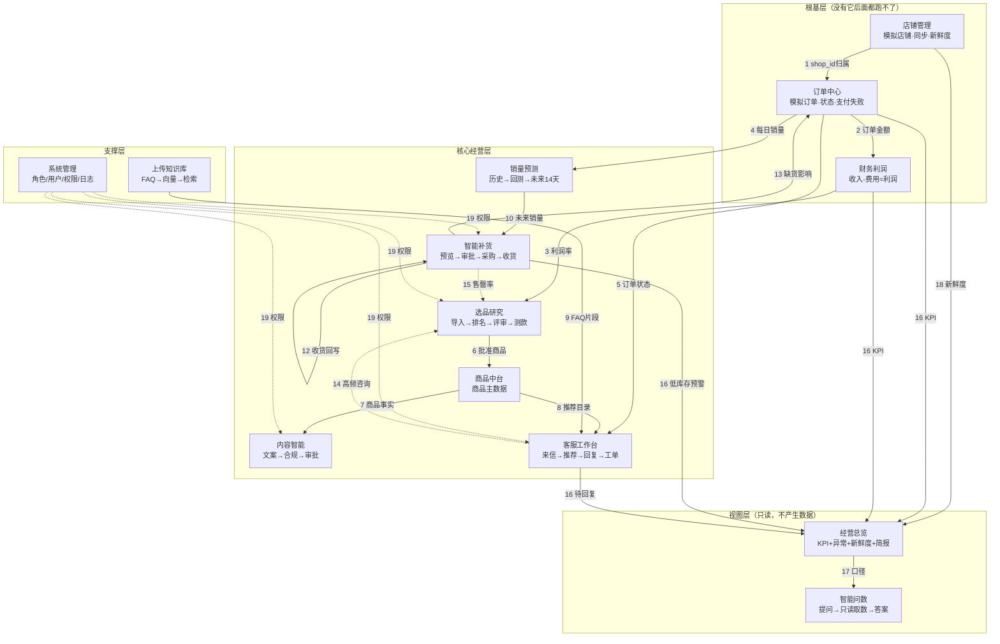
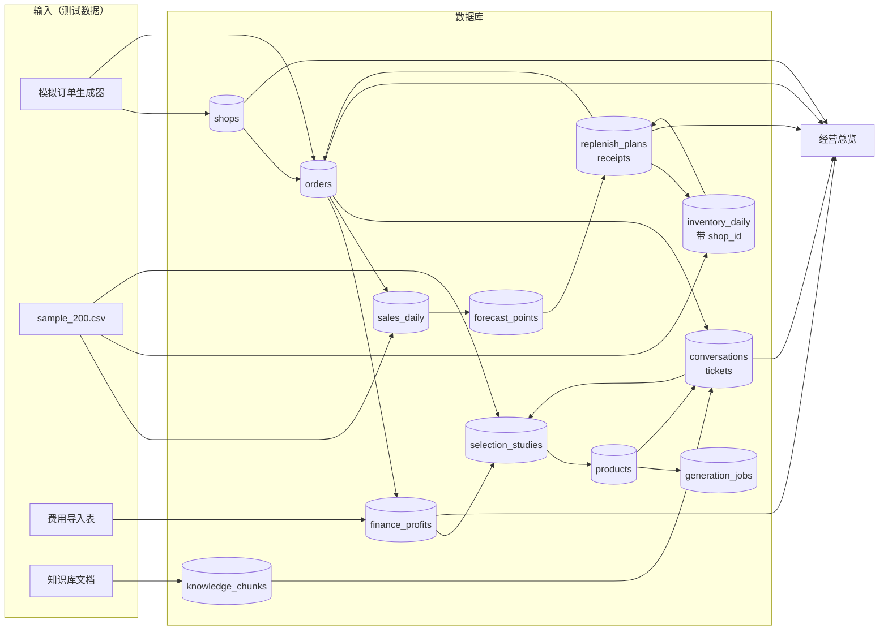
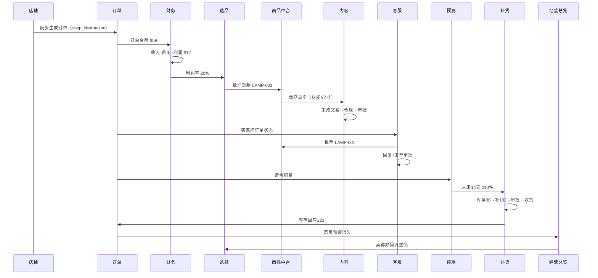

# 全部业务说明（板块 + 小功能 1-2-3 + 板块联系 + 流程图）

> 对照老师原型 CrossPilot 跨境智管平台（3 张截图）+ B `AI跨境电商平台V1.0-软件需求规格说明书.md`
> 原则：**业务完整，数据可假**。店铺/订单/财务一个不少，数据先用测试数据跑通。
> 本文档只讲业务，不讲代码。看完你点头，我再开工。

---

## 一、全部板块一览（老师原型 13 个板块）

| # | 板块（老师导航） | 一句话是干什么的 | 我们做不做 |
|---|---|---|---|
| 1 | 经营总览 | 首页仪表盘：KPI+趋势+异常+新鲜度 | ✅ 做 |
| 2 | 店铺管理 | 管 Amazon/Shopee/TikTok 店铺，同步状态 | ✅ 做（模拟店铺） |
| 3 | 订单中心 | 管订单列表和状态，处理支付失败 | ✅ 做（模拟订单） |
| 4 | 财务利润 | 算收入-费用=利润 | ✅ 做（导入费用） |
| 5 | 商品中台 | 商品主数据唯一事实源 | ✅ 做 |
| 6 | 智能补货 + 补货方案 | 算补多少、审批、采购、收货 | ✅ 做（已有代码） |
| 7 | 选品研究（工作台+数据） | 选什么商品卖 | ✅ 做 |
| 8 | 内容智能（生成+商品图+短视频+合规检查+发布审批+规则库） | 生成文案和图片，合规后发布 | ✅ 做（文案 only，图片占位） |
| 9 | 智能服务（协作工作台+客服工作台） | 回复买家、处理投诉 | ✅ 做客服，❌ 砍协作台 |
| 10 | 上传知识库 | 上传 FAQ 给客服用 | ✅ 做 |
| 11 | 系统管理（角色/用户/权限/菜单/日志/指标） | 管人、管权限、管日志 | ✅ 做（砍菜单管理） |
| 12 | 智能 BI（驾驶舱+问数+驾驶舱设计） | 看数据、问数据、设计看板 | ✅ 做（设计页简化） |
| 13 | 系统设置 | 系统参数 | ⚠️ 合并到系统管理 |

---

## 二、每个板块的小功能（按 1-2-3 顺序）

### 板块 1：店铺管理（根基，没有它后面都不知道数据是谁的）

| 顺序 | 小功能 | 输入（从哪来） | 输出（给谁） |
|---|---|---|---|
| 1.1 | 店铺列表：看有哪些店（Amazon/Shopee/TikTok） | 测试数据生成器（模拟店铺） | 店铺列表 |
| 1.2 | 绑定组织：店铺属于哪个公司（org_id） | 组织选择 | `shops.org_id` |
| 1.3 | 同步状态：上次同步时间、新鲜度（5 分钟前/9 分钟前） | 同步任务记录 | 新鲜度 → 经营总览 |
| 1.4 | 手动同步：点一下，模拟拉一次数据 | 按钮触发 | 触发订单生成（见 2.1） |

**联系**：店铺是所有数据的归属键。订单带 `shop_id`，库存带 `shop_id`，财务按 `shop_id` 分店算。没有店铺，补货不知道给哪个店补。

### 板块 2：订单中心（所有数字的源头）

| 顺序 | 小功能 | 输入 | 输出 |
|---|---|---|---|
| 2.1 | 订单列表：按店铺/状态筛选，看 100 单 | 店铺同步（模拟生成） | 订单列表 |
| 2.2 | 订单详情：点一单看明细（商品/金额/状态） | 订单号 | 详情 |
| 2.3 | 状态流转：待支付→已支付→已发货→已送达 | 模拟状态机 | 状态变化 |
| 2.4 | 异常处理：支付失败的 3 单（TikTok）单独标红 | 状态机分支 `PAYMENT_FAILED` | 异常 → 经营总览异常提醒 |

**联系**：
- 订单 → 财务：订单金额汇总成收入
- 订单 → 预测：订单按天聚合（`sales_daily`），预测就是在预测订单量
- 订单 → 客服：买家问“我的订单呢”，客服查这张表

### 板块 3：财务利润（算钱的）

| 顺序 | 小功能 | 输入 | 输出 |
|---|---|---|---|
| 3.1 | 收入汇总：所有订单金额加总（$6,360,000） | 订单中心 | 总收入 |
| 3.2 | 费用导入：货代费、平台费、广告费（测试版报价表） | CSV 导入 | 费用明细 |
| 3.3 | 利润计算：收入 - 费用 = 净利润（$5,600） | 3.1 + 3.2 | 净利润 → 经营总览 KPI 卡 |
| 3.4 | 分店/分 SKU  breakdown：哪个店赚钱、哪个 SKU 赚钱 | 按 shop_id/SKU 分组 | 利润明细 → 选品 |

**联系**：财务 → 选品。选品排名第一看的就是利润率，没有财务，选品不知道哪个商品赚钱。

### 板块 4：商品中台（商品的身份证）

| 顺序 | 小功能 | 输入 | 输出 |
|---|---|---|---|
| 4.1 | 商品列表：所有在售商品（SKU/名称/类目） | 选品批准回流 + 导入 | 商品列表 |
| 4.2 | 商品详情：材质/尺寸/卖点/图片 | 商品主数据 | 详情 |
| 4.3 | 库存快照：每个商品在每个店的库存 | 库存表（`inventory_daily`） | 库存数 → 补货 |

**联系**：
- 选品 → 商品中台：选品批准的商品写进来
- 商品中台 → 内容：内容生成读商品事实（材质/尺寸），不编
- 商品中台 → 客服：客服推荐读商品目录（向量检索）

### 板块 5：选品研究（选什么商品卖）

| 顺序 | 小功能 | 输入 | 输出 |
|---|---|---|---|
| 5.1 | 选品数据导入：1688/平台数据（测试版 CSV） | CSV 导入 | 原始数据 |
| 5.2 | 周事实汇总：按周汇总销量/收入/趋势 | 导入数据 | 周事实表 |
| 5.3 | 初筛排名：三种模式（均衡/收入/增长），算综合分 | 周事实 + 财务利润 | 排名榜 |
| 5.4 | 人工评审：看排名，批准/驳回 | 排名榜 | 评审结果 |
| 5.5 | 测款决策：批准的写进商品中台 | 评审结果 | → 商品中台 |
| 5.6 | 复盘：卖得好的回流（售罄率/周转） | 销量+库存 | 下一轮选品参考 |

**联系**：财务给利润，订单给销量，选品算排名，批准的进商品中台。闭环回流：卖得好的下次优先选。

### 板块 6：内容智能（生成文案，合规后发布）

| 顺序 | 小功能 | 输入 | 输出 |
|---|---|---|---|
| 6.1 | 内容生成：选商品，生成文案五组（标题/五点/描述/关键词/后台词） | 商品中台事实 | 文案草稿 |
| 6.2 | 商品图：生成主图（ComfyUI） | 商品事实 | 图片（本期占位：显示未接入） |
| 6.3 | 短视频：生成视频 | 商品事实 | 视频（本期占位） |
| 6.4 | 合规检查：查术语/禁忌/品牌词 | 文案草稿 + 规则库 | 通过/警告/阻断 |
| 6.5 | 发布审批：人工确认后进审批 | 合规结果 | 审批状态 |
| 6.6 | 合规规则库：维护禁忌词和术语 | 人工维护 | 规则 → 6.4 用 |

**联系**：商品中台给事实，内容生成文案，合规检查把关，人工审批放行。生成完成 ≠ 合规通过 ≠ 已发布，三者分开。

### 板块 7：客服工作台（回复买家）

| 顺序 | 小功能 | 输入 | 输出 |
|---|---|---|---|
| 7.1 | 会话列表：12 条新消息，2 条需人工接管 | 模拟来信 | 会话列表 → 经营总览待处理 |
| 7.2 | 消息翻译：英文→中文 | 买家英文消息 | 中文 |
| 7.3 | 订单查询：买家问订单，查订单中心 | 订单号 | 订单状态 |
| 7.4 | 商品推荐：向量检索推荐最多 3 件 | 商品中台目录 | 推荐+依据 |
| 7.5 | 回复草稿：生成回复，人工确认后发送 | 7.2+7.3+7.4 | 回复 |
| 7.6 | 工单处理：投诉/退款生成工单，主管审批 | 投诉消息 | 工单状态（不退真钱） |

**联系**：
- 订单中心给订单状态
- 商品中台给推荐目录
- 知识库给 FAQ
- 客服的高频咨询回流选品（买家总问什么，说明什么商品有需求）

### 板块 8：销量预测（算未来卖多少）

| 顺序 | 小功能 | 输入 | 输出 |
|---|---|---|---|
| 8.1 | 历史销量查看：过去每天卖多少 | 订单聚合（`sales_daily`） | 历史曲线 |
| 8.2 | 模型选择：选 ma7/ma14 等模型 | 历史数据 | 模型 |
| 8.3 | 回测评估：用历史验证准不准（WAPE） | 历史数据 | WAPE 18% |
| 8.4 | 未来预测：跑未来 14 天逐日销量 | 模型+历史 | 未来曲线 → 补货 |

**联系**：订单给历史销量，预测算未来销量，补货读未来销量决定补多少。

### 板块 9：智能补货（算补多少、审批、收货）

| 顺序 | 小功能 | 输入 | 输出 |
|---|---|---|---|
| 9.1 | 补货预览：选 SKU+店铺仓库，看三方案（保守/均衡/激进） | 预测未来销量 + 当前库存 | 三方案+风险 |
| 9.2 | 补货方案提交：选一个方案，提交审批 | 三方案 | `READY_FOR_REVIEW` |
| 9.3 | 审批：主管批准/驳回 | 补货方案 | `APPROVED/REJECTED` |
| 9.4 | 采购单生成：批准后生成 PO | 批准的方案 | PO |
| 9.5 | 收货/质检/物流：模拟收货，上传凭证 | PO | 收货记录 |
| 9.6 | 库存回写：收货数量加到库存 | 收货记录 | `inventory_daily` 更新 |

**联系**：
- 预测给未来销量，库存给当前在手，补货算缺口
- 收货回写库存，库存变多，下次预测更准（闭环）
- 低库存触发经营总览预警

### 板块 10：经营总览（首页仪表盘）

| 顺序 | 小功能 | 输入（读谁） | 输出 |
|---|---|---|---|
| 10.1 | KPI 卡：订单数/广告费/净利润/销售额 | 订单+财务 | 4 张卡 |
| 10.2 | GMV 趋势：折线图 | 订单聚合 | 趋势图 |
| 10.3 | 平台占比：环形图 Amazon/Shopee | 订单按店铺分组 | 占比图 |
| 10.4 | 待处理事项：低库存预警、待回复消息 | 补货+客服 | 待办列表 |
| 10.5 | 异常提醒：库存异常、支付失败 | 补货+订单 | 异常列表 |
| 10.6 | 数据新鲜度：各店上次同步时间 | 店铺 | 新鲜度卡 |
| 10.7 | 生成经营简报：一键生成文字简报 | 全部 KPI | 简报 |

**联系**：经营总览不产生数据，只读所有模块。它的作用是把所有模块的异常汇到一页，答辩时先讲首页，再点进各模块。

### 板块 11：智能问数（用嘴问数据）

| 顺序 | 小功能 | 输入 | 输出 |
|---|---|---|---|
| 11.1 | 提问：自然语言问（“上周哪个 SKU 降最多”） | 用户输入 | 问题 |
| 11.2 | 解析范围：哪个店、哪个时间、哪个指标 | 问题 | 查询条件 |
| 11.3 | 只读取数：只查不写 | 数据库只读 | 数字 |
| 11.4 | 答案+证据：数字+口径+截止时间+来源 | 数字 | 答案（不编数） |

**联系**：问数读经营总览的指标口径，写入请求（“把价格降到 20”）会被拒绝并指向对应模块。

### 板块 12：系统管理（管人管权限）

| 顺序 | 小功能 | 输入 | 输出 |
|---|---|---|---|
| 12.1 | 角色管理：定义角色（管理员/运营/审批） | 人工创建 | 角色 |
| 12.2 | 用户管理：创建用户，分配角色 | 人工创建 | 用户 |
| 12.3 | 权限分配：哪个角色能点哪个按钮 | 角色+菜单 | 权限 |
| 12.4 | 操作日志：谁在什么时候干了什么 | 系统记录 | 日志 |

**联系**：所有审批点（选品评审、内容审批、补货审批、工单审批）都走 RBAC 鉴权，没权限点不了。

### 板块 13：上传知识库（给客服的弹药库）

| 顺序 | 小功能 | 输入 | 输出 |
|---|---|---|---|
| 13.1 | 上传文档：FAQ/退货政策/产品说明 | 文件上传 | 原始文档 |
| 13.2 | 切片向量化：切成小段，存向量库 | 文档 | 向量片段 |
| 13.3 | 检索：客服回复时搜相关片段 | 买家问题 | 片段 → 客服 |

---

## 三、板块之间怎么联系（19 条线，逐条）

| # | 从 → 到 | 传什么 | 为什么需要这条线 |
|---|---|---|---|
| 1 | 店铺 → 订单 | 店铺归属（shop_id） | 订单必须知道是哪个店的，否则财务分店、补货分店都算不了 |
| 2 | 订单 → 财务 | 订单金额 | 财务的收入就是订单金额加总 |
| 3 | 财务 → 选品 | 净利润/利润率 | 选品排名第一看利润，没有利润不知道哪个商品赚钱 |
| 4 | 订单 → 预测 | 每日销量 | 预测就是在预测订单量，没有订单就没有历史销量 |
| 5 | 订单 → 客服 | 订单状态 | 买家问“我的订单呢”，客服必须查订单中心 |
| 6 | 选品 → 商品中台 | 批准的商品 | 选品选出来的商品要进商品中台才能卖 |
| 7 | 商品中台 → 内容 | 商品事实 | 内容生成必须读真实事实（材质/尺寸），不能编 |
| 8 | 商品中台 → 客服 | 推荐目录 | 客服推荐必须读商品中台的目录，不能凭空推荐 |
| 9 | 知识库 → 客服 | FAQ 片段 | 客服回复政策问题必须查知识库，不能编 |
| 10 | 预测 → 补货 | 未来 14 天销量 | 补货算缺口 = 未来销量 - 当前库存，没有预测算不了 |
| 11 | 库存 → 补货 | 当前在手+在途 | 补货必须知道现在有多少，才能算还要补多少 |
| 12 | 补货 → 库存 | 收货数量 | 收货后库存增加，下次补货和预测都用新库存（闭环） |
| 13 | 补货 → 订单 | 缺货影响 | 缺货会导致订单发不出去，订单中心要标异常 |
| 14 | 客服 → 选品 | 高频咨询品类 | 买家总问什么，说明什么商品有需求，回流选品 |
| 15 | 补货 → 选品 | 售罄率/周转 | 卖得快、经常缺货的商品，下次选品优先推荐 |
| 16 | 全部 → 经营总览 | KPI/异常/新鲜度 | 首页把所有模块的异常汇到一页 |
| 17 | 经营总览 → 问数 | 指标口径 | 问数必须用和首页一样的口径，否则数字对不上 |
| 18 | 店铺 → 经营总览 | 新鲜度 | 首页新鲜度卡显示各店上次同步时间 |
| 19 | 系统管理 → 全部 | 权限 | 所有审批点都走 RBAC，没权限点不了 |

---

## 四、流程图（全部业务一张图）

### 4.1 业务主流程图（板块级）

### 4.2 数据流向图（表级，闭环关键线加粗）

### 4.3 一条订单的完整旅程（从生成到复盘）

---

## 五、测试数据怎么来（假数据走真链路）

| 数据 | 来源 | 标注 |
|---|---|---|
| 模拟店铺 | 测试数据生成器（写死 3 个店：Amazon/Shopee/TikTok） | 页面标“模拟店铺” |
| 模拟订单 | 生成器按 SKU/日期随机生成 100 单，含 3 笔支付失败 | 页面标“模拟订单” |
| 销量/库存 | `pilot/data/sample_200.csv` 导入 | 标“测试数据” |
| 费用 | 测试版货代报价表 CSV 导入 | 标“测试费用” |
| 模拟来信 | 写死 12 条英文消息 | 标“模拟来信” |
| 知识库 | 写死 5 篇 FAQ 文档 | 标“测试文档” |

**关键**：假数据必须真的写入数据库，真的被下游模块读取。不能只在前端写死数字——那样链路是假的，答辩一问就穿帮。

---

## 六、四个审批点（AI 不乱来的保证）

| 审批点 | 谁审批 | 批准后发生什么 | 不批准会怎样 |
|---|---|---|---|
| 选品评审 | 运营 | 商品写进商品中台 | 不进商品中台，不能卖 |
| 内容发布审批 | 运营 | 文案可发布（不真发） | 不能发布 |
| 补货审批 | 主管 | 生成 PO，可收货 | 不能采购 |
| 工单审批 | 主管 | 工单关闭（不退真钱） | 工单挂起 |

**批准 ≠ 真实执行**：补货批准不下真实 PO，工单批准不退真实款，内容批准不直发平台。这是安全设计，答辩时要主动讲。

---

*本文档只讲业务。流程图你看完，告诉我哪条线不对、哪个小功能顺序不对，我改完你点头再开工。*
