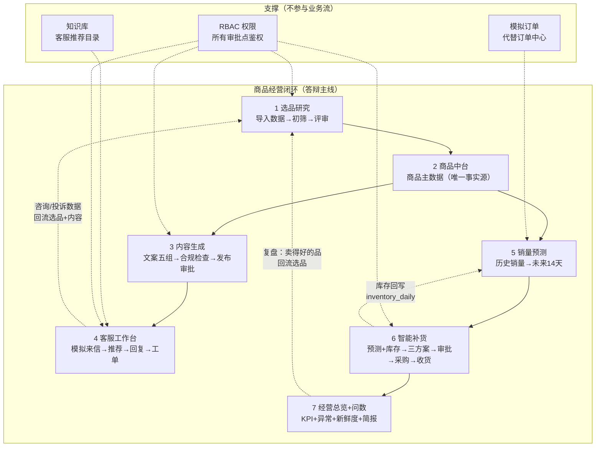
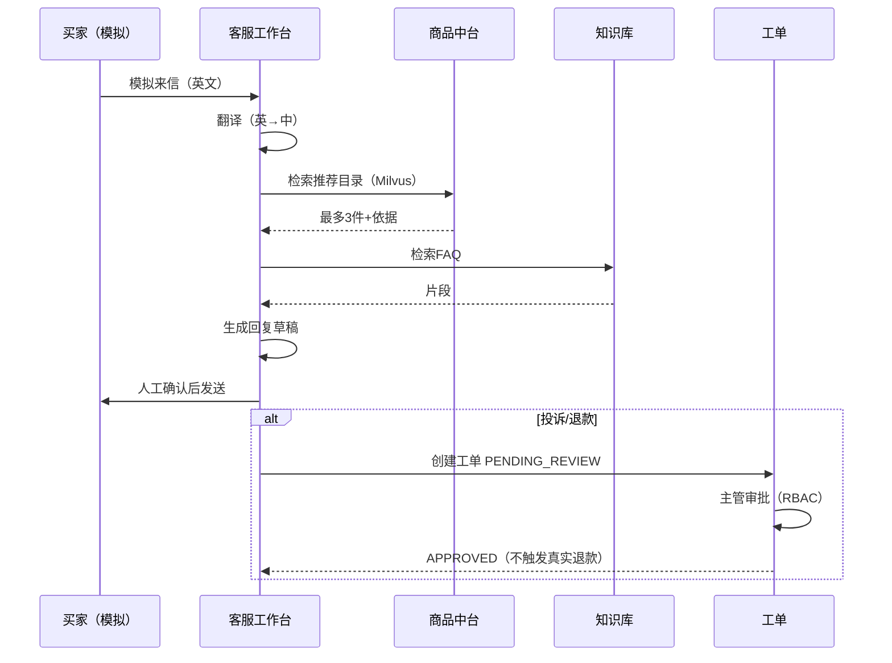
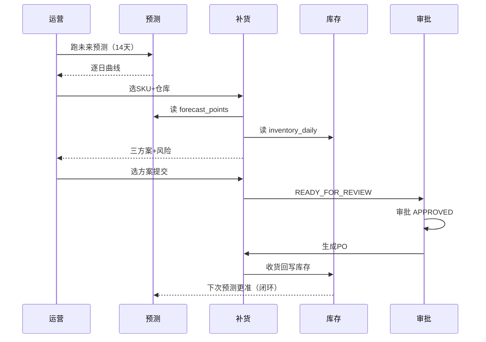
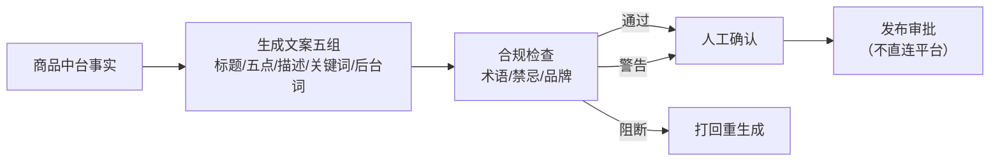
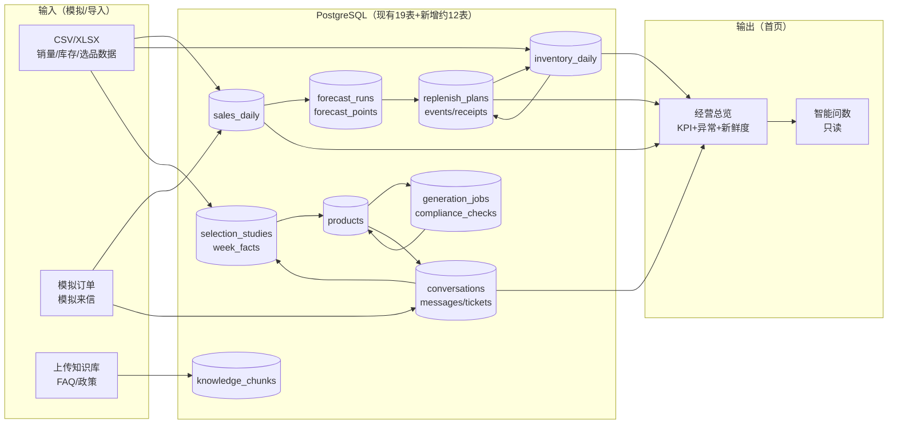
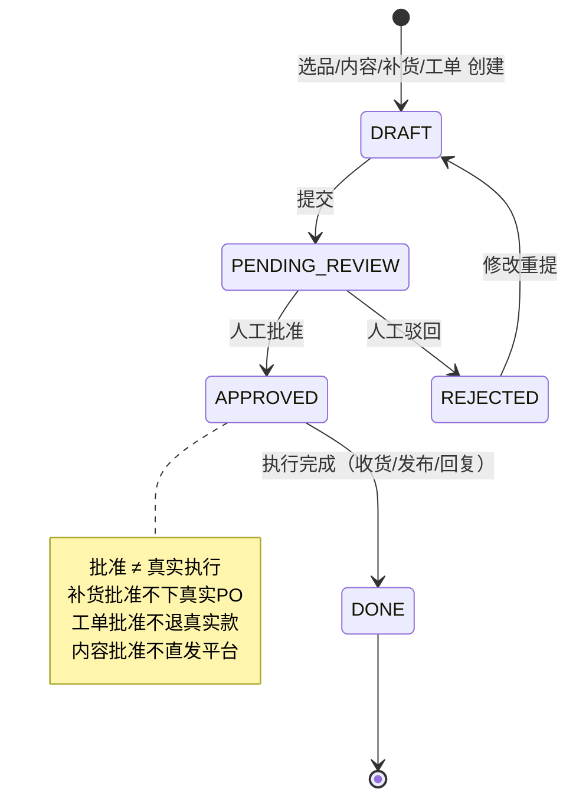

# 精简闭环业务流程（对照老师原型）

> 老师原型：CrossPilot 跨境智管平台（截图 3 张）
> 我们的策略：**功能砍 40%，链路不断**。答辩讲的是一条闭环故事，不是 20 个孤立页面。
> 对应文档：B `AI跨境电商平台V1.0-软件需求规格说明书.md` FR 编号、C `AI跨境电商平台V1.1-架构与需求.md` 7 层架构

## 1. 老师原型解析（从截图里读到的）

### 1.1 左侧导航树（完整版）

```
经营总览
店铺管理 / 订单中心 / 财务利润
商品中台
智能补货 / 智能补货方案
选品研究 → 选品研究工作台 / 选品数据
内容智能 → 内容生成 / 商品图 / 短视频 / 合规检查 / 发布审批 / 合规规则库
智能服务 → 智能体协作工作台 / 客服工作台
上传知识库 / 系统设置
系统管理 → 角色管理 / 用户管理 / 用户角色分配 / 权限分配 / 菜单管理 / 系统操作日志 / 指标管理 / 指标数据
智能 BI → 智能 BI 驾驶舱 / 智能问数 / 驾驶舱设计
```

### 1.2 经营总览页结构（截图核心页）

| 区域 | 内容 | 数据来源（页面标注） |
|---|---|---|
| 顶部 | 近 30 天筛选 + 刷新数据 + 生成经营简报 | — |
| 4 张指标卡 | 订单数 100 / 广告花费 $13,000 / 净利润 $5,600 / 虾皮销售额 1,000,000 | 指标数据调度 · Amazon/Shopee |
| GMV 同步趋势 | 折线图 2026-11-05~11-13，约 $6M | 指标数据 · USD |
| 平台销售占比 | 环形图 $6,360,000，Amazon 5.7% / Shopee 94.3% | 指标数据 · GMV 分布 |
| 待处理事项（8） | 低库存预警 3 个商品 / 客户消息待回复 12 条（2 条需人工接管） | 补货 + 客服 |
| 异常提醒 | Amazon 库存异常 LAMP-001 / TikTok 订单异常 3 笔支付失败 | 补货 + 订单 |
| 数据新鲜度 | Amazon 5 分钟前 / Shopee 9 分钟前 · 正常 | 同步任务 |

**关键洞察**：老师的首页本身就是闭环的“仪表盘”——它同时读了补货（低库存）、客服（待回复）、订单（支付失败）、同步任务（新鲜度）。首页不是孤立页，是所有模块的汇点。

### 1.3 老师原型的问题（为什么我们要砍）

| 老师有 | 我们没有 | 处理 |
|---|---|---|
| 店铺管理（真实授权同步） | 无 SP-API/Shopee/TikTok 代码 | 砍真实同步，保留“模拟店铺” |
| 订单中心（真实订单） | 只有模拟订单 | 砍真实，保留模拟订单导入 |
| 财务利润（真实核算） | 无费用引擎 | 砍真实，保留指标卡展示 |
| 商品图/短视频（ComfyUI） | A7 空骨架 | 砍生成，保留“未接入”占位 |
| 智能体协作工作台 | 无 | 砍掉（答辩不讲多 Agent 协作） |
| 菜单管理/指标数据等 10 个系统页 | 只有 RBAC 4 页 | 砍到 4 页：角色/用户/权限/日志 |

## 2. 砍减原则

1. **保闭环，不保 breadth**：宁可 7 个模块全通，不要 20 个模块半通。
2. **保数据流向，不保真实接入**：模拟数据可以，但必须标注 `模拟`，且流向正确（模拟订单 → 预测 → 补货 → 库存回写）。
3. **保人工确认点**：选品评审、内容合规、补货审批、客服工单——四个审批点一个不能少，这是老师最看重的“AI 不乱来”。
4. **保现有代码**：`pilot/core` 的预测+补货+RBAC 不动，只补接口和新表。

## 3. 精简版模块清单（7 + 2）

| # | 模块 | 对应老师页 | 对应 FR | 现有代码 | 本期做不做 |
|---|---|---|---|---|---|
| 1 | 经营总览（驾驶舱） | 经营总览 | B·FR-BI | P1 半实现 | ✅ 做（升级 P1） |
| 2 | 选品研究 | 选品研究工作台+选品数据 | B·FR-SEL | A4 骨架 | ✅ 做（新建） |
| 3 | 商品中台 | 商品中台 | B·FR-COM | Products 表有 | ✅ 做（只读+导入） |
| 4 | 内容生成 | 内容生成+合规检查+发布审批 | B·FR-GC | A7 骨架 | ✅ 做（文案 only） |
| 5 | 客服工作台 | 客服工作台 | B·FR-CS | A1 半实现 | ✅ 做（模拟来信） |
| 6 | 销量预测 | （老师无独立页，藏在补货里） | B·FR-FC | P4 半实现 | ✅ 做（补未来预测） |
| 7 | 智能补货 | 智能补货+补货方案 | B·FR-RP | P2/P3 已实现 | ✅ 做（已通） |
| 8 | 智能问数 | 智能问数 | B·FR-QA | A3 半实现 | ✅ 做（最小版） |
| 9 | 系统管理 | 角色/用户/权限/日志 | B·FR-COM | P7 已实现 | ✅ 做（已通） |
| — | 店铺管理/订单中心/财务利润 | — | — | 无 | ❌ 砍（用模拟订单代替） |
| — | 商品图/短视频 | — | A·FR-09/10 | 无 | ❌ 砍（占位） |
| — | 智能体协作/菜单管理等 | — | — | 无 | ❌ 砍 |

## 4. 闭环总图（核心）



**一句话闭环**：选品选出来的商品进商品中台 → 内容生成卖点 → 客服用同一商品目录回复买家 → 销量预测未来卖多少 → 补货决定补多少 → 收货回写库存 → 经营总览复盘 → 卖得好的回流选品再选。

## 5. 每个板块怎么联系（输入/输出/接口）

### 5.1 模块联系总表

| 从 → 到 | 传什么 | 通过什么（表/接口） | 谁触发 |
|---|---|---|---|
| 选品 → 商品中台 | 批准测款的商品（SKU/名称/类目） | `selection_studies` → `products`（人工点“批准”时写入） | 选品评审人 |
| 商品中台 → 内容 | 商品事实（材质/尺寸/卖点） | `products` 表只读 | 内容生成时读 |
| 内容 → 发布审批 | 文案草稿+合规结果 | `generation_jobs` + `compliance_checks` | 内容生成后 |
| 商品中台 → 客服 | 推荐目录（商品+用途） | `products` + Milvus 向量检索 | 客服推荐时读 |
| 知识库 → 客服 | FAQ/政策片段 | `knowledge_chunks`（上传知识库页） | 客服回复时读 |
| 模拟订单 → 预测 | 每日销量 | `sales_daily`（CSV 导入） | 定时/手动导入 |
| 预测 → 补货 | 未来 14 天逐日销量 | `forecast_points`（新增未来预测接口） | 补货预览时读 |
| 库存 → 补货 | 当前在手+在途 | `inventory_daily` | 补货预览时读 |
| 补货 → 库存 | 收货数量+日期 | `replenish_receipts` → 回写 `inventory_daily` | 履约收货时写 |
| 所有模块 → 经营总览 | KPI/异常/新鲜度 | `metrics` 聚合查询（只读） | 打开首页时算 |
| 经营总览 → 问数 | 指标口径 | `bi_metrics` 定义表 | 问数时读 |
| 客服 → 选品 | 高频咨询/投诉品类 | `conversations` 聚合 | 每日定时（或手动看） |
| 补货 → 选品 | 实际售罄率/周转 | `sales_daily` + `inventory_daily` 聚合 | 选品复盘时读 |

### 5.2 客服内部流（最复杂的一条）



### 5.3 补货内部流（已有代码，最成熟）



### 5.4 内容内部流



## 6. 数据流向图（表级）



## 7. 状态机（四个审批点，防 AI 乱来）



## 8. 一条完整故事（答辩演示脚本，5 分钟）

> 拿截图里的 **LAMP-001** 走一遍：

1. **选品**：导入一批灯具数据 → 初筛排名 → LAMP-001 利润率 20% → 人工评审批准测款 → 写入商品中台。
2. **内容**：选 LAMP-001 → 生成标题/五点 → 合规检查通过 → 人工确认 → 进入发布审批（演示到此，不真发）。
3. **客服**：模拟买家问 “Where is my order?” → 翻译 → 推荐 LAMP-001（向量检索命中）→ 回复草稿 → 人工发送。另一条投诉 → 生成工单 → 主管审批（不退真钱）。
4. **预测**：选 LAMP-001 → 跑未来 14 天预测 → 曲线+总量 210 件 → WAPE 18%。
5. **补货**：预测 210 件 + 当前库存 30 → 三方案（保守/均衡/激进）→ 选均衡 192 件 → 审批 → 生成 PO → 模拟收货 → 库存回写 222。
6. **经营总览**：首页刷新 → 低库存预警消失 → 数据新鲜度更新 → 点“生成经营简报” → 问数追问 “LAMP-001 为什么预警？” → 答案带口径和截止时间。
7. **回流**：LAMP-001 卖得好 → 选品复盘页显示高周转 → 下一轮选品优先推荐同类。

**闭环点**：第 6 步的库存回写让第 4 步的预测更准，第 7 步的复盘让第 1 步的选品更准。这就是闭环。

## 9. 砍掉的功能 + 答辩话术

| 砍掉 | 答辩怎么说（诚实版） |
|---|---|
| 真实店铺同步（SP-API） | “店铺同步需要平台授权，当前用模拟订单代替，接口已预留 `shop_id` 字段” |
| 真实 ComfyUI 生成 | “内容生成先做文案五组，图片/视频需 GPU 服务，当前显示未接入，不生成假成功” |
| 真实退款/下单 | “工单批准只改内部状态，不触发真实资金操作，这是安全设计” |
| 财务利润真实核算 | “利润口径需货代报价表，当前用导入费用计算，未知不填零” |
| 智能体协作工作台 | “多 Agent 协作是后续扩展，当前单 Agent + 工具调用已跑通” |

## 10. 落地顺序（按闭环依赖）

| 顺序 | 做什么 | 依赖 | 交付物 |
|---|---|---|---|
| 1 | 商品中台只读页 + 模拟订单导入 | 现有 Products 表 | 能看到商品列表 |
| 2 | 未来预测接口（补 P4） | sales_daily | 能跑 14 天预测 |
| 3 | 选品最小版（导入→排名→评审） | 商品中台 | 能批准测款 |
| 4 | 内容文案版（生成→合规→审批） | 商品中台 | 能生成五组文案 |
| 5 | 客服模拟版（来信→推荐→工单） | 商品中台+知识库 | 能走完工单审批 |
| 6 | 经营总览升级（读全部模块） | 全部 | 首页数字对得上 |
| 7 | 问数最小版（3 指标只读） | 经营总览口径 | 能问能答带证据 |

> 每步交付后跑 `pytest`，全绿才进下一步。原型你点头，我按这个顺序开工。
