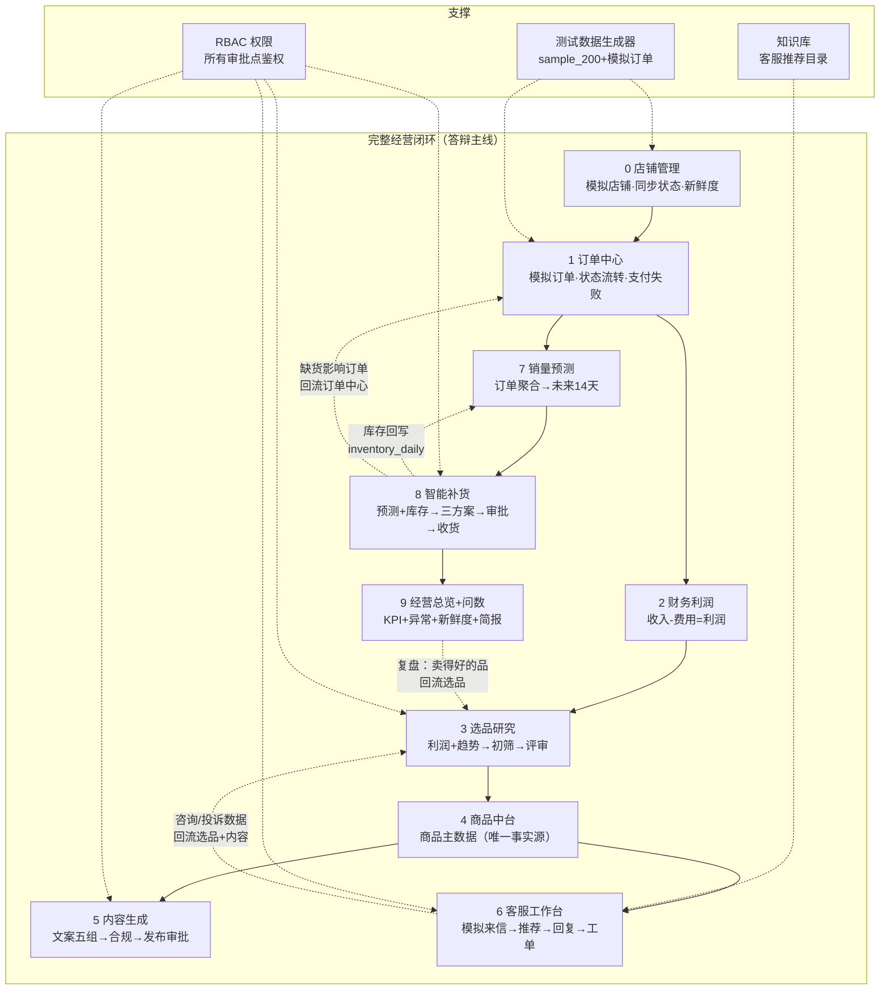
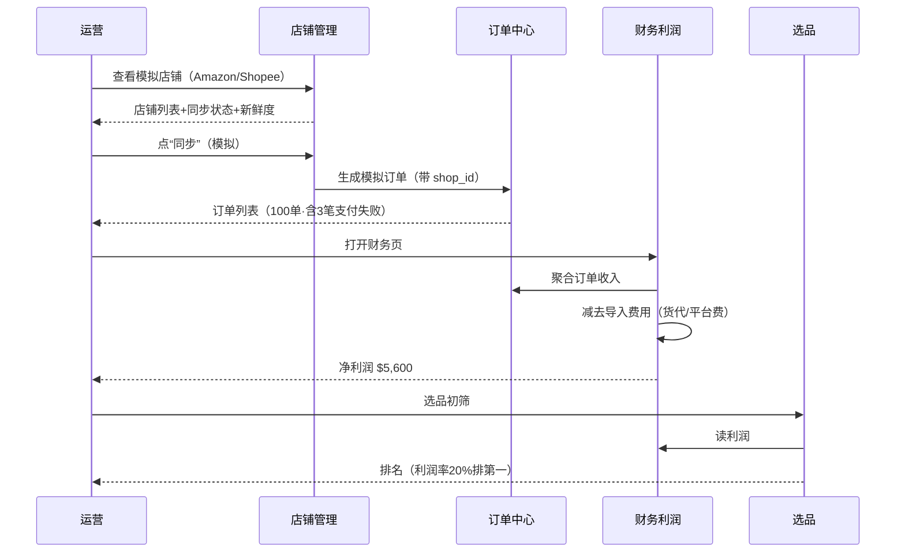
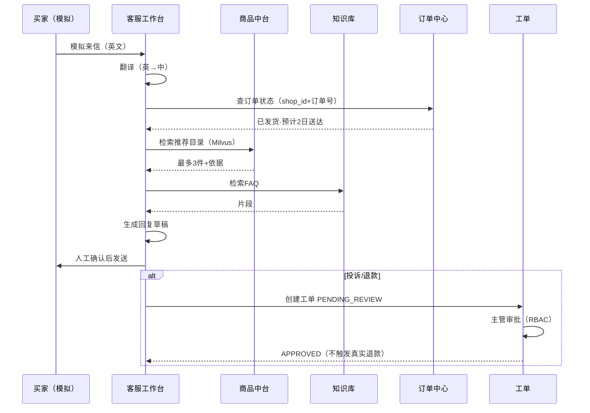
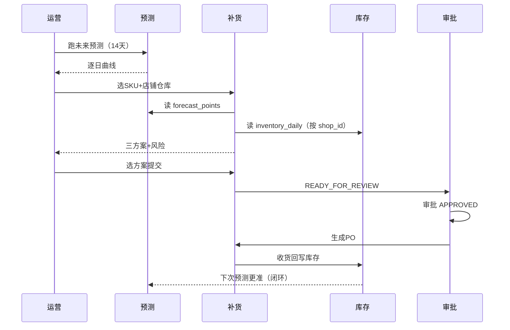
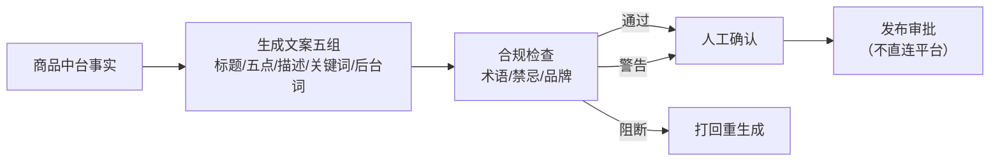
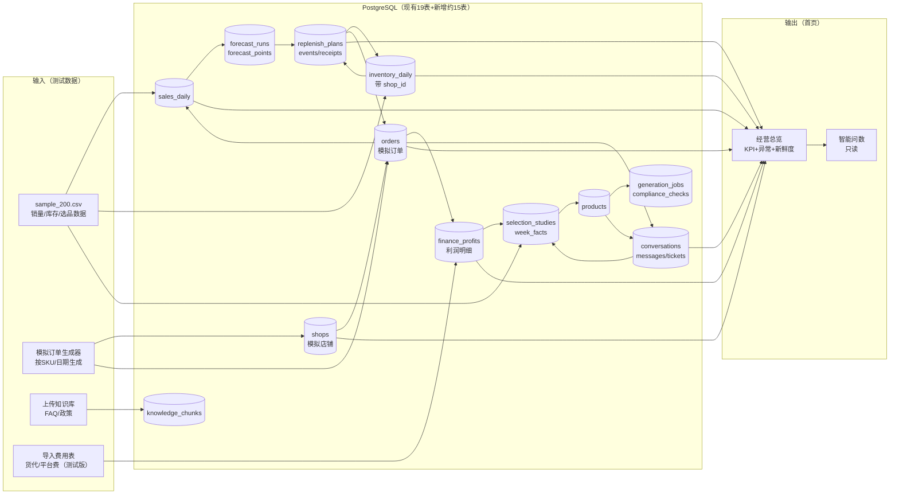
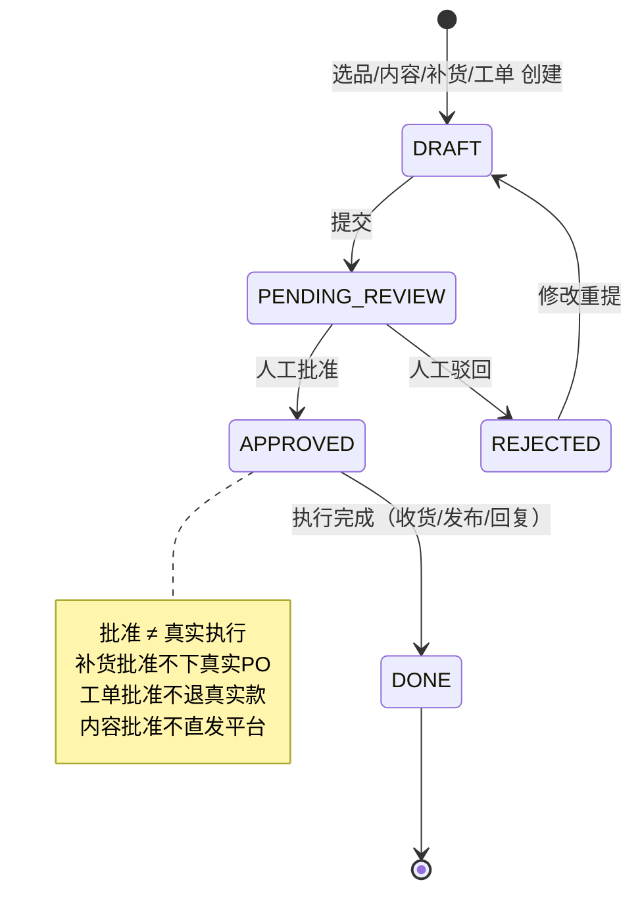

# 完整闭环业务流程（对照老师原型，业务完整、数据可假）

> 老师原型：CrossPilot 跨境智管平台（截图 3 张）
> 我们的策略：**业务完整，数据可假**。店铺/订单/财务一个不能少——没有店铺就没法补货，没有订单就没法预测，没有财务就没法选品。砍的只是“真实平台接入”（SP-API 授权），不是砍业务模块。
> 对应文档：B `AI跨境电商平台V1.0-软件需求规格说明书.md` FR 编号、C `AI跨境电商平台V1.1-架构与需求.md` 7 层架构

## 1. 老师原型解析（从截图里读到的）

### 1.1 左侧导航树（完整版）

```
经营总览
店铺管理 / 订单中心 / 财务利润
商品中台
智能补货 / 智能补货方案
选品研究 → 选品研究工作台 / 选品数据
内容智能 → 内容生成 / 商品图 / 短视频 / 合规检查 / 发布审批 / 合规规则库
智能服务 → 智能体协作工作台 / 客服工作台
上传知识库 / 系统设置
系统管理 → 角色管理 / 用户管理 / 用户角色分配 / 权限分配 / 菜单管理 / 系统操作日志 / 指标管理 / 指标数据
智能 BI → 智能 BI 驾驶舱 / 智能问数 / 驾驶舱设计
```

### 1.2 经营总览页结构（截图核心页）

| 区域 | 内容 | 数据来源（页面标注） |
|---|---|---|
| 顶部 | 近 30 天筛选 + 刷新数据 + 生成经营简报 | — |
| 4 张指标卡 | 订单数 100 / 广告花费 $13,000 / 净利润 $5,600 / 虾皮销售额 1,000,000 | 指标数据调度 · Amazon/Shopee |
| GMV 同步趋势 | 折线图 2026-11-05~11-13，约 $6M | 指标数据 · USD |
| 平台销售占比 | 环形图 $6,360,000，Amazon 5.7% / Shopee 94.3% | 指标数据 · GMV 分布 |
| 待处理事项（8） | 低库存预警 3 个商品 / 客户消息待回复 12 条（2 条需人工接管） | 补货 + 客服 |
| 异常提醒 | Amazon 库存异常 LAMP-001 / TikTok 订单异常 3 笔支付失败 | 补货 + 订单 |
| 数据新鲜度 | Amazon 5 分钟前 / Shopee 9 分钟前 · 正常 | 同步任务 |

**关键洞察**：老师的首页本身就是闭环的“仪表盘”——它同时读了补货（低库存）、客服（待回复）、订单（支付失败）、同步任务（新鲜度）。首页不是孤立页，是所有模块的汇点。

### 1.3 关键澄清：砍什么、不砍什么

| 业务模块 | 业务做不做 | 数据真不真 | 说明 |
|---|---|---|---|
| 店铺管理 | ✅ 做（完整业务） | 假（模拟店铺） | 店铺列表/绑定组织/同步状态/新鲜度全有，只是同步按钮走模拟，不调 SP-API |
| 订单中心 | ✅ 做（完整业务） | 假（模拟订单） | 订单列表/状态流转/支付失败处理全有，订单来自测试数据生成器 |
| 财务利润 | ✅ 做（完整业务） | 假（导入费用） | 收入-费用=利润全有，费用来自导入的货代报价表（测试版） |
| 商品图/短视频 | ⚠️ 业务保留、生成砍掉 | — | 页面保留，显示“未接入 ComfyUI”，不生成假成功 |
| 智能体协作工作台 | ❌ 砍 | — | 多 Agent 协作演示页，答辩不讲 |
| 菜单管理等系统页 | ❌ 砍到 4 页 | — | 只保留角色/用户/权限/日志 |

**一句话**：**业务流程完整（店铺→订单→财务→选品→内容→客服→预测→补货→总览），数据先用假的跑通**。真实接入（SP-API/ComfyUI/真实退款）是后续替换数据源的事，不影响业务闭环。

## 2. 完整性原则（修正版）

1. **业务完整优先**：店铺、订单、财务是补货和选品的根基，砍了它们闭环就断了。所以这三个必须做，哪怕数据是假的。
2. **数据可假，但流向必须真**：模拟订单必须真的写入 `orders` 表，真的聚合到 `sales_daily`，真的被预测读取，真的触发补货预警。假数据走真链路。
3. **测试数据策略**：用 `pilot/data/sample_200.csv` + 模拟订单生成器（按 SKU/日期随机生成订单），所有模拟数据带 `data_nature=模拟` 标识，页面上标注“模拟数据”，答辩时诚实说明。
4. **保人工确认点**：选品评审、内容合规、补货审批、客服工单——四个审批点一个不能少。
5. **保现有代码**：`pilot/core` 的预测+补货+RBAC 不动，只补接口和新表。

## 3. 完整模块清单（10 + 2）

| # | 模块 | 对应老师页 | 对应 FR | 现有代码 | 数据 | 本期做不做 |
|---|---|---|---|---|---|---|
| 1 | 店铺管理 | 店铺管理 | B·FR-COM | 无（需新建） | 模拟店铺 | ✅ 做 |
| 2 | 订单中心 | 订单中心 | B·FR-COM | 无（需新建） | 模拟订单 | ✅ 做 |
| 3 | 财务利润 | 财务利润 | B·FR-COM | 无（需新建） | 导入费用 | ✅ 做 |
| 4 | 商品中台 | 商品中台 | B·FR-COM | Products 表有 | 导入+选品回流 | ✅ 做 |
| 5 | 选品研究 | 选品研究工作台+选品数据 | B·FR-SEL | A4 骨架 | 导入数据 | ✅ 做 |
| 6 | 内容生成 | 内容生成+合规检查+发布审批 | B·FR-GC | A7 骨架 | 真实生成文案 | ✅ 做（文案 only） |
| 7 | 客服工作台 | 客服工作台 | B·FR-CS | A1 半实现 | 模拟来信 | ✅ 做 |
| 8 | 销量预测 | （藏在补货里） | B·FR-FC | P4 半实现 | 真实订单聚合 | ✅ 做 |
| 9 | 智能补货 | 智能补货+补货方案 | B·FR-RP | P2/P3 已实现 | 真实计算 | ✅ 做 |
| 10 | 经营总览 | 经营总览 | B·FR-BI | P1 半实现 | 聚合全部 | ✅ 做 |
| 11 | 智能问数 | 智能问数 | B·FR-QA | A3 半实现 | 只读 | ✅ 做（最小版） |
| 12 | 系统管理 | 角色/用户/权限/日志 | B·FR-COM | P7 已实现 | 真实 | ✅ 做 |
| — | 商品图/短视频 | 商品图/短视频 | A·FR-09/10 | 无 | — | ⚠️ 页面保留，占位 |
| — | 智能体协作/菜单管理 | — | — | 无 | — | ❌ 砍 |

## 4. 完整闭环总图（核心，业务完整版）



**一句话闭环**：店铺同步（模拟）产生订单 → 订单算出利润 → 利润驱动选品 → 选品批准的商品进商品中台 → 内容生成卖点 → 客服用同一目录回复买家 → 订单聚合出销量 → 预测未来卖多少 → 补货决定补多少 → 收货回写库存 → 经营总览复盘 → 卖得好的回流选品再选。

**为什么店铺不能砍**：补货的“在手库存”挂在店铺仓库上（`inventory_daily.shop_id`），选品的“净收入”挂在店铺订单上（`orders.shop_id`）。没有店铺，补货不知道给哪个店补，选品不知道哪个店赚钱。店铺是所有数据的归属键。

## 5. 每个板块怎么联系（输入/输出/接口）

### 5.1 模块联系总表（完整版，19 条）

| # | 从 → 到 | 传什么 | 通过什么（表/接口） | 谁触发 |
|---|---|---|---|---|
| 1 | 店铺 → 订单 | 店铺归属（shop_id） | `shops` → `orders.shop_id` | 订单生成时带 shop_id |
| 2 | 订单 → 财务 | 订单金额/数量 | `orders` 聚合 | 财务页打开时算 |
| 3 | 财务 → 选品 | 净收入/经营利润 | `finance_profits`（订单收入-导入费用） | 选品初筛时读 |
| 4 | 订单 → 预测 | 每日销量 | `orders` → `sales_daily` 聚合 | 定时/手动聚合 |
| 5 | 订单 → 客服 | 订单状态查询 | `orders` 只读（客服查“我的订单呢”） | 客服回复时读 |
| 6 | 选品 → 商品中台 | 批准测款的商品 | `selection_studies` → `products`（人工批准时写入） | 选品评审人 |
| 7 | 商品中台 → 内容 | 商品事实（材质/尺寸/卖点） | `products` 表只读 | 内容生成时读 |
| 8 | 内容 → 发布审批 | 文案草稿+合规结果 | `generation_jobs` + `compliance_checks` | 内容生成后 |
| 9 | 商品中台 → 客服 | 推荐目录（商品+用途） | `products` + Milvus 向量检索 | 客服推荐时读 |
| 10 | 知识库 → 客服 | FAQ/政策片段 | `knowledge_chunks`（上传知识库页） | 客服回复时读 |
| 11 | 预测 → 补货 | 未来 14 天逐日销量 | `forecast_points`（未来预测接口） | 补货预览时读 |
| 12 | 库存 → 补货 | 当前在手+在途（按店铺仓库） | `inventory_daily`（带 shop_id） | 补货预览时读 |
| 13 | 补货 → 库存 | 收货数量+日期 | `replenish_receipts` → 回写 `inventory_daily` | 履约收货时写 |
| 14 | 补货 → 订单 | 缺货/延迟影响 | `replenish_plans` 状态 → 订单中心异常提醒 | 补货状态变化时 |
| 15 | 所有模块 → 经营总览 | KPI/异常/新鲜度 | 聚合查询（只读） | 打开首页时算 |
| 16 | 经营总览 → 问数 | 指标口径 | `bi_metrics` 定义表 | 问数时读 |
| 17 | 客服 → 选品 | 高频咨询/投诉品类 | `conversations` 聚合 | 每日定时 |
| 18 | 补货 → 选品 | 实际售罄率/周转 | `sales_daily` + `inventory_daily` 聚合 | 选品复盘时读 |
| 19 | 店铺 → 经营总览 | 数据新鲜度 | `shops.last_sync_at` | 首页新鲜度卡 |

### 5.2 店铺→订单→财务（新增三条，补货选品的根）



### 5.3 客服内部流



### 5.4 补货内部流（已有代码，最成熟）



### 5.5 内容内部流



## 6. 数据流向图（表级，完整版）



## 7. 状态机（四个审批点 + 订单状态）



订单状态（模拟订单中心）：`PENDING → PAID → SHIPPED → DELIVERED`，`PAYMENT_FAILED` 单独分支（对应截图 TikTok 3 笔支付失败）。

## 8. 一条完整故事（答辩演示脚本，5 分钟，业务完整版）

> 拿截图里的 **LAMP-001** 走一遍，店铺/订单/财务全在：

1. **店铺**：打开店铺管理 → 看到 Amazon 店（模拟）+ Shopee 店（模拟）→ 点同步 → 新鲜度变“刚刚更新”。
2. **订单**：打开订单中心 → 100 单列表 → 3 笔支付失败（TikTok）→ 点一单看详情。
3. **财务**：打开财务利润 → 订单收入 $6,360,000 - 费用 → 净利润 $5,600 → 利润率 20%。
4. **选品**：导入灯具数据 → 初筛排名（利润+趋势）→ LAMP-001 第一 → 人工评审批准测款 → 写入商品中台。
5. **内容**：选 LAMP-001 → 生成标题/五点 → 合规检查通过 → 人工确认 → 进入发布审批（演示到此，不真发）。
6. **客服**：模拟买家问 “Where is my order?” → 查订单（已发货）→ 推荐 LAMP-001 → 回复草稿 → 人工发送。另一条投诉 → 生成工单 → 主管审批（不退真钱）。
7. **预测**：选 LAMP-001 → 跑未来 14 天预测 → 曲线+总量 210 件 → WAPE 18%。
8. **补货**：预测 210 件 + Amazon 店库存 30 → 三方案 → 选均衡 192 件 → 审批 → 生成 PO → 模拟收货 → 库存回写 222。
9. **经营总览**：首页刷新 → 低库存预警消失 → 订单数变 101 → 新鲜度更新 → 点“生成经营简报” → 问数追问 “LAMP-001 为什么预警？” → 答案带口径和截止时间。
10. **回流**：LAMP-001 卖得好 → 选品复盘页显示高周转 → 下一轮选品优先推荐同类。

**闭环点**：第 8 步的库存回写让第 7 步的预测更准，第 10 步的复盘让第 4 步的选品更准，第 2 步的订单让第 7 步有销量可预测。这就是闭环——**没有店铺就没有订单，没有订单就没有预测，没有预测就没有补货**。

## 9. 真实接入砍掉 + 答辩话术（业务保留版）

| 砍掉的真实接入 | 业务保留 | 答辩怎么说（诚实版） |
|---|---|---|
| SP-API 真实店铺同步 | 店铺管理页保留，同步走模拟 | “店铺同步需平台授权，当前用模拟店铺+模拟订单跑通全链路，接口已预留 `shop_id`，换真实只需替换同步器” |
| 真实订单拉取 | 订单中心页保留，订单来自生成器 | “订单来自测试数据生成器（sample_200+随机生成），状态流转和支付失败处理是真实逻辑” |
| 真实财务核算 | 财务利润页保留，费用来自导入表 | “费用来自导入的货代报价表（测试版），未知不填零，利润口径已按 B·BR-SEL-02 实现” |
| 真实 ComfyUI 生成 | 内容页保留，文案真实生成 | “文案五组真实生成，图片/视频需 GPU 服务，当前显示未接入，不生成假成功” |
| 真实退款/下单 | 工单审批保留，只改内部状态 | “工单批准只改内部状态，不触发真实资金操作，这是安全设计” |
| 智能体协作工作台 | 砍掉 | “多 Agent 协作是后续扩展，当前单 Agent + 工具调用已跑通” |

## 10. 落地顺序（按闭环依赖，业务完整版）

| 顺序 | 做什么 | 依赖 | 交付物 |
|---|---|---|---|
| 1 | 店铺管理（模拟店铺+同步状态） | 无 | 能看到店铺列表和新鲜度 |
| 2 | 订单中心（模拟订单+状态流转） | 店铺 | 能看到订单列表和支付失败 |
| 3 | 财务利润（收入-费用） | 订单 | 能看到净利润和利润率 |
| 4 | 商品中台只读页 | 选品（先导入） | 能看到商品列表 |
| 5 | 未来预测接口（补 P4） | 订单聚合 | 能跑 14 天预测 |
| 6 | 选品最小版（导入→排名→评审） | 财务+商品中台 | 能批准测款 |
| 7 | 内容文案版（生成→合规→审批） | 商品中台 | 能生成五组文案 |
| 8 | 客服模拟版（来信→推荐→工单） | 商品中台+知识库+订单 | 能走完工单审批 |
| 9 | 经营总览升级（读全部模块） | 全部 | 首页数字对得上 |
| 10 | 问数最小版（3 指标只读） | 经营总览口径 | 能问能答带证据 |

> 每步交付后跑 `pytest`，全绿才进下一步。原型你点头，我按这个顺序开工。
> 测试数据：`pilot/data/sample_200.csv` + 模拟订单生成器，所有模拟数据带 `data_nature=模拟` 标识。
