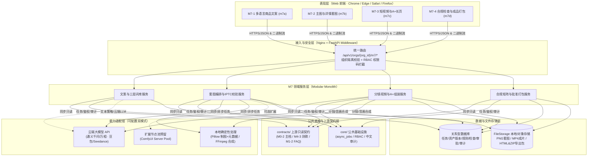
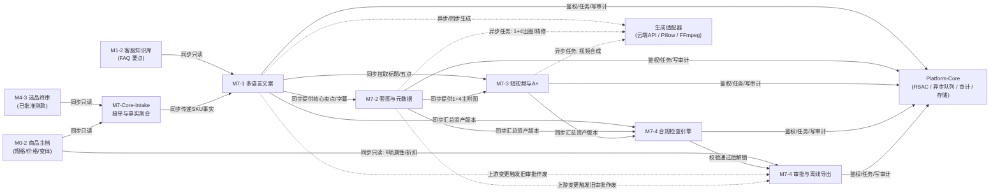
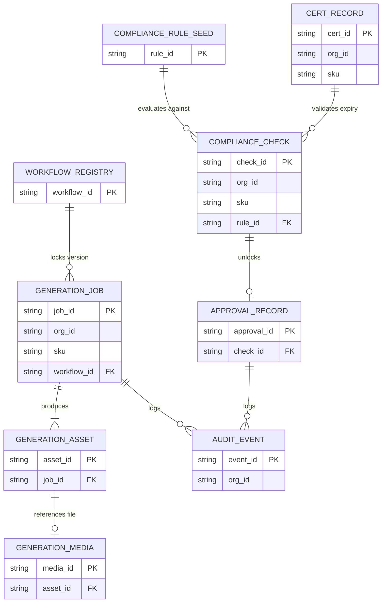
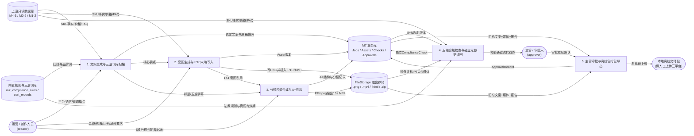

# CrossPilot · M7 商品内容创作与合规交付模块概要设计说明书（HLD V1.0）

> **文档定位**：本文档回答 M7 模块在 CrossPilot 平台中**“分成几块、每块干什么、块之间怎么连接、数据怎么存储”**，作为《CrossPilot-M7商品内容创作与合规交付需求说明书》与后续详细设计、后端编码之间的架构桥梁。  
> **设计边界遵守**：不展开接口请求/响应字段清单、不展开数据库全量列与字段类型、不编写具体算法步骤/代码片段、不罗列错误码明细表（上述内容均归入详细设计）。

---

## 1. 引言

### 1.1 编写目的
为 CrossPilot 平台 **M7 商品内容创作与合规交付模块**确立清晰的模块化单体架构、子域职责划分、同步/异步通信边界、核心数据实体关系、量化非功能目标与安全权限矩阵，确保研发、测试与评审团队对“系统结构、上下游契约及技术落地口径”达成唯一共识。

### 1.2 范围
- **覆盖范围**：
  1. M7 四大核心页面与对应后端子域：**M7-1 多语言商品文案（`m7a`）**、**M7-2 主图与详情套图（`m7b`）**、**M7-3 商品短视频制作（`m7c`，含 A+ 图文长页）**、**M7-4 合规检查与成品打包（`m7d`）**。
  2. M7 与平台公共底座的协作机制（组织与 RBAC 鉴权、异步任务、本地文件存储、中文操作审计台账）。
  3. M7 读取上游模块（`M0-2 商品主档`、`M4-3 选品终审`、`M1-2 客服知识库`）的单向只读契约，以及面向运营人工使用的离线交付包导出链路。
- **不覆盖范围**：
  1. 不覆盖 `M0–M6`、`M8` 等其余业务模块的内部设计。
  2. 不覆盖实际申请或直连海外电商平台（Amazon / Shopee / TikTok Shop）商家生产 API、不覆盖线上在售商品自动改价/改库存/自动发布。
  3. 不覆盖本地高显存 GPU 集群部署与重型 ComfyUI 集群运维（V1 仅保留统一引擎适配器接口）。
  4. 不展开接口字段明细、全表字段与数据类型、具体算法伪代码及错误码对照表。

### 1.3 术语表
| 术语 | 定义 |
|---|---|
| **8+N 交付体系** | 由 8 类上架必需核心资产（标题、五点、详情、搜索词、白底主图、4 张附图、A+ 页面、15s 短视频）与 6 类可选扩展文案（FAQ、A+ 文案、变体命名、后台属性、ALT 文本、保修说明）构成的独立计数交付结构 |
| **MOCK 标识** | 用于显式区分预置演示/模拟店铺商品数据与真实生产数据的强标记，防止模拟数据混入经营核算 |
| **三层词库联防** | 由「品牌必用词库 + SKU 卖点」「目标平台红线违禁词库」「商标侵权与类目监管敏感词库」组成的三级扫描机制 |
| **IPTC / XMP 元数据** | 写入图片文件内部的合规声明属性（含 `trainedAlgorithmicMedia` 与 `contains-synthetic-performer`），用于标识 AI 生成内容与合成人物 |
| **FFmpeg 合成** | 后端基于开源音视频工具将云端动态镜头或套图、运镜缩放、配音、BGM 与双语字幕合成为标准 `.mp4` 的本地处理环节 |
| **单向契约（Contracts）** | 跨业务域只读接口封装层，保证 M7 读取上游事实数据时不引入跨模块数据库物理外键 |

### 1.4 参考资料
1. 《CrossPilot-M7商品内容创作与合规交付需求说明书》（含第 6 节《已确认的技术落地口径》）
2. 《CrossPilot-M7商品内容创作与合规交付测试用例》（V2.0 评审版）
3. 《CrossPilot-需求分析》（FR-09～FR-15、FR-23～FR-32）
4. 《AI跨境电商平台V1.1-架构与需求》《AI跨境电商平台-模块需求细化_V1.1》

---

## 2. 总体设计

### 2.1 设计原则
1. **模块化单体与边界隔离**：M7 作为独立业务域模块运行在统一单体服务内，通过 `contracts/` 单向读取 `M0-2`、`M4-3`、`M1-2` 的数据快照，**禁止跨模块建立数据库外键或反向写改上游业务表**。
2. **双路径诚实声明与阻断优先**：创作阶段高亮提示不替代正式合规检查；未配置生成节点或未取回真实有效媒体文件时，系统必须如实阻断并保留已有成果，禁止用任务号或占位图伪造成功。
3. **事实锁定与局部变更最小化**：文案、套图、A+ 与视频共享 `M0-2` 商品事实源，不继承竞品多件套虚假配件；支持单段微调、单图重绘与单镜重做，修改后仅重新校验受影响链路并作废旧审批结论。
4. **职责分离与权限前置**：内容制作/送检（`creator`）与上架终审放行（`approver`）严格分离，杜绝自批自导；词库与资质变更权收敛至 `approver` 并全程留痕。

### 2.2 技术选型及理由
| 技术领域 | 选型方案 | 选型理由 |
|---|---|---|
| **前后端交互** | 前后端分离（Web SPA + FastAPI REST） | 便于原型页面（`m7a`–`m7d`）平滑对接后端 API，支持异步任务轮询与二进制媒体/导出包下载 |
| **业务元数据存储** | 关系型数据库（PostgreSQL / 开发态兼容 SQLite） | 任务状态机、版本快照、合规检查报告、审批记录、审计事件要求强事务一致性与可追溯关联 |
| **媒体与导出存储** | 本地文件 / 对象存储抽象（`FileStorage`） | 图片（`.png`）、视频（`.mp4`）与离线导出包体积大，与关系型主库分离存储可避免数据库膨胀并支持真实磁盘读写校验 |
| **内容/视觉生成引擎** | 统一适配器（云端 LLM/生图/生视频 API + 本地 `Pillow` & `FFmpeg`） | 适配普通笔记本无独显运行约束；云端 API 负责文案润色与动态画面，本地 `Pillow` 保证套图拼装可控，`FFmpeg` 保证字幕零乱码、分镜秒数精准且可降级兜底 |
| **合规元数据读写** | Python `Pillow` 本地文件读写 + 校验器 | 无需对接海外平台审核接口即可在图片保存末端真实写入并从磁盘读回验证 IPTC/XMP 标签，支持裁剪剥离阻断演练 |
| **规则与词库管理** | 数据库配置表 + 默认 JSON 种子 | 避免过度开发庞大规则后台，出厂即具备三平台规则与三层词库，仅由主管在线维护 |

### 2.3 系统边界
- **本系统做什么**：
  1. 承接 M4-3 批准测款新品与在售老品，基于 M0-2 事实生成/微调 `8+N` 多语言文案并执行三层词库拦截。
  2. 通过统一引擎适配器生成 1+4 差异化电商套图（支持单图重绘与局部对比精修），并在保存末端写入及读回校验 IPTC/XMP 合规元数据。
  3. 生成可控的 15 秒 3 段分镜短视频（支持单镜改图/改运镜/改字幕/引用 M7-1/单镜重做）及可视化 A+ 图文详情长页。
  4. 维护三平台 × 四类目规则矩阵与资质有效期，执行 5 项上架合规校验、提供「预览，尚未发布」买家视角预览，并经主管批准后导出本地离线交付包。
- **本系统明确不做什么**：
  1. **不直连真实海外平台卖家后台**：不向 Amazon / Shopee / TikTok 生产店铺自动建品、传图或发布上架。
  2. **不直接修改上游模块数据**：不篡改 M0-2 成本/库存/价格、不修改 M1-2 客服知识库、不更改 M4-3 选品评审结论。
  3. **不强依赖本地显卡算力**：普通笔记本无需部署重型本地 ComfyUI（保留未来切换节点池的适配位）。
  4. **不将模拟数据冒充实盘经营数据**：所有模拟店铺商品及演示素材均带显式 `MOCK` /「预览，尚未发布」标识。

---

## 3. 系统架构设计

### 3.1 分层架构说明
1. **表现层（Web 前端）**：承载 `M7-1`～`M7-4` 四个交互工作台，完成多岗位视图切换、表单校验、1+4 画廊、15s 播放器与 6 页签成品预览。
2. **网关与安全层**：通过统一路径 `/api/v1/orgs/{org_id}/m7/*` 接入，负责组织作用域隔离（`org_id`）与 RBAC 权限码校验。
3. **M7 领域服务层**：包含接单聚合、文案与词库扫描、套图编排与元数据检验、分镜视频与 A+ 组装、合规引擎与打包导出 6 个高内聚子模块。
4. **公共底座与上游契约层**：复用平台 `core/`（`async_jobs` 异步任务调度、`FileStorage` 文件存取、`audit` 中文审计台账）与 `contracts/`（只读拉取 M0-2/M4-3/M1-2）。
5. **外部引擎与存储层**：通过适配器调用云端 AI API（通义/豆包）及本地 `Pillow` / `FFmpeg`（预留 ComfyUI 节点池扩展）；结构化数据落关系型数据库，二进制资产落文件存储。

### 3.2 系统分层与部署架构图

---

## 4. 模块划分与职责

### 4.1 模块清单与单一职责
| 模块编号 | 模块名称 | 归属层级 | 单一职责说明 |
|---|---|---|---|
| **M7-Core-Intake** | 接单与事实聚合模块 | M7 领域层 | 聚合 M4-3 已批准新品与 M0-2 老品清单、带入规格与 FAQ，提供全局进度汇总与重置 |
| **M7-1-Copy** | 多语言文案与词库模块 | M7 领域层 | 管理三站点字符/字节规则、三层词库扫描、10 类文案生成、就地微调与还原 AI 原稿 |
| **M7-2-Image** | 套图工作台与元数据模块 | M7 领域层 | 管理结构化出图参数、1+4 异步任务/单图重绘/局部精修、IPTC/XMP 末端写入与读回校验 |
| **M7-3-VideoAplus** | 短视频分镜与 A+ 模块 | M7 领域层 | 管理 3 段分镜图位/运镜/字幕编排、单镜重做、引用 M7-1、FFmpeg 成片合成与 A+ 组装 |
| **M7-4-Compliance** | 合规规则与质检模块 | M7 领域层 | 维护站点×类目规则矩阵与资质有效期，执行 5 项上架合规检查并生成独立检查记录 |
| **M7-4-Package** | 审批门禁与离线打包模块 | M7 领域层 | 执行主管审批权限校验、上游修改失效机制、买家视角预览聚合与离线交付包生成 |
| **Platform-Contracts** | 上游只读契约模块 | 平台公共层 | 只读提供 M0-2 商品属性/价格/变体、M4-3 测款状态、M1-2 导购 FAQ |
| **Platform-Core** | 权限/任务/存储/审计底座 | 平台公共层 | 提供 9 岗位 RBAC、异步任务调度、磁盘媒体存取、全量中文审计台账 |

### 4.2 模块依赖关系图（标明同步 / 异步）

---

## 5. 功能模块设计（追溯至需求与用例）

### 5.1 功能与需求追溯总表
| 页面 / 子模块 | 对应界面路径 | 核心子功能 | 追溯需求编号 | 对应冒烟用例 |
|---|---|---|---|---|
| **M7-1 多语言商品文案** | `#m7a` | 选品切换与接力条、三平台字数/字节限制、三层词库扫描、10 类页签与一键采纳、中文对照、就地微调与还原原稿 | `FR-09`, `FR-GC-01/04/05`, `M7-AC-01/02` | `TC-SMK-01` ~ `03` |
| **M7-2 主图与详情套图** | `#m7b` | M7-1 同步开关与主体锁定、结构化参数工作台、1+4 出图、单图重绘、局部对比精修、可折叠 Prompt 编排、节点状态、IPTC/XMP 读写校验 | `FR-10`, `FR-23`~`32`, `FR-GC-06`~`10`, `M7-AC-03/04` | `TC-SMK-04` ~ `06` |
| **M7-3 商品短视频制作** | `#m7c` | 服务可用性诚实校验、脚本/配音/BGM、15s 交互播放器、3 段可编辑分镜（图位/运镜/字幕/引用M7-1/单镜重做）、素材溯源、A+ 图文组装 | `FR-11`, `FR-23`~`29`, `FR-GC-06`~`10`, `M7-AC-05/06` | `TC-SMK-07` ~ `09` |
| **M7-4 合规检查与成品打包** | `#m7d` | 站点×类目规则矩阵、资质有效期与 TikTok 保证金、5 项逐条合规检查、6 页签总览（含买家视角预览）、8+N 补齐、主管审批门禁、离线导出 | `FR-12`~`15`, `FR-GC-05/09`, `M7-AC-07/08` | `TC-SMK-10` ~ `12` |

### 5.2 各子模块关键业务设计说明
1. **M7-1 多语言商品文案**：将交付物切分为「核心 4 类（计入 8/8 进度）」与「扩展 6 类（8+N 独立计数）」；支持保存时与输入态双重词库扫描，已选原稿独立留存快照供一键还原。
2. **M7-2 主图与详情套图**：将底层英文 Prompt 拆装逻辑收敛在后端适配器与可折叠高级视图中，前端面向运营暴露风格/视角/画幅/避坑芯片与分图位要求；单图重绘与局部修改通过资产版本号隔离，确保其余 4 张图不变；AI 人物文件在存储最末端写入双标记并在 `m7d` 检查时真读盘验证。
3. **M7-3 商品短视频制作**：视频任务必须取回真实可播放媒体流才计入成功；分镜状态数组独立维护每段的 `slot`、`motion`、`subEN`、`subCN`，支持单镜局部重渲染并保持其余两段配置。A+ 模块在本步自动消费 M7-1 标题与 M7-2 图位完成拼装。
4. **M7-4 合规检查与成品打包**：作为整套流程的唯一合规关口，整合「静态规则矩阵 + 动态资质状态 + 资产完整度 + 磁盘元数据读回 + 文本红线二次复查」，形成独立 `ComplianceCheck` 记录；仅在全部通过且由主管审批签字后，允许导出本地离线包；一旦上游文案或主图发生修改，已生成的批准状态自动失效。

---

## 6. 数据设计

### 6.1 统一数据口径定义（全局防打架规范）
1. **核心交付进度口径（`doneCnt / 8`）**：仅统计核心 8 类资产就绪数（标题、五点、详情、搜索词、白底主图、4 张附图全部完成、A+ 图文、15s 短视频）；任意一项未达标均记为部分完成，扩展文案不得顶替核心 8 类计数。
2. **扩展文案计数口径（`extDoneCnt / 6`）**：6 类扩展文案独立统计，共同构成 `8+N` 交付包清单。
3. **字符与字节校验口径**：Amazon（`200`）/ TikTok（`150`）/ Shopee（`120`）按字符长度校验；后台搜索词（`250`）按 UTF-8 编码真实字节数校验。
4. **买家视角折扣与价格口径**：折扣率 = `round((1 - 售价 / 划线价) × 100)%`；仅当划线价存在且大于售价时展示折扣标签；M0-2 字段缺失时显示引导补齐，不参与算术拼接或输出 `NaN`。
5. **资质有效期判定口径**：当前日期 `>` 到期日（`T-1` 及更早）判定为「已过期」并触发合规阻断；当天到期及以后判定为「有效」。
6. **演示与实盘隔离口径**：模拟商品、演示图、演示视频与买家视角预览页面强制携带 `MOCK` 或「预览，尚未发布」标识。

### 6.2 核心数据 ER 图

### 6.3 核心表清单（仅列归属、主键与职责，不展开全表字段）
| 表名 | 主键 | 关键逻辑/外键关联 | 核心职责 |
|---|---|---|---|
| `m7_workflow_registry` | `workflow_id` | 被 `m7_generation_jobs` 引用 | 存储可用出图/视频工作流模板、版本与末端元数据节点定义 |
| `m7_generation_jobs` | `job_id` | 关联 `org_id`、`sku`（逻辑归属）与 `workflow_id` | 记录文案/套图/视频/A+ 异步任务状态、幂等键与引擎回执号 |
| `m7_generation_assets` | `asset_id` | 外键关联 `job_id` | 存储各槽位文案 JSON（含当前稿与 AI 原稿快照）及分镜/图位描述与选中态 |
| `m7_generation_media` | `media_id` | 外键关联 `asset_id` | 记录本地/对象存储媒体路径、真实 MIME、大小及 IPTC/XMP 核验状态 |
| `m7_compliance_rules` | `rule_id` | 索引 `(platform, category, rule_version)` | 内置三平台 × 四类目合规规则矩阵、字符限制与三层词库种子 |
| `m7_cert_records` | `cert_id` | 关联 `org_id`、`sku` | 管理产品质检报告、品牌授权等资质台账与到期状态 |
| `m7_compliance_checks` | `check_id` | 关联 `org_id`、`sku`、`rule_id` | 持久化 M7-4 独立运行的 5 项合规校验结论（不与创作提示混淆） |
| `m7_approval_records` | `approval_id` | 外键关联 `check_id` | 存储主管批准人、审批时间、意见及当前包有效状态（上游变更可置为失效） |
| `core_audit_events` | `event_id` | 平台公共审计表（按 `org_id` 隔离） | 记录全流程生成、越权拦截、红线阻断、重绘、审批与导出中文审计句 |

### 6.4 端到端数据流图（DFD）

---

## 7. 接口设计（接口清单）

> 统一前缀：`/api/v1/orgs/{org_id}/m7`；统一鉴权头：登录会话与组织上下文；本节仅列接口路径、方法、模式与用途，请求/响应字段留待详细设计。

| 序号 | HTTP 方法 | 接口路径 | 调用模式 | 允许角色 | 用途说明 |
|---|---|---|---|---|---|
| 1 | `GET` | `/products/available` | 同步 | `creator`, `approver`, 只读岗 | 拉取 M4-3 已批准测款新品与 M0-2 老品列表及摘要 |
| 2 | `POST` | `/copy/generate` | 同步/异步 | `creator`, `approver` | 生成当前 SKU 的多版本多语言文案草稿（幂等保护） |
| 3 | `POST` | `/copy/scan` | 同步 | `creator`, `approver` | 按三层词库与站点字符/字节口径实时扫描指定文本 |
| 4 | `PUT` | `/copy/assets/{asset_id}` | 同步 | `creator`, `approver` | 校验并保存人工就地微调后的文案版本 |
| 5 | `POST` | `/copy/assets/{asset_id}/restore` | 同步 | `creator`, `approver` | 将已微调文案无损还原为 AI 原稿快照 |
| 6 | `POST` | `/images/batch` | 异步 | `creator`, `approver` | 提交 1+4 差异化电商套图生成任务 |
| 7 | `POST` | `/images/slots/{slot_idx}/regenerate` | 异步 | `creator`, `approver` | 单独重绘指定图位（其余 4 张图保持不变） |
| 8 | `POST` | `/images/slots/{slot_idx}/inpaint` | 异步 | `creator`, `approver` | 对指定图位执行局部精修并生成修改前后对比结果 |
| 9 | `GET` | `/engines/status` | 同步 | `creator`, `approver`, 只读岗 | 查询当前生成引擎（云端 API / 本地 Pillow&FFmpeg / 预留节点池）与批量队列状态 |
| 10 | `POST` | `/jobs/{job_id}/sync` | 同步 | `creator`, `approver` | 轮询异步生成进度并在 MIME 校验通过后落盘真实媒体文件 |
| 11 | `POST` | `/images/iptc/verify` | 同步 | `creator`, `approver` | 读盘核验或重新写入图片末端 IPTC/XMP 合规标记 |
| 12 | `POST` | `/videos/generate` | 异步 | `creator`, `approver` | 提交 15 秒 3 段分镜短视频生成与 FFmpeg 音画合成任务 |
| 13 | `PUT` / `POST` | `/videos/segments/{seg_idx}` 与 `.../regenerate` | 同步/异步 | `creator`, `approver` | 更新单段分镜图位/运镜/字幕（含引用 M7-1）或单独重做本镜 |
| 14 | `POST` | `/aplus/generate` | 同步 | `creator`, `approver` | 聚合 M7-1 文案与 M7-2 套图组装可视化 A+ 图文详情结构 |
| 15 | `GET` / `POST` | `/compliance/matrix` 与 `/compliance/check` | 同步 | `creator`, `approver`（矩阵含只读） | 查询站点×类目规则与资质（含主管更新资质接口）；执行 5 项上架合规检查并落库 |
| 16 | `POST` / `GET` | `/packages/approve` 与 `/packages/{sku}/export` | 同步 | `approve` 仅 `approver`；`export` 需已批准 | 主管审批放行上架素材包；校验批准状态后打包下载本地离线交付包 |

---

## 8. 非功能设计

### 8.1 性能指标（全量化基准）
| 指标项 | 目标阈值 | 度量口径与前提 |
|---|---|---|
| **前端页面切换与重渲染耗时** | `< 50 ms` | 桌面浏览器中 `m7a`–`m7d` 切换与状态重绘单次主线程耗时 |
| **文案实时合规扫描响应** | `< 10 ms` | 单次输入 500 字符、15 条三层词库规则即时扫描，无输入卡顿 |
| **单 SKU 1+4 出图耗时** | `P95 ≤ 30 s`（本地 Pillow `≤ 2 s`） | 云端 API 稳定响应或本地处理器执行 5 张图渲染、IPTC 写入与落盘端到端耗时 |
| **多 SKU 批量处理吞吐** | `≥ 100 SKU / 小时 / 节点` | 并发队列开启下批量任务稳定吞吐下限 |
| **FFmpeg 15s 短视频合成耗时** | `≤ 5 s`（纯局部合成） | 基于已就绪 3 段画面与音频字幕执行拼接与封装耗时 |
| **离线交付包打包下载响应** | `< 1 s`（HTML）/ `≤ 3 s`（含媒体 ZIP） | `8+N` 全套资产读取组装并返回文件流耗时 |

### 8.2 可靠性与容错指标
1. **幂等防重率 100%**：相同 `idempotency_key` 并发重提不产生重复任务与重复扣费。
2. **伪成功零容忍（100% 拦截）**：仅拿到任务号无媒体文件、媒体 MIME 校验不匹配或视频服务未配置时，任务状态必须显式落为失败，不得虚增 `8/8` 完成度。
3. **部分失败隔离**：多 SKU 批处理中单品失败不影响同批次其他 SKU 已完成结果落库。
4. **状态一致性**：已批准的素材包在修改 M7-1 核心文案或 M7-2 主图后，`ApprovalRecord` **100% 自动置为失效**，强制重新运行合规检查与主管批准。
5. **前端资源零泄漏**：离开 `m7c` 或暂停预览时 100% 清理播放定时器。

### 8.3 可扩展性指标
1. **引擎可插拔**：通过统一 `Copy/Image/VideoGenerator` 接口切换「本地 Pillow/FFmpeg ↔ 云端通义/豆包 API ↔ 未来 ComfyUI GPU 节点池」，业务主流程代码零改动。
2. **规则与站点可扩展**：新增平台站点（如 Amazon DE/JP）、新增类目或补充扩展文案页签，通过追加配置种子记录即可生效，不破坏原有核心 `8/8` 校验结构。

---

## 9. 安全设计

### 9.1 岗位 RBAC 权限矩阵
> 图例：`✓ 读写/执行` ｜ `★ 终审放行/规则维护` ｜ `○ 只读查看` ｜ `✕ 禁止（403拦截+写审计）`

| 权限码 / 能力 | 主管/审批人 (`approver`) | 内容创作/审核 (`creator`) | 管理者 (`manager`) | 运营 (`planner`) | 选品 (`selector`) | BI / 仓管 / 客服 / 测买 |
|---|---|---|---|---|---|---|
| `m7:content:read`（查看四页及预览） | ✓ | ✓ | ○ | ○ | ○ | ✕ |
| `m7:content:edit`（文案微调/套图/视频/A+） | ✓ | ✓ | ✕ | ✕ | ✕ | ✕ |
| `m7:compliance:run`（发起 5 项合规检查） | ✓ | ✓ | ✕ | ✕ | ✕ | ✕ |
| `m7:rule:maintain`（改红线词/资质续期） | **★** | ✕ | ✕ | ✕ | ✕ | ✕ |
| `m7:publish:approve`（主管批准发布包） | **★** | **✕（禁自批）** | ✕ | ✕ | ✕ | ✕ |
| `m7:package:export`（批准后下载导出包） | ✓（需已批） | ✓（需主管已批） | ✕ | ✕ | ✕ | ✕ |

### 9.2 安全防护与审计策略
1. **多租户组织隔离**：所有 M7 查询与修改接口强制校验请求上下文 `org_id` 与资源归属一致，跨组织访问拦截率 **100%** 并写入安全审计。
2. **职责分离强约束**：`creator` 岗位在前端隐藏/禁用审批按钮且后端强制拦截 `m7:publish:approve`；禁止跳过合规检查直接导出。
3. **输入与导出防 XSS 转义**：文案、分镜字幕、设计要求与审批意见在渲染及生成离线 HTML 导出包时全部执行 HTML 实体转义；媒体文件入库前校验文件魔数（Magic Bytes）。
4. **词库防篡改与密钥隔离**：M7-4 正式合规检查以服务端持久化词库为准，不采信前端篡改后的放行列表；云端 API Key 仅存服务端环境变量或密钥托管配置，严禁下发至浏览器。
5. **全量不可篡改审计**：所有生成、红线拦截、局部重绘、元数据失败/修复、规则调整、主管批准、离线导出与越权事件均以完整中文自然语言写入平台审计台账，前端无删除入口。

---

## 10. 运行环境与外部依赖

| 类别 | 组件 / 环境 | 版本与规格要求 | 用途与兜底说明 |
|---|---|---|---|
| **客户端运行环境** | 桌面主流浏览器 | Chrome ≥ 110 / Edge ≥ 110 / Safari ≥ 16 / Firefox ≥ 110 | 支持 `1024×768` 至 `1920×1080` 响应式网格、HTML5 与 Blob 离线导出 |
| **服务端运行时** | Python + Web 框架 | Python ≥ 3.11、FastAPI ≥ 0.110、Uvicorn | 承载 M7 领域接口、RBAC 中间件与异步任务调度 |
| **本地图像处理与元数据** | Pillow | Pillow ≥ 10.0 | 本地生成/合成 1+4 规范套图、在图片末端写入并读回校验 IPTC/XMP 元数据 |
| **本地视频合成引擎** | FFmpeg | FFmpeg ≥ 6.0（静态二进制即可，无需 GPU） | 将云端动态片段或套图与双语字幕、配音、BGM 合成标准 15s `.mp4` |
| **数据与文件存储** | 数据库 + 本地存储 | PostgreSQL ≥ 15（本地开发兼容 SQLite 3）+ 本地磁盘/MinIO | 分离存放结构化记录与真实二进制媒体/离线交付包 |
| **云端 AI 接口（可选/推荐）** | 阿里云百炼 / 火山方舟 | 通义千问 & 通义万相 API / 豆包 & Seedance API（HTTPS） | 普通笔记本零显卡生成多语言文案、电商图与动态视频镜头；未配置 Key 时触发本地兜底或诚实阻断 |
| **GPU 算力节点（预留扩展）** | ComfyUI Server Pool | ComfyUI ≥ 0.3.2（可选 ≥ 12GB 显存节点） | 仅作后期算力升级扩展预留，V1 本地开发与演示不强制依赖 |
